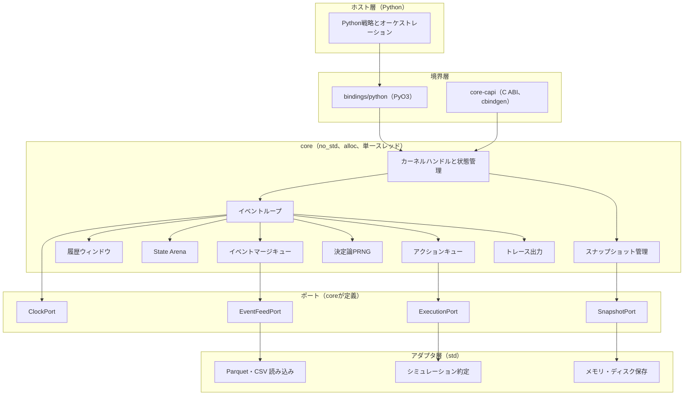
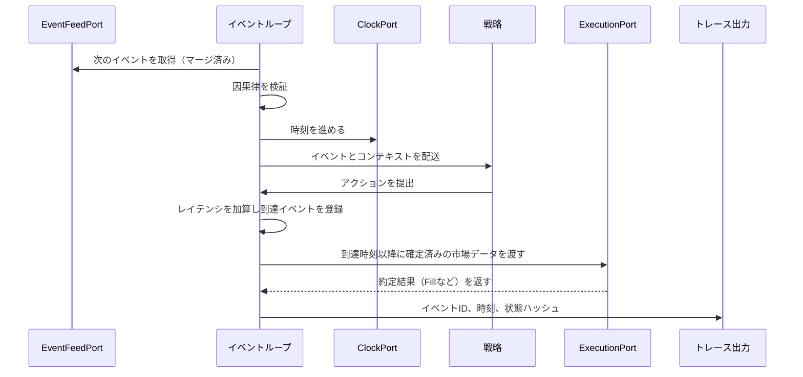
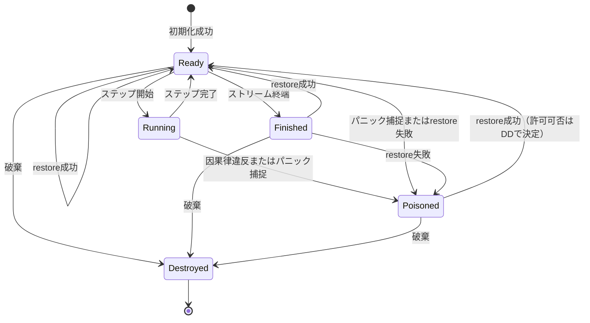

# 基本設計書（Deterministic Event Kernel システム全体アーキテクチャ）
**決定論的リプレイ・イベント駆動カーネルの構造、責務境界、横断方針**

文書番号の `PROJECT_PREFIX`（`EK`）は仮の値である。確定した場合は、本書と関連文書の番号を更新する。

---

## 1. 概要と基本方針

### 1.1 システム目的と対象範囲

- **対象範囲**: 要件定義書 1.2節のインスコープに対応する。単調増加タイムスタンプに基づくイベント配送、未来データを遮断する読み取り専用コンテキスト、状態のスナップショット保存と復元、Pythonホストとの境界。
- **対象外範囲**: 本番環境へのリアルタイム発注とネットワーク通信、戦略のアルゴリズム設計、機械学習モデルの学習。ただし、将来の本番アダプタを接続できるように、ポート契約の互換性は維持する。
- **利用者・外部システム**: Pythonのホスト層（オーケストレーション、パラメータ探索、分析）、ネイティブ戦略モジュールの開発者、データ供給元（Parquet / CSV）。
- **前提・制約**:
  - コア実装言語は Rust（ADR-002）。
  - `core` は `#![no_std]`、`#![forbid(unsafe_code)]` とし、`alloc` を初期化フェーズに限って使う（ADR-004）。
  - Python境界は3層分離（`core` / `core-capi` / `bindings/python`）を暫定前提とする。ADR-003 は `Proposed` であり、スパイク V-01〜V-06 の結果で見直す余地を残す。
  - 未確定事項のうち、OPEN-01（ヘッダのアラインメント）、OPEN-03（PRNG方式）、OPEN-05（状態ハッシュのアルゴリズム）、OPEN-06（基準機）、および `Poisoned` からの `restore` の可否は、BDのブロッカーとしない。詳細設計（DD）、データ構造仕様（DS）、テスト計画で決める。
- **主要な非機能要件**: 下表に示す。目標値の正本は要件定義書である。

| ID     | 区分         | 要件                                         | 目標値・基準                           | 測定方法・確認先                      | 正本                                                                     |
| :----- | :----------- | :------------------------------------------- | :------------------------------------- | :------------------------------------ | :----------------------------------------------------------------------- |
| NFR-01 | 決定論性     | 同一入力・同一シードで出力が一致する         | SHA-256が100%一致                      | AC-04、AC-07                          | [要件定義書 4章](../features/deterministic-event-kernel-requirements.md) |
| NFR-02 | メモリ効率   | ホットパスの動的確保をゼロにする             | 確保・解放0回                          | AC-05                                 | [要件定義書 4章](../features/deterministic-event-kernel-requirements.md) |
| NFR-03 | 処理性能     | ネイティブ戦略で高スループットを達成する     | 単一コアで毎秒1,000万イベント以上      | AC-06、標準測定条件（要件定義書 8章） | [要件定義書 4章](../features/deterministic-event-kernel-requirements.md) |
| NFR-04 | 数値精度     | 累積計算を固定小数点数または厳密な丸めで行う | 累積誤差による状態分岐なし             | DDの機能テスト要件                    | [要件定義書 4章](../features/deterministic-event-kernel-requirements.md) |
| NFR-05 | 監査・検証性 | ステップごとにトレースログを出力できる       | 入力イベントID、現在時刻、状態ハッシュ | DDの機能テスト要件                    | [要件定義書 4章](../features/deterministic-event-kernel-requirements.md) |

品質ゲートの実行条件と合格基準は、[EK-ENV-001 環境・開発基盤仕様書](../setup/EK-ENV-001_環境・開発基盤仕様書.md)を正本とする。本書には参照先だけを記載する。

### 1.2 アーキテクチャ基本原則と課題解決

| #    | 課題・ボトルネック               | 優先度 | 解決方針・選定技術                                                                                                                               | 選定理由・トレードオフ                                                                                                       | 担当コンポーネント         | 関連文書                                |
| :--- | :------------------------------- | :----: | :----------------------------------------------------------------------------------------------------------------------------------------------- | :--------------------------------------------------------------------------------------------------------------------------- | :------------------------- | :-------------------------------------- |
| 1    | 先読みバイアスの混入             |   高   | 現在時刻以下の確定済みイベントだけを固定長のリングバッファ経由で公開し、未来バッファの参照を渡さない。                                           | 型とAPIの形で未来参照を構造的に排除する。戦略は過去データの窓の外を参照できない。                                            | C-001、C-004、C-010        | 要件定義書 FR-01、FR-02                 |
| 2    | 非決定性                         |   高   | OS時刻、OS乱数、順序非保証コンテナを使わない。単一スレッドで実行し、同時刻イベントは `(timestamp_ns, stream_id, sequence_id)` の昇順で処理する。 | `no_std` により、OS依存のAPIはコンパイル時に使えない。並列化はインスタンス間に限るため、1インスタンス内の順序が一意になる。  | C-001、C-002、C-003、C-007 | 要件定義書 FR-01、FR-05、2.2節、ADR-004 |
| 3    | スループットの限界               |   高   | コアをRustで実装し、ホットパスの動的確保をゼロにする。確保は初期化関数に限定し、固定長の所有型で保持する。                                       | 安全なコードと境界検査のままで目標を満たせるかは実測が必要。満たせない場合は新しいADRで `unsafe` の局所化を検討する。        | C-001〜C-009               | ADR-002、ADR-004                        |
| 4    | Pythonとの境界の安全性と二重保守 |   高   | 境界の共通ロジックを `core` の安全なAPIに集約し、`core-capi` と `bindings/python` は型変換と境界チェックだけにする。                             | 2つの公開面の挙動を構造的に一致させ、出力ハッシュの一致（V-03）の検証コストを下げる。公開面が2つになる点は契約テストで補う。 | C-009、C-012、C-013        | ADR-003                                 |
| 5    | 戦略状態のスナップショット       |   中   | 保証対象を State Arena（`StrategyArena` を含む）に限る。Pythonヒープ上の状態は対象外にする。                                                     | Pythonの任意のオブジェクトは固定長の領域に収まらない。決定論性の責任範囲を明確にする。                                       | C-005、C-008               | 要件定義書 FR-03                        |

### 1.3 本書のSSOT範囲と文書境界

- **本書の正本範囲**: `system_architecture`。システム全体の目的、アーキテクチャ、責務、境界、横断的な方針。
- **詳細設計との境界**: 関数契約、DTO、制御フロー、状態遷移の条件、エラーコードの値は詳細設計書（DD）を正本とする。
- **データ構造仕様との境界**: スナップショットのバイト列の形式、移行、書き込みの原子性はデータ構造仕様書（DS）を正本とする。
- **IF/API仕様との境界**: `core-capi` の関数と型、Pythonの公開API、Arrow出力の形式は IF/API 仕様書を正本とする。
- **他文書との関係**: 要件の正本は要件定義書、判断理由の正本は ADR とする。本書は要件の目標値を再定義しない。
- **全体ルール**: 文書分類、Frontmatter、ライフサイクルは [`docs/README.md`](../README.md) を正本とする。

---

## 2. システム全体アーキテクチャとコンポーネント分離

### 2.1 全体構造とデータフロー

ヘキサゴナルアーキテクチャ（Port & Adapter）を採用する。`core` は4つのポートを定義し、外部I/Oとホストのランタイムから隔離する。依存の向きは、境界層とアダプタ層から `core` への一方向である。

図中の矢印は、処理と呼び出しの向きを示す。コンパイル時の依存関係は、境界層とアダプタ層から `core` への一方向である。

図で表現しない事項は、次のとおり補足する。

- `ClockPort` は、標準では `core` 内の論理クロック実装を使う。将来の本番連携や特殊なテストでだけ、外部アダプタで差し替える。このため図にはアダプタを描いていない。

- ネイティブ戦略は `core` と同じRustのプロセス内で動く。FFIは通らない。
- Python戦略は `bindings/python` または `core-capi` を通じて、コールバックとして呼ばれる。
- 1ステップの処理順序は、2.3節のシーケンス図に示す。

### 2.2 コンポーネント責務マッピング

| コンポーネントID | コンポーネント名                   | 担当領域・主要責務                                                                                                                                                                                                                                                                                                                                                                                             | 依存先・依存方向 / 公開インターフェース                                               | 関連詳細設計書                                     |
| :--------------- | :--------------------------------- | :------------------------------------------------------------------------------------------------------------------------------------------------------------------------------------------------------------------------------------------------------------------------------------------------------------------------------------------------------------------------------------------------------------- | :------------------------------------------------------------------------------------ | :------------------------------------------------- |
| C-001            | イベントループ                     | マージキューから次のイベントを取り出し、因果律を検証し、戦略へ配送する。時刻の進行は `ClockPort` 経由で行う。                                                                                                                                                                                                                                                                                                  | C-002、C-003、C-004、C-006、C-010 / ステップ実行                                      | [EK-DD-001](./EK-DD-001_カーネルコア詳細設計書.md) |
| C-002            | 論理クロック（`ClockPort`）        | 論理時刻（ナノ秒）の提供と進行。単調非減少を保証する。                                                                                                                                                                                                                                                                                                                                                         | なし / `now_ns`、`advance_to`                                                         | [EK-DD-001](./EK-DD-001_カーネルコア詳細設計書.md) |
| C-003            | イベントマージキュー               | 複数の `EventFeedPort` を、各ストリームの先頭1イベントだけを保持する K-way マージで統合する。容量は登録ストリーム数（C-006 の仮想ストリームを含む）で固定する。                                                                                                                                                                                                                                                | `EventFeedPort`、C-006 / 次イベントの取得                                             | [EK-DD-001](./EK-DD-001_カーネルコア詳細設計書.md) |
| C-004            | 履歴ウィンドウ                     | 現在時刻以下の確定済みイベントを、固定長のリングバッファに保持する。溢れたときは最古のデータを上書きする。                                                                                                                                                                                                                                                                                                     | なし / 読み取り専用の窓                                                               | [EK-DD-001](./EK-DD-001_カーネルコア詳細設計書.md) |
| C-005            | State Arena                        | 戦略とカーネルの状態を連続メモリに集約する。`StrategyArena` を含む。サイズは初期化時に固定する。                                                                                                                                                                                                                                                                                                               | なし / 状態領域の貸与                                                                 | [EK-DS-001](./EK-DS-001_データ構造仕様書.md)       |
| C-006            | アクションキューと遅延スケジューラ | 戦略のアクションにレイテンシを加算し、未来時刻の「到達イベント」として保持する（この時点では約定しない）。約定結果（`Fill` など）も、未来時刻のシステムイベントとして保持する。固定容量の時刻順キューを自身で持ち、C-003 からは1つの仮想ストリーム（先頭1イベントを供給するソース）として統合される。同時刻のイベントは、キューへの投入順の連番（`sequence_id`）で順序付ける。満杯のときはエラーコードを返す。 | `ExecutionPort` / `submit_action`                                                     | [EK-DD-001](./EK-DD-001_カーネルコア詳細設計書.md) |
| C-007            | 決定論PRNG                         | OS乱数を使わない擬似乱数。内部状態をスナップショットに含める。                                                                                                                                                                                                                                                                                                                                                 | なし / 乱数の取得                                                                     | [EK-DD-001](./EK-DD-001_カーネルコア詳細設計書.md) |
| C-008            | スナップショット管理               | State Arena、PRNG、クロック、キューの状態と、外部ポートの状態（`EventFeedPort` の読み取り位置、`ExecutionPort` の内部状態）をバイト列として保存・復元する。復元時は、各ポートへ保存時点の位置と状態を戻す。                                                                                                                                                                                                    | `SnapshotPort`、`EventFeedPort`、`ExecutionPort`、C-005、C-007 / `capture`、`restore` | [EK-DS-001](./EK-DS-001_データ構造仕様書.md)       |
| C-009            | ハンドル状態と境界共通ロジック     | ハンドルの状態遷移（2.4節）、再入ガード、エラーコード、バッチ分割を提供する。`core-capi` と `bindings/python` が共有する。                                                                                                                                                                                                                                                                                     | C-001 / 安全なRust API                                                                | [EK-DD-001](./EK-DD-001_カーネルコア詳細設計書.md) |
| C-010            | コンテキストとビュー               | 戦略へ渡す読み取り専用コンテキストと入力バッチのビューを提供する。ビューの無効化は `Drop` のスコープガードで行う。                                                                                                                                                                                                                                                                                             | C-004、C-005 / ビュー                                                                 | [EK-DD-001](./EK-DD-001_カーネルコア詳細設計書.md) |
| C-011            | トレース出力                       | ステップごとに入力イベントID、現在時刻、状態ハッシュを出力する。                                                                                                                                                                                                                                                                                                                                               | C-001 / トレースの出力先                                                              | [EK-DD-001](./EK-DD-001_カーネルコア詳細設計書.md) |
| C-012            | `core-capi`                        | C ABI の薄い変換層。`#[repr(C)]` の境界型、ポインタの検証、`catch_unwind` によるパニックの捕捉を担う。                                                                                                                                                                                                                                                                                                         | C-009 / C ABI                                                                         | [EK-IF-001](./EK-IF-001_IF仕様書.md)               |
| C-013            | `bindings/python`                  | PyO3 による薄い変換層。コールバック、NumPy・Arrow（PyCapsule）の受け渡し、例外変換を担う。                                                                                                                                                                                                                                                                                                                     | C-009 / Python API                                                                    | [EK-IF-001](./EK-IF-001_IF仕様書.md)               |
| C-014            | アダプタ層                         | データの読み込み（Parquet / CSV）、シミュレーション約定、スナップショットの保存先を、ポートの実装として提供する。                                                                                                                                                                                                                                                                                              | `core` のポート / ポートの実装                                                        | [EK-DD-001](./EK-DD-001_カーネルコア詳細設計書.md) |
| C-015            | 戦略層                             | ネイティブ戦略とPython戦略。同一のインターフェースで切り替える（FR-06-1）。                                                                                                                                                                                                                                                                                                                                    | C-010 / 戦略インターフェース                                                          | [EK-DD-001](./EK-DD-001_カーネルコア詳細設計書.md) |

依存の循環はない。依存の向きは、境界層とアダプタ層が `core` に依存する一方向である。

### 2.3 1ステップの処理フロー

- 因果律違反を検出した場合は、イベントを処理せずに停止する（2.4節）。
- アクションは2段階で処理する。提出時（時刻 t）は、C-006 がレイテンシ（Δ）を加算して、時刻 t+Δ の到達イベントを登録するだけで、約定価格を確定しない。提出時点では未来の価格が分からず、確定すると未来参照になるためである。到達時刻以降に、`ExecutionPort` が確定済みの市場データだけを参照して約定を判定し、`Fill` などの結果を生成する。たとえば次バー始値での約定は、到達後に最初に届いたバーのイベント時刻に約定する。この2段階の呼び出し順序（受付、到達、市場イベントの通知）は、DD と IF/API 仕様書で定義する。
- 同一の市場イベントに対する処理の順序は、イベントループの契約として固定する。先に `ExecutionPort` が待機中のアクションを約定判定し、その後に戦略へ通知する。約定ロジックの実装だけを `ExecutionPort` に委譲し、順序は `core` が保証する。通知の経路と呼び出し順序の詳細は DD で定義する。
- アクションの結果は、受付と同じ時刻には返らない。必ず未来時刻のシステムイベントとして、アクションキュー（C-006）に入る。アクションキューは固定容量の時刻順キューで、マージキュー（C-003）からは1つの仮想ストリームとして見える。複数のアクションが逆順に到着しても、アクションキューが時刻順に並べるので、マージキューの容量は増えない。

### 2.4 カーネルハンドルの状態

ハンドルの状態と、遷移を起こす事象の概要を示す。遷移条件の詳細とエラーコードの値は DD を正本とする。

- `Poisoned` のハンドルは、`step`、`snapshot`、`submit_action` を拒否する。
- `Running` 中は、`step`、`snapshot`、`restore`、破棄を、再入として拒否する（`ERR_REENTRANT` 相当）。
- `Ready` と `Finished` のハンドルは、`restore` で保存時点に戻せる。グリッドサーチや分岐リプレイで、終端まで実行したインスタンスを再利用するためである。
- `restore` は、外部ポートの位置と状態も保存時点へ戻す（C-008）。位置を戻せない（シーク不可の）データ源では、`capture` を拒否する。
- `restore` は、復元が最後まで成功したときだけ `Poisoned` を解除する。許可するかどうかは DD で決める（ADR-003 5.1-9）。

### 2.5 メモリと並行性の方針

- **確保の範囲（ADR-004）**: 確保は初期化関数に限る。実行時のバッファは、要素数が固定の所有型で保持し、ホットパスから再確保を伴う操作を呼べない型にする。検証は AC-05 で行う。
- **容量**: リングバッファ長と State Arena のサイズは、起動時のパラメータで決まる。最大メモリ使用量は、この設定で上限が確定する（NFR-02）。
- **並行性（要件定義書 2.2節）**: 1カーネルは単一スレッドで動く。カーネルの型は `Send` を許可し、`Sync` を禁止する。並列化は、不変の入力データを共有する、独立したインスタンス間に限る。
- **Python戦略の並列**: Pythonコールバックを持つインスタンスは、GIL のため実質的に直列で動く。

---

## 3. 動作前提およびシステム境界

### 3.1 実行前提環境

- **対応OS**: Windows と Linux（AC-07 の対象）。
- **ランタイム要件・依存管理**: Rust と Python のバージョン、依存管理ツール、固定方法は、[EK-ENV-001 環境・開発基盤仕様書](../setup/EK-ENV-001_環境・開発基盤仕様書.md)を正本とする。
- **実行エントリポイント**: ネイティブ戦略は Rust のバイナリまたはテスト、Python戦略は `bindings/python` のモジュール。
- **品質目標・品質ゲート**: 品質目標は 1.1節に示す。ゲートの実行条件と合格基準は、[EK-ENV-001](../setup/EK-ENV-001_環境・開発基盤仕様書.md) の 4.4節を正本とし、本書では参照だけにする。

### 3.2 安全回路・システム境界方針

- **外部アクター・外部システム**: Pythonのホスト層とデータ供給元。
- **信頼境界**: `core` の外側（Python戦略、アダプタ、ホストから渡されるポインタ）は、すべて信頼しない。`core-capi` は、ポインタとサイズを検証してから `core` を呼ぶ。
- **ビューの寿命**: コールバックに渡す入力ビューは、コールバック終了時に必ず無効化する。無効化後のアクセスは `RuntimeError` にする（ADR-003 5.1-7）。`StrategyArena` の書き込み可能ビューも、入力ビューと同様に、コールバック中だけ有効とする。コールバックの終了時に `ViewGuard` で無効化する。ビューを長く保持させると、カーネル破棄後の解放済みメモリの参照と、ステップ外での状態の書き換え（状態ハッシュとスナップショットの整合性の破綻）が起きるためである。ステップ外で状態を確認する場合は、コピーを返す読み取り専用APIまたはスナップショットを使う。
- **認証・認可境界**: 本システムは、ネットワーク通信と認証を持たない。
- **タイムアウトと再試行**: カーネル内部に、タイムアウトと再試行を持たない。論理時間を止める待機は、決定論的なイベントループと相性が悪いため採用しない。
- **排他制御・競合防止**: カーネル内部にロックを持たない。インスタンス間で共有するのは、読み取り専用の入力データだけである。
- **失敗時保全契約**: 致命的エラー（因果律違反、パニック捕捉、`restore` の途中失敗）では、ハンドルを `Poisoned` にし、以降の状態変更を拒否する。中途半端な状態からの続行はしない。`restore` は、State Arena、PRNG、クロック、キュー、外部ポートをまたいで状態を書き換えるため、途中で失敗すると巻き戻せない。途中失敗は `Poisoned` とする。全ポートに検証フェーズと適用フェーズを分け、失敗を適用前に検出する方式は、DD と DS で検討する。
- **機密情報・監査ログ方針**: 機密情報を扱わない。監査証跡は、トレース出力（NFR-05）で残す。

**エラー処理の方針:**

| 分類     | 事象                                                                                                                                                                        | 動作                                                       | ハンドルへの影響     |
| :------- | :-------------------------------------------------------------------------------------------------------------------------------------------------------------------------- | :--------------------------------------------------------- | :------------------- |
| 致命的   | 因果律違反（`ERR_CAUSALITY_VIOLATION`）                                                                                                                                     | イベントを処理せず停止する                                 | `Poisoned`           |
| 致命的   | パニックの捕捉（`ERR_PANIC`）                                                                                                                                               | 境界の入口で捕捉し、エラーコードまたはPython例外に変換する | `Poisoned`           |
| 致命的   | `restore` の途中失敗                                                                                                                                                        | 復元を中止する。ロールバックはしない                       | `Poisoned`           |
| 致命的   | 入力の順序違反（`ERR_SEQUENCE_VIOLATION`）、ポートの失敗（`ERR_PORT_FAILURE`）、`ExecutionPort` の結果の溢れ（`ERR_RESULT_OVERFLOW`）、戦略の失敗（`ERR_STRATEGY_FAILURE`） | 処理を中止する。値と判定の詳細は DD 4.1節                  | `Poisoned`           |
| 初期化時 | 容量超過（`ERR_CAPACITY_EXCEEDED`）                                                                                                                                         | 初期化を拒否する                                           | ハンドルは作られない |
| 回復可能 | アクションキュー満杯（`ERR_QUEUE_FULL`）                                                                                                                                    | エラーコードを返す。カーネル状態は変更しない               | 変化なし             |
| 拒否     | `Poisoned` への操作（`ERR_POISONED`）                                                                                                                                       | 操作を拒否する                                             | 変化なし             |
| 拒否     | `Running` 中の再入（`ERR_REENTRANT` 相当）                                                                                                                                  | 操作を拒否する                                             | 変化なし             |
| 正常動作 | 履歴リングバッファの溢れ                                                                                                                                                    | 最古のデータを上書きする                                   | 変化なし             |

遅延したイベントを破棄して続行する運用は、`core` ではなく、アダプタ層で事前にフィルタリングし、監査ログを出力してから供給する。

---

## 4. 基本設計における変更管理方針

- **拡張時のルール**: 新しいデータ源は `EventFeedPort`、新しい約定モデルは `ExecutionPort`、新しい保存先は `SnapshotPort` の実装として追加し、`core` を変更しない。業務固有のロジック（指標計算、決済ルールなど）は `core` に置かず、戦略層またはアダプタ層に置く。
- **仕様の決定権（SSOT）**: 基本設計方針は本書を正本とする。関数シグネチャと状態遷移の条件は DD、スナップショットの形式は DS、公開 API は IF/API 仕様書を正本とする。
- **変更影響の確認方法**: 要件定義書、ADR、本書、DD の順に更新する。判断の変更はADRを新設し、既存のADRは削除せず状態を更新する。

### 4.1 設計レビューの観点

| 観点               | 確認項目                                                                                                                                           | 根拠                 |
| :----------------- | :------------------------------------------------------------------------------------------------------------------------------------------------- | :------------------- |
| 依存方向と隔離性   | `core` が `#![no_std]`、`#![forbid(unsafe_code)]` を維持している。`alloc` の使用は初期化関数に限られ、OS時刻、OS乱数、Python依存が混入していない。 | ADR-002、ADR-004     |
| 業務ロジックの分離 | 業務固有のロジックが `core` に漏れ出さず、戦略層またはアダプタ層にある。                                                                           | 4章                  |
| メモリ寿命         | 入力ビューと `StrategyArena` ビューの無効化（`ViewGuard`）が、例外送出を含むすべての経路で働く構造になっている。                                   | ADR-003 5.1-7        |
| 状態遷移の整合     | パニック捕捉後の `Poisoned` 遷移と、各APIの拒否条件が、状態遷移図と矛盾していない。                                                                | ADR-003 5.1-9、2.4節 |
| ゼロアロケーション | ホットパスに、ヒープ確保が発生するデータ構造やAPI呼び出しがない。                                                                                  | NFR-02、AC-05        |
| ゼロコピー         | 入力（SoA配列）と出力（Arrow PyCapsule、連続メモリ）で、不要なコピーが発生しない所有権移譲になっている。                                           | FR-06-2              |

### 4.2 DD・DS・IF/API 仕様書への引き継ぎ事項

| #    | 引き継ぎ先 | 内容                                                                                                                                                                                                          |
| :--- | :--------- | :------------------------------------------------------------------------------------------------------------------------------------------------------------------------------------------------------------ |
| 1    | DD、IF/API | `ExecutionPort` の呼び出し（受付、到達、市場イベントの通知）の順序と契約。同一の市場イベントでは、`ExecutionPort` の約定判定を、戦略への通知より先に行う（2.3節）。                                           |
| 2    | DD、DS     | `restore` の途中失敗の扱い。BD は `Poisoned` への遷移を定める（3.2節）。検証フェーズと適用フェーズに分ける方式の採否は DD と DS で決める。                                                                    |
| 3    | DS         | `EventHeader` のアラインメント（OPEN-01）、SoA ペイロード、State Arena、スナップショットのバイナリ形式（外部ポートの状態のシリアライズ契約を含む）、状態ハッシュの対象範囲とアルゴリズム（OPEN-05）。         |
| 4    | DD         | エラーコードの値、ハンドル状態遷移の条件、`Poisoned` からの `restore` の可否、PRNG の方式（OPEN-03）、`EventFeedPort` の位置トークンの形式、位置を戻せないデータ源を `capture` で拒否したときのエラーの扱い。 |
| 5    | IF/API     | `core-capi` の関数と型、Python の公開 API、Arrow 出力の形式。ADR-003 のスパイク V-01〜V-06 の結果を反映する。                                                                                                 |

---

## 5. 作成完了チェック

- [x] 対象範囲、対象外範囲、利用者、前提を記入した。
- [x] 主要な非機能要件を表に記入し、正本を設定した。
- [x] `document_role`、`ssot_scope`、`status`、`owner` をFrontmatterへ設定した。
- [x] 課題ごとに優先度、選定理由、トレードオフ、担当、関連文書を記入した。
- [x] Mermaid図を実際の構成へ置換した。
- [x] 全コンポーネントの責務、依存方向、公開インターフェースを記入した。
- [x] 全コンポーネントの詳細設計書リンクを記入した（C-012・C-013 の `EK-IF-001` リンクを含め記入済み）。
- [x] 環境・開発基盤仕様書への参照を記入した。
- [x] 外部システム、信頼境界、失敗時保全を記入した（認証・認可は対象外と明記した）。
- [x] 未置換の `[ ... ]`、`YYYY-MM-DD`、サンプル固有名が残っていない。

---

## 6. 改訂履歴 (Change Log)

| 版数    | 改訂日     | 変更者 | 変更内容・変更理由 (Why)                                                                                                                                                                                                                  |
| :------ | :--------- | :----- | :---------------------------------------------------------------------------------------------------------------------------------------------------------------------------------------------------------------------------------------- |
| Rev.0.1 | 2026-11-24 | xzyozi | 初版ドラフト。要件定義書 v0.2 と ADR-002、003、004 を前提に作成した。`PROJECT_PREFIX` は仮の `EK`。                                                                                                                                       |
| Rev.0.2 | 2026-11-24 | xzyozi | レビュー指摘を反映。`StrategyArena` ビューをコールバック中のみ有効に変更、外部ポートの状態をスナップショット対象に追加、`restore` の遷移と `ERR_REENTRANT` を追加、アクションキューを仮想ストリームとして位置付け、図の矢印の注記を追加。 |
| Rev.0.3 | 2026-11-24 | xzyozi | 価格依存の約定を「到達イベント」と「約定確定」の2段階に分けた。`ClockPort` の標準実装が `core` 内にある旨を追記。                                                                                                                         |
| Rev.0.4 | 2026-11-27 | xzyozi | `EK-IF-001` の取り込みに伴い、`related_documents`・C-012/C-013 のリンク・チェックリストを更新した。                                                                                                                                      |
| Rev.0.4 | 2026-11-24 | xzyozi | `restore` の途中失敗を `Poisoned` とする方針、同一市場イベントでの処理順序（約定判定、戦略通知の順）、DD・DS・IF/API への引き継ぎ事項（4.2節）を追加。C-003 の依存先と 4.1節の観点を、本文に合わせて修正。                                |
| Rev.0.5 | 2026-11-24 | xzyozi | 環境・開発基盤仕様書 EK-ENV-001 の作成に伴い、品質ゲートの正本への参照を追加。                                                                                                                                                            |
| Rev.0.6 | 2026-11-24 | xzyozi | 3.1節の環境情報（Rust と Python のバージョン、依存管理）を、EK-ENV-001 への参照に置き換えた。二重管理を避けるため。                                                                                                                       |
| Rev.0.7 | 2026-11-25 | xzyozi | 2.3節のシーケンス図で、参加者名 `Loop` が予約語 `loop` と衝突して Mermaid の構文エラーになるため、`EvLoop` に変更した。                                                                                                                   |
| Rev.0.8 | 2026-11-25 | xzyozi | エラー処理の方針表に、DD で定義した致命的エラー（入力の順序違反、ポートの失敗、結果の溢れ、戦略の失敗）を追加した。                                                                                                                       |
| Rev.0.9 | 2026-11-26 | xzyozi | DD と DS のマージに伴い、2.2節の関連詳細設計書の欄に、EK-DD-001 と EK-DS-001 へのリンクを記入した。IF/API 仕様書は未作成のまま。                                                                                                          |
