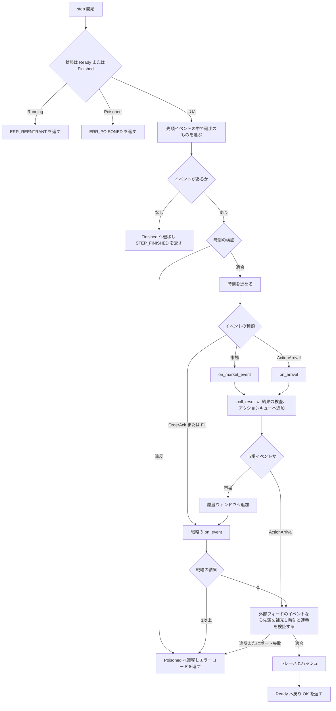
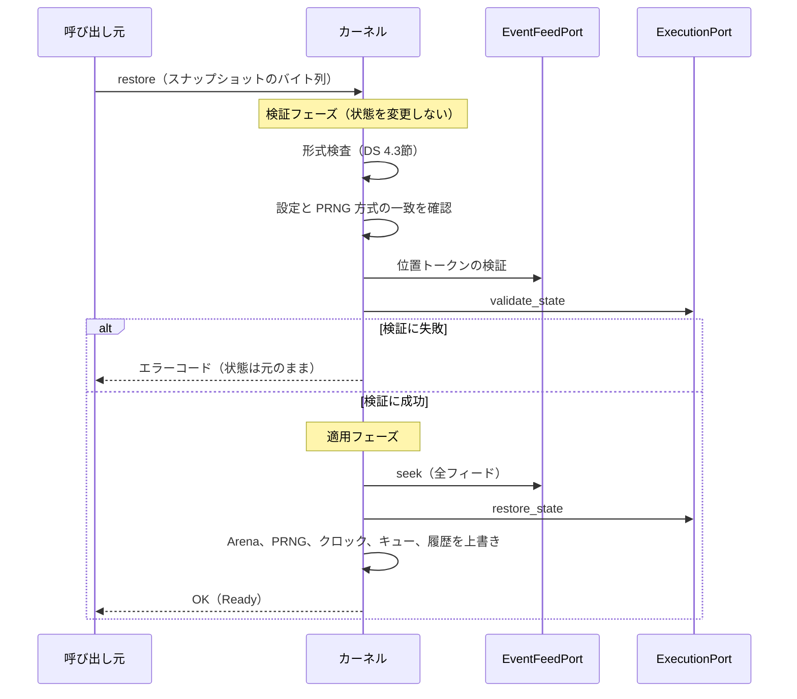

# 詳細設計書（カーネルコアの制御仕様）
**ハンドル操作、イベントループ、ポートと戦略の契約、状態遷移、エラーコード**

---

## 1. 概要とSSOT境界

### 1.1 モジュールの目的

`core/` ディレクトリ配下のクレート（パッケージ名 `event-kernel-core`、ライブラリ名 `ek_core`。Rust 組み込みの `core` クレートとの衝突を避けるため）が公開する、カーネルのハンドル操作（作成、ステップ実行、連続実行、スナップショット、復元、破棄）と、4つのポート（`ClockPort`、`EventFeedPort`、`ExecutionPort`、`SnapshotPort`）および戦略（`Strategy`）の呼び出し契約を定義する。BD のコンポーネント C-001〜C-011 と C-015 が対象である。

### 1.2 単一責任範囲 (SSOT) とデータ境界

- **本書の正本範囲**: `module_behavior`。関数の呼び出し順序、制御フロー、状態遷移の条件、エラーコードの値、ポートと戦略の呼び出し契約。
- **データ境界**: メモリ上のモジュール間の受け渡し（DTO）は本書を正本とする。保存形式（スナップショット、トレースログ、`EventHeader` のバイト配置）は EK-DS-001 を正本とする。
- **BDとの関係**: 構造、責務、横断方針は EK-BD-001 を正本とし、本書は機能単位へ具体化する。
- **外部公開契約**: `core-capi` の関数と型、Python の公開 API は、[EK-IF-001 IF仕様書](./EK-IF-001_IF仕様書.md) を正本とする。本書は `core` の安全な Rust API だけを定義し、公開範囲はすべて「内部」とする。
- **他文書へ委譲する情報**: 品質ゲートの実行条件と合格基準は EK-ENV-001、テストケースと実行結果は [EK-TEST-001 テスト計画・結果報告書](../test/EK-TEST-001_テスト計画・結果報告書.md) を正本とする。
- **責務の対象外**: C ABI の関数名とシグネチャ、Arrow 出力の形式、アダプタの内部実装（Parquet の読み込みなど）。
- **矛盾時の扱い**: 更新日ではなく、該当する `ssot_scope` の正本を更新して整合させる。

### 1.3 本書で確定する事項

| 事項                                             | 決定                                                                                                             | 節    |
| :----------------------------------------------- | :--------------------------------------------------------------------------------------------------------------- | :---- |
| 同一の市場イベントでの処理順序                   | `ExecutionPort` の約定判定を先に行い、その後に戦略へ通知する                                                     | 3.1節 |
| 履歴ウィンドウに入れるイベント                   | 市場イベント（`event_type` 1〜15）だけを入れる。システムイベントは入れない                                       | 2.5節 |
| `ExecutionPort` が今の市場イベントを参照する方法 | 今のイベントを引数で渡す。履歴には、そのイベントを含めない。履歴には、現在時刻以下の過去の市場イベントだけが入る | 2.7節 |
| 戦略インターフェース                             | `on_event` の1メソッド。戻り値は `StrategyStatus`                                                                | 2.8節 |
| 戦略への通知の対象                               | 市場イベント、`OrderAck`、`Fill`。`ActionArrival` は通知しない                                                   | 2.8節 |
| アクションの到達イベントの形式                   | `event_type` 16。ペイロードの配置は、DS 2.4節を正本とする                                                        | 2.3節 |
| システムストリームの ID                          | アクションキューの仮想ストリームは `0xFFFF_FF00`。同一時刻では、外部フィードの後に配送する                       | 2.5節 |
| `sequence_id` の検証                             | 外部ストリームごとに、`(timestamp_ns, sequence_id)` が厳密に増加することを検証する。違反は致命的                 | 3.1節 |
| `ExecutionPort` の結果の検査                     | 時刻が現在時刻以上で、`event_type` が `OrderAck` または `Fill` であること。違反は致命的                          | 3.1節 |
| `hash_interval` の単位                           | 処理済みイベント数。`processed_event_count` が倍数になるたびに計算する                                           | 2.3節 |
| `restore` の手順                                 | 検証フェーズ（状態を変更しない）と適用フェーズに分ける。`Poisoned` からの `restore` を許可する                   | 3.3節 |
| 再入の検出                                       | `core` のハンドルが、`RefCell` の `try_borrow_mut` で検出する                                                    | 3.2節 |
| `create` での先頭の取り込み                      | `create` が、全外部フィードの先頭を取り込む                                                                      | 2.2節 |
| PRNG の方式（OPEN-03）                           | Xoshiro256++。シードは SplitMix64 で展開する                                                                     | 2.6節 |
| 復元後のペイロードの参照先                       | `core` が、フィードからイベントを取得するときに、ペイロードを自分の領域へコピーする                              | 3.1節 |
| エラーコードの値                                 | 4.1節                                                                                                            | 4.1節 |

---

## 2. インターフェースと DTO (Data Transfer Object) 仕様

### 2.1 対象機能一覧

| 機能ID | 関数・機能名                                | 呼び出し元                     | 主な呼び出し先                                                          | 同期 / 非同期 |                  冪等性                  | 外部副作用                      | 公開範囲 |
| :----- | :------------------------------------------ | :----------------------------- | :---------------------------------------------------------------------- | :-----------: | :--------------------------------------: | :------------------------------ | :------: |
| F-001  | カーネルの作成（`create`）                  | 境界層、ネイティブ戦略のホスト | `EventFeedPort`、`ExecutionPort`                                        |     同期      |                   なし                   | メモリの確保（この関数だけ）    |   内部   |
| F-002  | ステップ実行（`step`）                      | 境界層、F-003                  | F-004、`ClockPort`、`EventFeedPort`、`ExecutionPort`、`TraceSink`、戦略 |     同期      |                   なし                   | トレースの出力（任意）          |   内部   |
| F-003  | 連続実行（`run`）                           | 境界層                         | F-002                                                                   |     同期      |                   なし                   | 同上                            |   内部   |
| F-004  | アクションの提出（`submit_action`）         | 戦略（コールバック中のみ）     | アクションキュー                                                        |     同期      |                   なし                   | なし                            |   内部   |
| F-005  | スナップショット作成（`capture`）           | 境界層                         | `SnapshotPort`、`EventFeedPort`、`ExecutionPort`                        |     同期      |   条件付き（同じ状態なら同じバイト列）   | `SnapshotPort` の実装による保存 |   内部   |
| F-006  | 復元（`restore`）                           | 境界層                         | `EventFeedPort`、`ExecutionPort`                                        |     同期      | あり（同じスナップショットなら同じ状態） | ポートの状態の書き換え          |   内部   |
| F-007  | 破棄（`destroy`）                           | 境界層                         | なし                                                                    |     同期      |                   あり                   | メモリの解放                    |   内部   |
| F-008  | `EventFeedPort` の契約                      | F-001、F-002、F-005、F-006     | アダプタ                                                                |     同期      |                 条件付き                 | アダプタによる                  |   内部   |
| F-009  | `ExecutionPort` の契約                      | F-002、F-005、F-006            | アダプタ                                                                |     同期      |                   なし                   | アダプタによる                  |   内部   |
| F-010  | 戦略インターフェース（`Strategy`）          | F-002                          | ネイティブ戦略、Python 戦略（境界層経由）                               |     同期      |                   なし                   | 戦略による                      |   内部   |
| F-011  | 戦略領域の初期化（`init_strategy_arena`）   | 境界層、ネイティブ戦略のホスト | なし                                                                    |     同期      |                   あり                   | なし                            |   内部   |
| F-012  | 戦略領域の読み出し（`read_strategy_arena`） | 境界層                         | なし                                                                    |     同期      |                   あり                   | なし                            |   内部   |

### 2.2 主要関数・機能の契約

#### 機能契約（F-001 `create`）

- **機能概要**: 設定を検証し、すべてのバッファを確保して、全外部フィードの先頭イベントを取り込み、`Ready` 状態のハンドルを返す。確保は、この関数に限る（ADR-004）。
- **事前条件**: 設定が 2.3節の制約を満たす。登録する外部フィードの数が 1以上である。`trace_enabled` が true の場合は、`TraceSink` が登録されている（登録されていなければ `ERR_INVALID_ARGUMENT`）。
- **事後条件**:
  - ハンドルは `Ready`。`processed_event_count` は0。論理時刻は、最初のイベントを処理するまで未設定（`i64` の最小値）。PRNG はシードで初期化済み。`trace_enabled` が true の場合は、`TraceSink.write_header` で `TRACE_HEADER`（DS 2.2節）を書き込んでいる。
  - 各外部フィードについて、`peek_next_timestamp` を呼び、「なし」でなければ `pop_next` を1回呼んで、先頭イベントをマージキューへ取り込んでいる（ペイロードはコピー済み）。取り込んだ先頭イベントが市場イベント（`event_type` 1〜15）以外、登録順と異なる `stream_id`、または `peek_next_timestamp` と一致しない `timestamp_ns` の場合は `ERR_PORT_FAILURE` とする。「なし」のフィードの先頭は「なし」とする。
  - ホットパスで確保が起きない。
- **失敗時**: 設定の検証に失敗した場合は `ERR_INVALID_ARGUMENT` または `ERR_CAPACITY_EXCEEDED`（2.3節）。`peek_next_timestamp` または `pop_next` が失敗した場合は `ERR_PORT_FAILURE`。どちらも、ハンドルを作らず、確保したメモリを解放する。
- **タイムアウト / キャンセル**: なし。
- **ログ・メトリクス**: なし。

#### 機能契約（F-002 `step`）

- **機能概要**: 次の1イベントを取り出し、因果律を検証し、時刻を進め、ポートと戦略へ配送する（3.1節）。
- **事前条件**: ハンドルが `Ready` または `Finished`。
- **事後条件**: 正常時は、1イベントを処理し、`processed_event_count` が1増える。次のイベントがない場合は、`Finished` に遷移し、終了コード `STEP_FINISHED` を返す。エラー時は、4.1節に従う。
- **タイムアウト / キャンセル**: なし。ステップは、有限の処理で必ず終わる。
- **ログ・メトリクス**: `trace_enabled` のとき、ステップごとにトレースレコードを出力する。`processed_event_count` が `hash_interval` の倍数になったとき、状態ハッシュを付ける（DS 2.5節）。

#### 機能契約（F-003 `run`）

- **機能概要**: `step` を、停止条件が成立するまで繰り返す。
- **事前条件**: F-002 と同じ。
- **事後条件**: 次のいずれかで終了する。終了コードで区別する。
  - `STEP_FINISHED`: 入力が尽きた。
  - `RUN_LIMIT_REACHED`: `max_events` 個のイベントを処理した。
  - `RUN_SNAPSHOT_REQUESTED`: `SnapshotTrigger` フラグ付きのイベントを処理した（同一イベントで `max_events` にも達した場合は `RUN_SNAPSHOT_REQUESTED` を優先する）。呼び出し側は `capture` を呼べる。
  - エラーコード: 最初のエラーで停止する。
- **タイムアウト / キャンセル**: `max_events` が上限になる。

#### 機能契約（F-004 `submit_action`）

- **機能概要**: 戦略のコールバック中に、アクションを提出する。アクションは、`latency_ns` を加算した時刻の到達イベント（`event_type` 16）として、アクションキューに入る。
- **事前条件**: ハンドルが `Running`（戦略のコールバック中）。`latency_ns` が1以上。
- **事後条件**: アクションキューに `ActionArrival` イベントが1件増える。時刻は現在時刻 + `latency_ns`。`sequence_id` は `next_action_sequence_id` から振り、1増やす。約定価格は確定しない（要件定義書 FR-04-2）。
- **失敗時**: キューが満杯なら `ERR_QUEUE_FULL`（状態は変更しない、`Poisoned` にしない）。`latency_ns` が0以下、または現在時刻 + `latency_ns` が `i64` の範囲を超える場合は `ERR_INVALID_ARGUMENT`（同上）。

#### 機能契約（F-005 `capture`）

- **機能概要**: 現在の状態を、DS 2.3節のセクション構成のバイト列にし、`SnapshotPort` へ渡す。
- **事前条件**: ハンドルが `Ready` または `Finished`。外部フィードがすべて `seekable`。`EXEC_STATE` と位置トークンが、宣言した最大長以内。
- **事後条件**: 同じ状態からは、常に同じバイト列が得られる。カーネルの状態は変化しない。
- **失敗時**: `Running` は `ERR_REENTRANT`。`Poisoned` は `ERR_POISONED`。`seekable` でないフィードがある場合と、最大長を超えた場合は `ERR_SNAPSHOT_UNSUPPORTED`。`SnapshotPort` の `store` が失敗した場合は `ERR_SNAPSHOT_IO`。どの場合も、カーネルの状態を変更しない。
- **注記**: 最終状態のハッシュの計算（DS 2.5節）は、`seekable` でないフィードがあっても行える。これは `capture` とは別の操作（`state_digest`）で、保存を伴わない。

#### 機能契約（F-006 `restore`）

- **機能概要**: スナップショットから状態を復元する（3.3節）。
- **事前条件**: ハンドルが `Ready`、`Finished`、または `Poisoned`。
- **事後条件**: 成功時は、保存時点の状態と、外部ポートの位置と状態が戻り、ハンドルは `Ready`（`Poisoned` も解除）。
- **失敗時**: 検証フェーズの失敗は、状態を変更せず、ハンドルの状態も変えない。適用フェーズの失敗は、`Poisoned`（`ERR_PORT_FAILURE`）。
- **スナップショットの入手**: `restore` は、スナップショットのバイト列を引数で受け取る。`core` は `SnapshotPort` の `load` を呼ばない。`load` は、境界層（ホスト）が、保存時のキー（`run_id`、`logical_time_ns`、`event_count`）を指定して呼ぶ。`load` の失敗（`ERR_SNAPSHOT_IO`）は、`restore` の呼び出しより前に起き、カーネルの状態に影響しない。
- **クロックの扱い**: `restore` は、`CLOCK` セクションの値で論理クロックを直接上書きする。`ClockPort` を経由しない（2.7節）。
- **比較しない設定項目**: `prng_seed`、`hash_interval`、`trace_enabled`、`max_total_bytes` は、スナップショットに保存されないので、検証で比較しない。復元後も現在の設定の値を使う。PRNG の状態は、スナップショットのものに置き換わるので、`prng_seed` は復元後の結果に影響しない。`hash_interval` と `trace_enabled` は、トレースの出力だけに影響する。

#### 機能契約（F-007 `destroy`）

- **機能概要**: ハンドルのメモリを解放する。
- **事前条件**: ハンドルが `Running` ではない（`Ready`、`Finished`、`Poisoned`）。
- **事後条件**: ハンドルは無効になる。以後の操作は未定義で、境界層が使用後の操作を防ぐ。

#### 機能契約（F-011 `init_strategy_arena`）

- **機能概要**: 戦略が使う `StrategyArena` の初期値を、ホストが書き込む。
- **事前条件**: ハンドルが `Ready` で、`processed_event_count` が0。書き込む範囲が、`StrategyArena` の内側。
- **事後条件**: 指定した範囲が書き換わる。
- **失敗時**: 事前条件に反する場合（`Finished` で呼んだ場合を含む）は `ERR_INVALID_ARGUMENT`、`Poisoned` は `ERR_POISONED`、`Running` は `ERR_REENTRANT`（いずれも状態を変更しない）。
- **理由**: 最初のステップの後に、ステップ外から書き込むと、状態ハッシュとスナップショットの整合性が崩れる（ADR-003 5.1-7）。初期化は、最初のステップより前に限る。

#### 機能契約（F-012 `read_strategy_arena`）

- **機能概要**: `StrategyArena` の内容を、呼び出し側が渡すバッファ（`ArenaRead.len` バイト）へコピーする。`core` は、確保しない（ADR-004）。
- **事前条件**: ハンドルが `Ready` または `Finished`。
- **事後条件**: カーネルの状態は変化しない。呼び出し側は、コピーを保持してよい。

### 2.3 入力 DTO スキーマ・パラメータ仕様

#### F-001: `KernelConfig`

| フィールド              | データ型 | 必須性 | NULL可 | デフォルト値 | バリデーションルール・入力制約                                   |
| :---------------------- | :------- | :----: | :----: | :----------- | :--------------------------------------------------------------- |
| `history_ring_len`      | `u32`    |  必須  |  不可  | なし         | 1以上                                                            |
| `arena_size`            | `u64`    |  必須  |  不可  | なし         | 8の倍数。`strategy_arena_offset + strategy_arena_size` 以上      |
| `strategy_arena_offset` | `u64`    |  必須  |  不可  | 0            | 8の倍数                                                          |
| `strategy_arena_size`   | `u64`    |  必須  |  不可  | 0            | 8の倍数                                                          |
| `action_queue_capacity` | `u32`    |  必須  |  不可  | なし         | 1以上                                                            |
| `payload_record_size`   | `u32`    |  必須  |  不可  | 64           | 8の倍数。16以上（アクションのペイロードが1バイト以上になるため） |
| `price_scale_exp`       | `i32`    |  必須  |  不可  | なし         | 0以下                                                            |
| `qty_scale_exp`         | `i32`    |  必須  |  不可  | なし         | 0以下                                                            |
| `prng_seed`             | `u64`    |  必須  |  不可  | なし         | 任意の値。SplitMix64 で状態を展開する（2.6節）                   |
| `exec_state_max_bytes`  | `u32`    |  必須  |  不可  | なし         | 8の倍数                                                          |
| `feed_token_max_bytes`  | `u32`    |  必須  |  不可  | 4096         | 1以上                                                            |
| `hash_interval`         | `u64`    |  必須  |  不可  | 0            | 処理済みイベント数の間隔。0は、ハッシュを計算しない              |
| `trace_enabled`         | `bool`   |  必須  |  不可  | false        | true の場合のみトレースを出力する                                |
| `max_total_bytes`       | `u64`    |  必須  |  不可  | なし         | `create` が確保する合計バイト数の上限                            |

- 外部フィードの登録順が、`stream_id` の添字になる。`stream_id` は `0` から `stream_count - 1` の連番である。`stream_count` は、登録したフィードの数から決まる。
- **エラーコードの使い分け**:
  - `ERR_INVALID_ARGUMENT`: 1つのフィールドの値が、上の制約を満たさない（0、8の倍数でない、範囲外）。登録したフィードが0個の場合も含む。
  - `ERR_CAPACITY_EXCEEDED`: 個々の値は制約を満たすが、導出される確保量が `max_total_bytes` を超える。確保量の計算がオーバーフローする場合と、`stream_count` が実装の上限 `MAX_STREAMS`（4096）を超える場合も含む。
- **確保量の計算**: DS 2.3節のスナップショットの最大サイズの式と、State Arena、履歴リング、マージキュー、アクションキューのサイズの合計とする。

#### F-003: `RunLimit`

| フィールド   | データ型 | 必須性 | NULL可 | デフォルト値 | バリデーションルール・入力制約                                                                                  |
| :----------- | :------- | :----: | :----: | :----------- | :-------------------------------------------------------------------------------------------------------------- |
| `max_events` | `u64`    |  必須  |  不可  | 0            | この呼び出しで処理するイベント数の上限。0は無制限（`STEP_FINISHED` またはエラー、`SnapshotTrigger` まで続ける） |

#### F-004: `Action`

| フィールド    | データ型                      | 必須性 | NULL可 | デフォルト値 | バリデーションルール・入力制約                           |
| :------------ | :---------------------------- | :----: | :----: | :----------- | :------------------------------------------------------- |
| `action_kind` | `u16`                         |  必須  |  不可  | なし         | 戦略と `ExecutionPort` の間で決める。`core` は解釈しない |
| `latency_ns`  | `i64`                         |  必須  |  不可  | なし         | 1以上                                                    |
| `payload`     | `u8[payload_record_size - 8]` |  必須  |  不可  | 0            | `ExecutionPort` が解釈する                               |

- **到達イベントの形式**: `submit_action` は、`ActionArrival` の `EVENT_RECORD`（DS 2.2節）を作る。
  - ヘッダ: `timestamp_ns` は現在時刻 + `latency_ns`、`stream_id` は `0xFFFF_FF00`、`event_type` は16、`flags` は0、`payload_idx` は0。
  - ペイロード（`payload_record_size` バイト）: EK-DS-001 2.4節の「`ActionArrival` のペイロード」の配置に従い、`action_kind` と `Action.payload` を詰める。`Action.payload` が `payload_record_size - 8` より短い場合は残りを `0` で埋め、長い場合は `ERR_INVALID_ARGUMENT` を返す（状態は変えない）。配置の正本は DS である。
- `on_arrival` は、この `EVENT_RECORD` を受け取る（2.7節）。

#### F-011: `ArenaWrite`

| フィールド | データ型 | 必須性 | NULL可 | デフォルト値 | バリデーションルール・入力制約                  |
| :--------- | :------- | :----: | :----: | :----------- | :---------------------------------------------- |
| `offset`   | `u64`    |  必須  |  不可  | 0            | `StrategyArena` の先頭からのオフセット。8の倍数 |
| `bytes`    | `u8[]`   |  必須  |  不可  | なし         | `offset + 長さ` が `strategy_arena_size` 以下   |

#### F-012: `ArenaRead`

| フィールド | データ型 | 必須性 | NULL可 | デフォルト値 | バリデーションルール・入力制約               |
| :--------- | :------- | :----: | :----: | :----------- | :------------------------------------------- |
| `offset`   | `u64`    |  必須  |  不可  | 0            | 8の倍数                                      |
| `len`      | `u64`    |  必須  |  不可  | なし         | `offset + len` が `strategy_arena_size` 以下 |

#### F-010: `Strategy` へ渡す `Context`

| 項目             | 内容                                                                                                                                                                                     |
| :--------------- | :--------------------------------------------------------------------------------------------------------------------------------------------------------------------------------------- |
| `now_ns`         | 現在の論理時刻                                                                                                                                                                           |
| `history`        | 履歴ウィンドウの読み取り専用ビュー。現在時刻以下の市場イベントだけを含む。市場イベントの通知では、今のイベントも含む。`OrderAck` と `Fill` の通知では、今のイベントは履歴にない（2.5節） |
| `strategy_arena` | `StrategyArena` の書き込み可能ビュー。コールバック中のみ有効（ADR-003 5.1-7）                                                                                                            |
| `rng`            | 決定論 PRNG への参照。戦略は、これ以外の乱数源を使わない                                                                                                                                 |
| `submit_action`  | F-004 を呼ぶ手段                                                                                                                                                                         |

### 2.4 出力 DTO スキーマ・戻り値仕様

#### 共通: 終了コード

すべての操作は、32ビットの符号付き整数の終了コードを返す。0以上は正常、負は失敗である。

|  値   | 名前                     | 意味                                                                                          |
| :---: | :----------------------- | :-------------------------------------------------------------------------------------------- |
|   0   | `OK`                     | 正常終了                                                                                      |
|   1   | `STEP_FINISHED`          | 入力が尽きた（正常）。`Finished` の状態で `step` を呼んだ場合も、この値を返し、状態を変えない |
|   2   | `RUN_LIMIT_REACHED`      | `max_events` 個のイベントを処理した（正常）                                                   |
|   3   | `RUN_SNAPSHOT_REQUESTED` | `SnapshotTrigger` 付きのイベントを処理した（正常）                                            |

#### F-002、F-003: `StepResult`

| フィールド              | データ型 | 必須性 | NULL可 | 正常時の意味・制約                              |
| :---------------------- | :------- | :----: | :----: | :---------------------------------------------- |
| `status`                | `i32`    |  必須  |  不可  | 終了コード                                      |
| `detail`                | `i32`    |  必須  |  不可  | 戦略またはポートが返した詳細コード。ない場合は0 |
| `processed_event_count` | `u64`    |  必須  |  不可  | 処理済みイベントの累計                          |
| `now_ns`                | `i64`    |  必須  |  不可  | 現在の論理時刻                                  |

- **異常時の戻り値**: 4.1節のエラーコード。`StepResult` の `status` に入る。なお `ERR_REENTRANT`（本体を借用できない場合）の返却時は、`processed_event_count` と `now_ns` に `0` を設定する。
- **再試行可否**: 致命的エラー（`Poisoned` になるもの）は、再試行しない。`restore` で復旧する。回復可能なエラーは、4.1節の列に従う。
- **相関ID・監査情報**: `processed_event_count` と、トレースレコード（DS 2.2節）。

### 2.5 イベント配送の順序と履歴ウィンドウ

- 同一時刻のイベントは、`(timestamp_ns, stream_id, sequence_id)` の昇順で配送する（要件定義書 FR-01-3）。
- アクションキューの仮想ストリームの `stream_id` は、`0xFFFF_FF00` とする。外部フィードの `stream_id` より大きいので、同一時刻では、外部フィードのイベントの後に配送される。
- アクションキューのイベントの `sequence_id` は、`next_action_sequence_id`（DS の `CLOCK` セクション）から振る。到達イベントを入れるときと、`ExecutionPort` の結果を入れるときの両方で、投入のたびに1増える。
- **履歴ウィンドウ**:
  - 入れるのは、市場イベント（`event_type` 1〜15）だけである。`ActionArrival`、`OrderAck`、`Fill` は入れない。
  - 理由: `ExecutionPort` が参照する「確定済みの市場データ」（要件定義書 FR-04-2）に、自分が出した結果が混ざることを防ぎ、`history_ring_len` を市場データの長さとして使えるようにするため。
  - 戦略が `OrderAck` と `Fill` を記録したい場合は、`on_event` で受け取り、`StrategyArena` に書く。
- **根拠**: 市場イベントを先に処理してから、そのイベントの時刻に生成された約定結果などを処理する。BD 2.3節の「同一の市場イベントでは、`ExecutionPort` の約定判定を、戦略への通知より先に行う」は、ステップの中の手順（3.1節の手順5と手順7）で保証する。

### 2.6 決定論 PRNG（OPEN-03 の決定）

- **方式**: Xoshiro256++。状態は32バイト（`u64` が4つ）。DS の `prng_algorithm` は1とする。
- **シードの展開**: 64ビットの `prng_seed` から、SplitMix64 を4回呼んで状態を作る。状態がすべて0になることは、この方法では起きない。
- **理由**: 128ビットの演算を必要とせず、実装が単純で速い。PCG64 は、128ビットの状態と乗算を必要とする。
- **使用者**: 戦略（`Context.rng` 経由）と、`ExecutionPort`（約定モデルのスリッページなど）。呼び出し順序が決定論的であれば、同じ結果になる。
- **スナップショット**: 状態の4つの `u64` を保存する。

### 2.7 ポートの呼び出し契約

#### `EventFeedPort`（F-008）

| 操作                  | 契約                                                                                                                                                                                                                                              |
| :-------------------- | :------------------------------------------------------------------------------------------------------------------------------------------------------------------------------------------------------------------------------------------------ |
| `peek_next_timestamp` | 次のイベントの時刻を返す。「なし」は、入力が尽きたこと（終端）を意味する。ライブのフィードのように、「まだ届いていない」状態は、本システムの対象外とする。失敗は `PortError` を返す。状態を変えない                                               |
| `pop_next`            | 次のイベントを取り出し、ヘッダとペイロードを、`core` が渡すバッファへコピーする。ペイロードを、`core` が後から参照することはない。`pop_next` の呼び出しごとに、位置が1つ進む。失敗は `PortError` を返す                                           |
| `position`            | 次に `pop_next` が返すイベントの位置（`core` が先頭へ取り込み済みのイベントの次）を、不透明なトークンとして返す。先頭を取り込んだ後の位置を、スナップショットに保存する。位置を戻せない（`seekable` でない）データ源は、`seekable = false` を返す |
| `seek`                | 保存したトークンの位置へ戻す。戻した後の最初の `pop_next` は、保存時の先頭の次のイベントを返す（先頭自体は、スナップショットの `MERGE_HEADS` に保存されている）。**既存の状態を読まず、位置だけで状態を決める（全上書き）**                       |
| 不変条件              | `peek` した時刻より前のイベントを、後から返してはならない。同一ストリーム内で、`(timestamp_ns, sequence_id)` は厳密に増加する                                                                                                                     |

#### `ExecutionPort`（F-009）

| 操作              | 呼び出されるとき                                               | 契約                                                                                                                                                                                                                                           |
| :---------------- | :------------------------------------------------------------- | :--------------------------------------------------------------------------------------------------------------------------------------------------------------------------------------------------------------------------------------------- |
| `on_arrival`      | `ActionArrival` イベントを配送するとき                         | 引数は、到達イベントの `EVENT_RECORD`（2.3節）と `&mut Prng`。内部状態を更新する。結果（`OrderAck`、`Fill`）を、結果バッファへ積んでよい                                                                                                               |
| `on_market_event` | 市場イベントを配送するとき（履歴への追加と戦略への通知より前） | 引数は、今の市場イベントの `EVENT_RECORD`、履歴ウィンドウの読み取り専用ビュー、および `&mut Prng`。**今のイベントは、履歴に含まれない**。履歴には、これより前に処理した現在時刻以下の市場イベントだけが入る。待機中のアクションの約定を判定し、結果を積んでよい |
| `poll_result`     | `on_arrival` と `on_market_event` の直後に結果が尽きるまで繰り返す | 積まれた結果を、**生成した順**に1件ずつ `core` のバッファへ書き出し、`bool`（有無）を返す（動的確保をしないため）。同じ入力と状態からは、同じ順序で返さなければならない。`core` は、返された順に `sequence_id` を振り、`stream_id` を `0xFFFF_FF00`、`payload_idx` を `0` に上書きする |
| `capture_state`   | `capture` のとき                                               | 内部状態を、決定的な直列化（DS 2.3節）で返す。長さは `exec_state_max_bytes` 以下                                                                                                                                                               |
| `restore_state`   | `restore` の適用フェーズ                                       | 内部状態を、バイト列だけから全上書きする。既存の状態を読まない                                                                                                                                                                                 |
| `validate_state`  | `restore` の検証フェーズ                                       | バイト列が復元できるかを検査する。状態を変更しない                                                                                                                                                                                             |

- 約定価格は、約定判定の時刻以前に確定した市場データだけから決める（要件定義書 FR-04-2）。「次バー始値で約定」のような規則は、到達後に最初に届いたバーの市場イベント（今のイベント）の価格を使って、`on_market_event` で約定させる。
- 結果の `event_type` は `OrderAck`（17）または `Fill`（18）で、時刻は現在時刻以上でなければならない。`core` は、返された結果をこの条件で検査する（3.1節の手順5）。結果の時刻は到達時刻以上で、到達時刻は提出時刻より `latency_ns`（1以上）だけ後なので、提出時刻と同一時刻に確定することはない（要件定義書 5.2節の `ExecutionPort` の制約を満たす）。
- 乱数が必要な場合は、`core` が渡す PRNG を使う。独自の乱数源を使わない。

#### `ClockPort`

| 操作                    | 契約                                                                                                                                                                                                                                                                                                                    |
| :---------------------- | :---------------------------------------------------------------------------------------------------------------------------------------------------------------------------------------------------------------------------------------------------------------------------------------------------------------------- |
| `now_ns`                | 現在の論理時刻を返す。最初のイベントを処理するまでは、`i64` の最小値を返す。OS 時刻を参照しない                                                                                                                                                                                                                         |
| `advance_to(target_ns)` | `target_ns` が現在時刻以上なら、現在時刻を `target_ns` にする。小さければ失敗し、`ERR_CAUSALITY_VIOLATION` になる。`core` の外部からの時刻の書き換えはできない。例外は `restore` で、`CLOCK` セクションの値で論理クロックを直接上書きし、`ClockPort` を経由しない（要件定義書 2.1節の「スナップショット復元時を除く」） |

- 標準の実装は、`core` の中の論理クロックである（BD 2.1節）。

#### `SnapshotPort`

| 操作                                        | 契約                                                                                                                                                                                                                                |
| :------------------------------------------ | :---------------------------------------------------------------------------------------------------------------------------------------------------------------------------------------------------------------------------------- |
| `store(blob, logical_time_ns, event_count)` | スナップショットのバイト列を保存する。失敗したら、`ERR_SNAPSHOT_IO` を返す。カーネルの状態は変えない。同じ名前の既存のスナップショットを上書きしない（DS 3.1節）。`run_id` は、ポートの実装が設定として持ち、`store` の引数にしない |
| `load(key)`                                 | 保存したバイト列を返す。`key` は、保存時の `(run_id, logical_time_ns, event_count)`。**`core` は呼ばず、境界層（ホスト）が呼ぶ**。失敗は、境界層が `ERR_SNAPSHOT_IO` として返す。カーネルの状態は変えない                           |

#### `TraceSink`

| 操作                   | 契約                                                                                                                                                                                              |
| :--------------------- | :------------------------------------------------------------------------------------------------------------------------------------------------------------------------------------------------ |
| `write_header(header)` | 初期化時（`trace_enabled` が true のとき）に `TRACE_HEADER`（DS 2.2節）を書き込む。失敗したら `ERR_PORT_FAILURE` を返し、ハンドルを作らない                                                     |
| `write(record)`        | トレースレコード（DS 2.2節の `TRACE_RECORD`）を1件出力する。失敗したら、`ERR_PORT_FAILURE` を返し、ハンドルは `Poisoned` になる。トレースが欠けた実行の結果は、監査（NFR-05）に使えないためである |

### 2.8 戦略インターフェース（F-010 `Strategy`）

- **メソッド**: `on_event(context, event) -> StrategyStatus` の1つだけである。初期化は、`init_strategy_arena`（F-011）で行い、終了処理は設けない。
- **呼び出される条件**: 次のイベントの処理で、ステップの手順7に呼ぶ。
  - 市場イベント（`event_type` 1〜15）
  - `OrderAck`（17）
  - `Fill`（18）
- **呼び出されない条件**: `ActionArrival`（16）は、`ExecutionPort` が内部で扱うので、戦略へ通知しない。
- **引数**:
  - `context`: 2.3節の `Context`。
  - `event`: 処理中のイベントの `EVENT_RECORD`（読み取り専用。コールバック中のみ有効）。
- **戻り値 `StrategyStatus`**:

|  値   | 意味                                                                                           |
| :---: | :--------------------------------------------------------------------------------------------- |
|   0   | 正常                                                                                           |
| 1以上 | 戦略が定義する異常。`core` は `ERR_STRATEGY_FAILURE` を返し、値を `StepResult.detail` へ入れる |

- **制約**:
  - コールバック中に呼べる操作は、`Context` にあるものだけである。`step`、`capture`、`restore`、`destroy` は、呼べない（3.2節の再入の検出）。
  - Python 戦略の例外は、境界層が `StrategyStatus` の1以上に変換する（IF/API 仕様書）。
  - ネイティブ戦略と Python 戦略は、同じ `Strategy` で切り替えられる（要件定義書 FR-06-1）。

---

## 3. 処理フロー・シーケンス・状態遷移ロジック (Mermaid 図)

### 3.1 ステップ実行のフロー（F-002）

- **図の正本**: 手順表（下の表）を正本とする。図は、手順の流れを示す。
- **対象機能ID**: F-002、F-004、F-009、F-010

#### 手順表（正本）

| 手順  | 処理                                                                                                                                                                                                                                                                                                                                                                                                                                                                                                                                                                                                                                                                          | 失敗時                                                                                                                                                    |
| :---: | :---------------------------------------------------------------------------------------------------------------------------------------------------------------------------------------------------------------------------------------------------------------------------------------------------------------------------------------------------------------------------------------------------------------------------------------------------------------------------------------------------------------------------------------------------------------------------------------------------------------------------------------------------------------------------- | :-------------------------------------------------------------------------------------------------------------------------------------------------------- |
|   1   | 状態を検査する（3.2節の表）                                                                                                                                                                                                                                                                                                                                                                                                                                                                                                                                                                                                                                                   | `ERR_REENTRANT`、`ERR_POISONED`。状態を変更しない                                                                                                         |
|   2   | 外部フィードの先頭とアクションキューの先頭から、`(timestamp_ns, stream_id, sequence_id)` が最小のイベントを選ぶ。何もなければ `Finished` に遷移し、`STEP_FINISHED` を返す                                                                                                                                                                                                                                                                                                                                                                                                                                                                                                     | なし（先頭は `create` と手順8で取り込み済み）                                                                                                             |
|   3   | **検証**: 選んだイベントの `timestamp_ns` が現在時刻より小さければ `ERR_CAUSALITY_VIOLATION`。イベントを処理せずに `Poisoned` へ遷移する。この検査は防御的なもので、通常は手順8で検出済みのため到達しない。時刻の逆行と連番の検証は、手順8の取り込み時に行う（`restore` の後も、スナップショットに保存した先頭が「直前のイベント」になるので、追加の状態は要らない）                                                                                                                                                                                                                                                                                                          | `Poisoned`                                                                                                                                                |
|   4   | `ClockPort` を、イベントの時刻へ進める。時刻の検査は手順3で済んでいるので、ここでは失敗しない。外部フィードの先頭の補充は、手順8で行う                                                                                                                                                                                                                                                                                                                                                                                                                                                                                                                                        | なし（手順3で検査済み）                                                                                                                                   |
|   5   | イベントの種類に応じて、`ExecutionPort` を呼ぶ。市場イベントは `on_market_event`、`ActionArrival` は `on_arrival`。`OrderAck` と `Fill` は呼ばない。呼び出しの直後に `poll_results` で結果を受け取り、1件ずつ検査する（`event_type` が `OrderAck` または `Fill`、時刻が現在時刻以上）。検査を通った結果を、返された順にアクションキューへ入れる                                                                                                                                                                                                                                                                                                                               | 検査に違反した結果の時刻は `ERR_CAUSALITY_VIOLATION`、`event_type` は `ERR_PORT_FAILURE`。キューに入らなければ `ERR_RESULT_OVERFLOW`。いずれも `Poisoned` |
|   6   | 市場イベントだけを、履歴ウィンドウへ追加する（満杯なら、最古を上書きする）。`ActionArrival`、`OrderAck`、`Fill` は追加しない                                                                                                                                                                                                                                                                                                                                                                                                                                                                                                                                                  | なし                                                                                                                                                      |
|   7   | 市場イベント、`OrderAck`、`Fill` について、戦略の `on_event` を呼ぶ（2.8節）。戦略は、このコールバック中に F-004 を呼べる。コールバックの終了時に、ビューを無効化する（`ViewGuard`）。`ActionArrival` では、呼ばない                                                                                                                                                                                                                                                                                                                                                                                                                                                          | 戦略が1以上を返した場合は `ERR_STRATEGY_FAILURE`（`detail` に値）。`Poisoned`                                                                             |
|   8   | **先頭の補充と検証**: 手順2で選んだイベントが外部フィードのものなら、そのフィードに `peek_next_timestamp` を呼び、「なし」でなければ `pop_next` で次のイベントを取り込み、先頭を更新する（ペイロードをコピーする）。システムストリームのイベントなら、何もしない。取り込んだイベントを検査し、`peek_next_timestamp` との時刻不一致、登録順と異なる `stream_id`、または市場イベント（`event_type` 1〜15）以外の場合は `ERR_PORT_FAILURE` とする。また、今のイベント（同じストリームの直前のイベント）と比べて時刻が小さければ `ERR_CAUSALITY_VIOLATION`、時刻が同じで `sequence_id` が増えていなければ `ERR_SEQUENCE_VIOLATION` とする。いずれも、取り込んだイベントを処理せずに `Poisoned` へ遷移する。今のイベントの処理は、手順7までに終わっており、`processed_event_count` に数えている。このステップのトレースは出力されない | `ERR_CAUSALITY_VIOLATION`、`ERR_SEQUENCE_VIOLATION`、`ERR_PORT_FAILURE`。いずれも `Poisoned`                                                              |
|   9   | `trace_enabled` なら、トレースレコードを出力する。`processed_event_count`（処理後の値）が `hash_interval` の倍数なら、手順8の補充と検証が済んだ後の状態（`capture` が保存する状態と同じ）から、状態ハッシュを計算して付ける。`hash_interval` が0なら、計算しない                                                                                                                                                                                                                                                                                                                                                                                                              | 出力の失敗は `ERR_PORT_FAILURE`。`Poisoned`                                                                                                               |
|  10   | `Ready` に戻り、`OK` を返す                                                                                                                                                                                                                                                                                                                                                                                                                                                                                                                                                                                                                                                   | なし                                                                                                                                                      |

- **ハンドルの状態**: 手順3〜9は、`Running` で実行する。手順3〜9の中でエラーが起きた場合は、`Poisoned` に遷移する。
- **入力の違反の見え方**: 時刻の逆行と連番の違反は、違反したイベントの1つ前のイベントを処理したステップの手順8で検出する。そのステップは、1つ前のイベントを手順7まで処理し終えており、`processed_event_count` に数えている。そのステップのトレースは出力されない（状態が `Poisoned` になるため）。違反したイベントは、処理されない（AC-01）。`Poisoned` のハンドルは、`restore` で復旧する。
- **ペイロードのコピー**: 手順8（と `create`）で、`core` が自分のレコード領域へコピーする。復元後に、`core` が外部のペイロードを参照することはない。コピーの性能への影響は、ベンチマーク（QG-008）で確認する。
- **`hash_interval` と `restore`**: `processed_event_count` は、スナップショットの `CLOCK` セクションに保存され、復元で戻る。このため、ハッシュを計算するステップは、復元の前後で変わらない。
- **無限ループが起きない理由**: `OrderAck` と `Fill` では `ExecutionPort` を呼ばないので、結果が新しい結果を生まない。戦略が出すアクションの `latency_ns` は1以上なので、到達イベントの時刻は必ず進む。

### 3.2 ハンドルの状態と操作

- **図の正本**: 状態遷移表（下の表）。BD 2.4節の図は概要で、条件の詳細は本表を正本とする。
- **初期状態**: `Ready`（`create` の成功後）。
- **終端状態**: `Destroyed`。
- **状態不変条件**: `Ready` と `Finished` では、カーネルの状態が一貫している。`Running` は、1つのステップの間だけ存在する。`Poisoned` では、状態の一貫性を保証しない。
- **未定義イベントの扱い**: 表にない操作は、`ERR_INVALID_ARGUMENT` で拒否し、状態を変更しない。
- **再入の検出**: `core` のハンドル（BD の C-009）は、カーネルの本体を `RefCell` で包み、操作の入口で `try_borrow_mut` を呼ぶ。借用に失敗した場合（`Running` 中に別の操作が呼ばれた場合）は、`ERR_REENTRANT` を返す。この方法は、`unsafe` を使わない。この方式のため、ハンドルの操作は共有参照（`&self`）で受け、内部可変性で本体を借用する。再入は、ネイティブ戦略（Rust）の場合も含め、すべて実行時の検出で防ぐ。戦略が `Rc` などでハンドルへの参照を持てば、再入できてしまうためである。TR-014 は、`core` の単体テストで、コールバックからの再入を試して検証する。

| 現在の状態 | 操作                                                                                         | 結果                                                             | 次の状態                                 | 備考                     |
| :--------- | :------------------------------------------------------------------------------------------- | :--------------------------------------------------------------- | :--------------------------------------- | :----------------------- |
| `Ready`    | `step`、`run`                                                                                | 正常                                                             | `Ready`（入力が尽きたときは `Finished`） |                          |
| `Ready`    | `step`、`run`                                                                                | 致命的エラー                                                     | `Poisoned`                               | 4.1節                    |
| `Ready`    | `capture`、`read_strategy_arena`                                                             | 成功または回復可能なエラー                                       | `Ready`                                  | 状態は変化しない         |
| `Ready`    | `init_strategy_arena`                                                                        | 成功（`processed_event_count` が0）または `ERR_INVALID_ARGUMENT` | `Ready`                                  |                          |
| `Ready`    | `restore`                                                                                    | 成功                                                             | `Ready`                                  |                          |
| `Ready`    | `restore`                                                                                    | 検証フェーズの失敗                                               | `Ready`                                  | 状態を変更しない         |
| `Ready`    | `restore`                                                                                    | 適用フェーズの失敗                                               | `Poisoned`                               |                          |
| `Ready`    | `destroy`                                                                                    | 成功                                                             | `Destroyed`                              |                          |
| `Running`  | `step`、`run`、`capture`、`restore`、`destroy`、`init_strategy_arena`、`read_strategy_arena` | `ERR_REENTRANT`                                                  | `Running`                                | 再入の拒否               |
| `Running`  | `submit_action`                                                                              | 成功、`ERR_QUEUE_FULL`、`ERR_INVALID_ARGUMENT`                   | `Running`                                | 戦略のコールバック中だけ |
| `Finished` | `step`、`run`                                                                                | `STEP_FINISHED`                                                  | `Finished`                               | 状態を変更しない         |
| `Finished` | `capture`、`read_strategy_arena`                                                             | 成功または回復可能なエラー                                       | `Finished`                               |                          |
| `Finished` | `init_strategy_arena`                                                                        | `ERR_INVALID_ARGUMENT`                                           | `Finished`                               | 表にない操作・条件違反   |
| `Finished` | `restore`                                                                                    | 成功                                                             | `Ready`                                  |                          |
| `Finished` | `restore`                                                                                    | 適用フェーズの失敗                                               | `Poisoned`                               |                          |
| `Finished` | `destroy`                                                                                    | 成功                                                             | `Destroyed`                              |                          |
| `Poisoned` | `step`、`run`、`capture`、`submit_action`、`init_strategy_arena`、`read_strategy_arena`      | `ERR_POISONED`                                                   | `Poisoned`                               |                          |
| `Poisoned` | `restore`                                                                                    | 成功                                                             | `Ready`                                  | `Poisoned` を解除する    |
| `Poisoned` | `restore`                                                                                    | 検証または適用フェーズの失敗                                     | `Poisoned`                               |                          |
| `Poisoned` | `destroy`                                                                                    | 成功                                                             | `Destroyed`                              |                          |

- **`Finished` での `restore` の検証フェーズの失敗**: `Ready` の場合と同じく、状態を変更せず、`Finished` のままとする。
- **`Poisoned` からの `restore` を許可する理由**: ADR-003 5.1-9 の許可条件を満たすためである。`restore` は、既存のカーネル状態（State Arena、PRNG、クロック、キュー）を読まず、スナップショットのバイト列で全領域を上書きする。外部ポートの `seek`、`restore_state` も、全上書きを契約としている（2.7節）。復元が最後まで成功した場合にだけ、`Poisoned` を解除する。

### 3.3 `restore` のシーケンス（F-006）

- **検証フェーズ**: 次をすべて確認し、1つでも失敗したら、状態を変更せずにエラーコードを返す。
  - DS 4.3節の形式検査。失敗は `ERR_SNAPSHOT_INVALID`。
  - `CONFIG` が、現在の設定と一致する（`history_ring_len`、`arena_size`、`strategy_arena_*`、`stream_count`、`action_queue_capacity`、`payload_record_size`、スケール、`exec_state_max_bytes`、`feed_token_max_bytes`）。`PRNG.algorithm` が現在の方式と一致する。失敗は `ERR_SNAPSHOT_MISMATCH`。
  - `FEED_STATES` の `stream_id` が、登録済みのフィードと一致し、各フィードが位置トークンを受け付けられる。`EXEC_STATE` を `validate_state` が受け付ける。失敗は `ERR_SNAPSHOT_MISMATCH`。
- **適用フェーズ**: すべてのセクションを書き込み、外部ポートへ位置と状態を戻す。途中で失敗した場合は、ロールバックできないので、`Poisoned` へ遷移し、`ERR_PORT_FAILURE` を返す。
- **復元後のイベントのペイロード**: スナップショットのレコードは、ペイロードを含む。`core` は、復元したレコードを、そのまま自分の領域に置く。
- **比較しない設定項目**: 2.2節の F-006 を参照する。

---

## 4. エラー処理・失敗契約

### 4.1 エラー分類と対処方針

| エラーコード               |  値   | カテゴリ                        | 発生・判定基準                                                                                                                                              | 再試行安全条件                 | 終端ステータス                                  | 利用者・運用者対応                                                       | 副作用・データ保持契約                     |
| :------------------------- | :---: | :------------------------------ | :---------------------------------------------------------------------------------------------------------------------------------------------------------- | :----------------------------- | :---------------------------------------------- | :----------------------------------------------------------------------- | :----------------------------------------- |
| `ERR_INVALID_ARGUMENT`     |  -1   | 回復可能                        | 引数が制約を満たさない。表にない操作。登録したフィードが0個                                                                                                 | 引数を直せば安全               | 変化なし                                        | 引数を直す                                                               | 状態を変更しない                           |
| `ERR_CAPACITY_EXCEEDED`    |  -2   | 初期化時                        | 導出される確保量が `max_total_bytes` を超える。計算がオーバーフローする。`stream_count` が `MAX_STREAMS` を超える                                           | 設定を直せば安全               | ハンドルは作られない                            | 設定を直す                                                               | 確保したメモリを解放する                   |
| `ERR_QUEUE_FULL`           |  -3   | 回復可能                        | `submit_action` で、アクションキューが満杯                                                                                                                  | 空きができれば安全             | 変化なし                                        | 戦略が発注を見送る、または中断する                                       | 状態を変更しない                           |
| `ERR_CAUSALITY_VIOLATION`  |  -4   | 致命的                          | イベントの時刻が現在時刻より小さい（手順8で取り込んだイベントの時刻が、今のイベントより小さい場合を含む）。`ExecutionPort` の結果の時刻が現在時刻より小さい | 再試行しない                   | `Poisoned`                                      | 入力データまたはアダプタを直す。必要なら、アダプタ層でフィルタリングする | イベントを処理しない。`restore` で復旧する |
| `ERR_SEQUENCE_VIOLATION`   |  -5   | 致命的                          | 同一ストリームで、時刻が同じで `sequence_id` が増加しない（手順8の取り込み時に検出する）                                                                    | 再試行しない                   | `Poisoned`                                      | 入力データを直す                                                         | 同上                                       |
| `ERR_POISONED`             |  -6   | 拒否                            | `Poisoned` のハンドルへの操作                                                                                                                               | `restore` の後は安全           | 変化なし                                        | `restore` または `destroy`                                               | 状態を変更しない                           |
| `ERR_REENTRANT`            |  -7   | 拒否                            | `Running` 中の禁止操作                                                                                                                                      | コールバックの外では安全       | 変化なし                                        | コールバック内から禁止操作を呼ばない                                     | 状態を変更しない                           |
| `ERR_SNAPSHOT_UNSUPPORTED` |  -8   | 回復可能                        | `capture` で、位置を戻せないフィードがある。`EXEC_STATE` または位置トークンが最大長を超える                                                                 | 条件を満たせば安全             | 変化なし                                        | 設定を直す、または別のデータ源を使う                                     | 状態を変更しない                           |
| `ERR_SNAPSHOT_INVALID`     |  -9   | 回復可能                        | `restore` の形式検査に失敗                                                                                                                                  | 正しいスナップショットなら安全 | 変化なし                                        | 別のスナップショットを使う                                               | 状態を変更しない                           |
| `ERR_SNAPSHOT_MISMATCH`    |  -10  | 回復可能                        | `restore` の設定または外部ポートの検証に失敗                                                                                                                | 設定を合わせれば安全           | 変化なし                                        | 設定を合わせる                                                           | 状態を変更しない                           |
| `ERR_PORT_FAILURE`         |  -11  | 致命的（`create` では初期化時） | ポートの操作が失敗した（`peek_next_timestamp`、`pop_next`、`seek`、`TraceSink` の書き込みなど）。`ExecutionPort` の結果の `event_type` が不正               | `restore` の後は安全           | `Poisoned`（`create` ではハンドルが作られない） | アダプタの原因を調べる                                                   | 途中の状態は保証しない                     |
| `ERR_RESULT_OVERFLOW`      |  -12  | 致命的                          | `ExecutionPort` の結果が、アクションキューに入らない                                                                                                        | 再試行しない                   | `Poisoned`                                      | `action_queue_capacity` を増やす                                         | 同上                                       |
| `ERR_STRATEGY_FAILURE`     |  -13  | 致命的                          | 戦略が1以上の `StrategyStatus` を返した。Python 戦略の例外を含む                                                                                            | 再試行しない                   | `Poisoned`                                      | 戦略を直す。`detail` に戦略の値が入る                                    | 同上                                       |
| `ERR_SNAPSHOT_IO`          |  -14  | 回復可能                        | `SnapshotPort` の `store` が失敗した（`load` の失敗は、境界層が返す）                                                                                       | 保存先が回復すれば安全         | 変化なし                                        | 保存先を確認する                                                         | 状態を変更しない                           |
| `ERR_PANIC`                |  -99  | 致命的                          | 境界層がパニックを捕捉した（ADR-003 5.1-4）。`core` 内の回復不能な内部不変条件違反（先頭取り出し失敗等）にも用いる                                                                        | `restore` の後は安全           | `Poisoned`                                      | 不具合として報告する                                                     | 同上                                       |

- **再試行上限**: 致命的エラーは、再試行しない。`core` は、内部でリトライを持たない（BD 3.2節）。
- **未確定**: `ExecutionPort` の結果が、キューの空きを使い切らないようにする予約方式（`action_queue_capacity` のうち、結果用に確保する量）は、決まっていない（5.3節）。現在は、溢れた場合を致命的エラー `ERR_RESULT_OVERFLOW` とする。

---

## 5. 機能テスト要件

### 5.1 機能テスト要件一覧

| 要件ID | 対象機能ID   | 保証すべき振る舞い・条件                                                                                                                                                                                                                                                                                                                                                                   | 検証観点         | 対応テストケース          |
| :----- | :----------- | :----------------------------------------------------------------------------------------------------------------------------------------------------------------------------------------------------------------------------------------------------------------------------------------------------------------------------------------------------------------------------------------- | :--------------- | :------------------------ |
| TR-001 | F-001        | 1つのフィールドが制約を満たさない場合と、フィードが0個の場合、`trace_enabled` が true で `TraceSink` がない場合に `ERR_INVALID_ARGUMENT` を返す。個々の値は正しいが確保量が `max_total_bytes` を超える場合、計算がオーバーフローする場合、`stream_count` が上限を超える場合に `ERR_CAPACITY_EXCEEDED` を返す。どちらもハンドルを作らない。成功時は `Ready` で、`processed_event_count` が0 | 正常、境界、異常 | `TC-001` (`EK-TEST-001`)  |
| TR-002 | F-001、F-002 | `create` の完了後、`step` と `run` の間は、ヒープの確保も解放も起きない（AC-05）                                                                                                                                                                                                                                                                                                           | 正常             | `TC-002` (`EK-TEST-001`)  |
| TR-003 | F-002        | 同一時刻のイベントが、`(timestamp_ns, stream_id, sequence_id)` の昇順で配送される。システムストリームのイベントは、外部フィードの後（AC-02）                                                                                                                                                                                                                                               | 正常、境界       | `TC-003` (`EK-TEST-001`)  |
| TR-004 | F-002        | 同一ストリームで時刻が逆行するイベントを入力すると、逆行したイベントを処理せず `ERR_CAUSALITY_VIOLATION` を返し、`Poisoned` になる（AC-01）。エラーは、直前のイベントを処理したステップが返し、直前のイベントは処理済みで `processed_event_count` に数える                                                                                                                                 | 異常             | `TC-004` (`EK-TEST-001`)  |
| TR-005 | F-002        | 同一ストリームで、時刻が同じで `sequence_id` が増加しない入力に、`ERR_SEQUENCE_VIOLATION` を返し、`Poisoned` になる。エラーの返し方と処理済みイベントの扱いは、TR-004 と同じ                                                                                                                                                                                                               | 異常             | `TC-005` (`EK-TEST-001`)  |
| TR-006 | F-002、F-009 | 市場イベントの処理で、`ExecutionPort` の `on_market_event` が、戦略の `on_event` より先に呼ばれる。`on_market_event` へ渡す履歴は、今のイベントを含まない                                                                                                                                                                                                                                  | 正常             | `TC-006` (`EK-TEST-001`)  |
| TR-007 | F-004、F-009 | アクションの結果が、提出時刻より後の時刻にだけ現れる。`latency_ns` が0以下なら `ERR_INVALID_ARGUMENT`（AC-02）                                                                                                                                                                                                                                                                             | 正常、境界、異常 | `TC-007` (`EK-TEST-001`)  |
| TR-008 | F-004        | キューが満杯のとき `ERR_QUEUE_FULL` を返し、状態ハッシュが変化せず、`Poisoned` にならない（AC-08）                                                                                                                                                                                                                                                                                         | 境界             | `TC-008` (`EK-TEST-001`)  |
| TR-009 | F-002、F-010 | 戦略が1以上を返すと、`ERR_STRATEGY_FAILURE` を返し、`detail` に戦略の値が入り、`Poisoned` になる                                                                                                                                                                                                                                                                                           | 異常             | `TC-009` (`EK-TEST-001`)  |
| TR-010 | F-005、F-006 | `capture` の後に、パラメータを変えて実行し、`restore` して同じ設定で再実行すると、全セクションの SHA-256 が元の実行とビット単位で一致する（AC-03）。`HISTORY_RING` を含む。`hash_interval` と `trace_enabled` が同じなら、トレースも一致する                                                                                                                                               | 正常             | `TC-010` (`EK-TEST-001`)  |
| TR-011 | F-005        | 位置を戻せないフィード、または最大長を超える状態があると、`ERR_SNAPSHOT_UNSUPPORTED` を返し、状態を変更しない                                                                                                                                                                                                                                                                              | 異常             | `TC-011` (`EK-TEST-001`)  |
| TR-012 | F-006        | 検証フェーズの失敗（形式、設定の不一致）で、状態もハンドルの状態も変わらない。適用フェーズの失敗で `Poisoned` になる                                                                                                                                                                                                                                                                       | 異常             | `TC-012` (`EK-TEST-001`)  |
| TR-013 | F-006        | `Poisoned` のハンドルに `restore` が成功すると、`Ready` に戻り、以後の `step` の結果が、`restore` 元の状態から実行した場合と一致する                                                                                                                                                                                                                                                       | 正常             | `TC-012` (`EK-TEST-001`)  |
| TR-014 | F-002        | コールバックからの再入を試す単体テストで、`step`、`run`、`capture`、`restore`、`destroy` を `Running` 中に呼ぶと `ERR_REENTRANT` を返し、状態を変更しない                                                                                                                                                                                                                                  | 異常             | `TC-013` (`EK-TEST-001`)  |
| TR-015 | F-003        | `run` が、入力の終端、`max_events`、`SnapshotTrigger` で止まり、それぞれ異なる終了コードを返す。`max_events` が0なら無制限                                                                                                                                                                                                                                                                 | 正常、境界       | `TC-014` (`EK-TEST-001`)  |
| TR-016 | F-002、F-005 | 同じ入力、同じシード、同じ設定で、全セクションの SHA-256 とトレースログのハッシュが一致する（AC-04、AC-07）                                                                                                                                                                                                                                                                                | 正常             | `TC-015` (`EK-TEST-001`)  |
| TR-017 | F-001、F-002 | PRNG が、同じシードから同じ系列を出し、状態が `CLOCK` と並んで保存、復元される（FR-05-1）                                                                                                                                                                                                                                                                                                  | 正常             | `TC-010` (`EK-TEST-001`)  |
| TR-018 | F-001        | `create` が全外部フィードの先頭を取り込む。取り込みが失敗した場合は `ERR_PORT_FAILURE` を返し、ハンドルを作らない                                                                                                                                                                                                                                                                          | 正常、異常       | `TC-001` (`EK-TEST-001`)  |
| TR-019 | F-002、F-009 | `ExecutionPort` の結果の時刻が現在時刻より小さい場合は `ERR_CAUSALITY_VIOLATION`、`event_type` が不正な場合は `ERR_PORT_FAILURE` を返し、`Poisoned` になる。結果は、返された順に `sequence_id` が振られる                                                                                                                                                                                  | 異常、正常       | `TC-009` (`EK-TEST-001`)  |
| TR-020 | F-002        | 履歴ウィンドウに入るのは、市場イベントだけである。`ActionArrival`、`OrderAck`、`Fill` は入らない。戦略へ通知されるのは、市場イベント、`OrderAck`、`Fill` で、`ActionArrival` は通知されない                                                                                                                                                                                                | 正常             | `TC-006` (`EK-TEST-001`)  |
| TR-021 | F-002        | `hash_interval` が N のとき、`processed_event_count` が N の倍数になるステップだけ、ハッシュが付く。ハッシュは、先頭の補充（手順8）の後の状態から計算し、その状態を `capture` したバイト列から DS 2.5節の方法で計算した値と一致する。`restore` の前後で、ハッシュを付けるステップが変わらない                                                                                              | 正常、境界       | `TC-010` (`EK-TEST-001`)  |
| TR-022 | F-011、F-012 | `init_strategy_arena` は、`Ready` で `processed_event_count` が0のときだけ成功する。それ以外は `ERR_INVALID_ARGUMENT`。`read_strategy_arena` は、呼び出し側のバッファへコピーし、状態を変えず、確保しない                                                                                                                                                                                  | 正常、境界、異常 | `TC-026` (`EK-TEST-001`)  |
| TR-023 | F-005、F-006 | `SnapshotPort` の `store` が失敗すると `ERR_SNAPSHOT_IO` を返し、状態もハンドルの状態も変えない。`load` の失敗は境界層の機能で、IF/API 仕様書の要件とする                                                                                                                                                                                                                                  | 異常             | `TC-011` (`EK-TEST-001`)  |
| TR-024 | F-004        | 現在時刻 + `latency_ns` が `i64` の範囲を超える場合に `ERR_INVALID_ARGUMENT` を返し、状態を変えない。`ClockPort` の `advance_to` が現在時刻より小さい値を拒否する                                                                                                                                                                                                                          | 正常、境界、異常 | `TC-007` (`EK-TEST-001`)  |

### 5.2 適用する品質ゲート

- **品質ゲートの正本**: [EK-ENV-001 環境・開発基盤仕様書](../setup/EK-ENV-001_環境・開発基盤仕様書.md)
- **適用するゲートID**: QG-001〜QG-006、QG-014（`core/` を変更する PR）。QG-007、QG-012、QG-013 は、境界層の変更に適用する。QG-008、QG-009 は、定期実行に適用する。
- 本機能だけに必要な条件が出た場合は、環境・開発基盤仕様書へゲートを追加してから参照する。

### 5.3 未確定事項

| 項目                                  | 内容                                                                                                                       | 決める場所                                   |
| :------------------------------------ | :------------------------------------------------------------------------------------------------------------------------- | :------------------------------------------- |
| 結果用の予約                          | `ExecutionPort` の結果が、アクションキューの空きを使い切る場合の予約方式                                                   | 本書の次の版                                 |
| ペイロードのコピーの性能              | 手順8のコピーが NFR-03 に与える影響                                                                                        | ベンチマーク（QG-008）                       |
| 入力の `payload_idx`                  | 【解決済み】[EK-IF-001 2.2節](./EK-IF-001_IF仕様書.md) で定義済み（アダプタ設定可、内部・保存時は 0 扱い）                   | EK-IF-001                                    |
| 状態ハッシュのアルゴリズム（OPEN-05） | 【解決済み】XXH3-64（シード0、既定シークレット）に確定し、`core/` へ実装・ベンチマーク検証済み                               | EK-DS-001                                    |
| `state_digest` の定義                 | 【解決済み】[EK-IF-001 4.1.1節](./EK-IF-001_IF仕様書.md) および DS 2.5節に従い `core`（`Kernel::state_digest`）を実装済み      | EK-IF-001                                    |
| バッチ単位のコールバック              | ADR-003 5.1-2 のバッチ単位の呼び出しを、`Strategy` にどう載せるか。`core` の契約は、イベント単位の `on_event` を基準とする   | EK-IF-001 4.2節（V-01 計測後に確定）         |
| 戦略への通知の購読                    | 戦略が、通知を受ける `event_type` を選べるようにするか（現在は、市場イベント、`OrderAck`、`Fill` のすべて）                | 本書の次の版                                 |
| `event_type` ごとのペイロード         | `ActionArrival` 以外のペイロードの配置                                                                                     | DS の次の版                                  |

---

## 6. 作成完了チェック

- [x] `document_role`、`ssot_scope`、`status`、`owner` を Frontmatter へ設定した。
- [x] 対象機能一覧の ID と、契約、DTO、状態遷移、機能テスト要件の ID が対応している。
- [x] 呼び出し元、呼び出し先、同期方式、冪等性、外部副作用、公開範囲を記入した。
- [x] 外部公開する機能がない（すべて内部）ことを明記した。
- [x] 事前条件、事後条件、タイムアウト、キャンセル、ログを記入した。
- [x] 入力・出力 DTO の必須性、NULL可否、制約、異常時の形式を記入した。
- [x] 初期状態、終端状態、未定義イベント、状態不変条件を記入した。
- [x] エラーコード、再試行安全条件、利用者・運用者対応、データ保持契約を記入した。
- [x] 機能テスト要件ごとに、検証観点を記入した。
- [x] 機能テスト要件ごとに、テスト計画・結果報告書の対応ケース ID を記入した（[EK-TEST-001](../test/EK-TEST-001_テスト計画・結果報告書.md) の `TC-001`〜`TC-016` / `TC-026` に対応付け済み）。
- [x] 品質ゲートは、環境・開発基盤仕様書のゲート ID を参照し、実行コマンドと合格基準を再掲していない。
- [x] Mermaid のサンプルの状態名、エラー名、閾値と、未置換の `[ ... ]` が残っていない。

---

## 7. 改訂履歴 (Change Log)

| 版数    | 改訂日     | 変更者 | 変更内容・変更理由 (Why)                                                                                                                                                                                                                                                                                                                                                                                                                                                                                  |
| :------ | :--------- | :----- | :-------------------------------------------------------------------------------------------------------------------------------------------------------------------------------------------------------------------------------------------------------------------------------------------------------------------------------------------------------------------------------------------------------------------------------------------------------------------------------------------------------- |
| Rev.0.1 | 2026-11-25 | xzyozi | 初版ドラフト。BD 4.2節と DS 4.2節の引き継ぎ事項（処理順序、`restore` の手順、エラーコード、PRNG、`sequence_id` の検証、システムストリーム）に答えた。                                                                                                                                                                                                                                                                                                                                                     |
| Rev.0.2 | 2026-11-25 | xzyozi | レビュー指摘を反映。戦略インターフェース（2.8節）、`ExecutionPort` が今の市場イベントを引数で受ける契約、履歴ウィンドウを市場イベントだけにする規則、アクションの到達イベントの形式、`ActionArrival` を戦略へ通知しない規則、`hash_interval` の単位、`create` での先頭の取り込み、`ExecutionPort` の結果の検査、再入の検出方法（`RefCell`）、`peek` の意味、`restore` で比較しない設定項目、エラーコードの使い分け、`poll_results` の順序、`RunLimit`、戦略領域の初期化と読み出し（F-011、F-012）を追加。 |
| Rev.0.3 | 2026-11-25 | xzyozi | 再レビュー指摘を反映。`ActionArrival` のペイロード配置を DS へ移した。`read_strategy_arena` を呼び出し側のバッファへの書き込みにした。`Context.history` の説明、再入検出の根拠（実行時の検出）、`peek_next_timestamp` の使用箇所、位置トークンの時点を明確化。`sequence_id` の検証を取り込み時に変更した。`ClockPort`、`SnapshotPort`、`TraceSink` の契約と `ERR_SNAPSHOT_IO` を追加。結果の時刻と提出時刻の関係、`latency_ns` のオーバーフロー、`Finished` での `restore` 検証失敗を追記。               |
| Rev.0.4 | 2026-11-25 | xzyozi | 再レビュー指摘を反映。先頭の補充と検証を手順9へ移し、時刻の逆行は `ERR_CAUSALITY_VIOLATION`、連番の違反は `ERR_SEQUENCE_VIOLATION` と分けた（AC-01）。違反が見つかるステップと、処理済みイベントの扱いを明記（TR-004、TR-005）。`restore` がバイト列を受け取り、`load` は境界層が呼ぶことを明記。`restore` が `ClockPort` を経由しない例外を明記。`TraceSink` の登録条件と、F-002、F-005 の呼び出し先とエラーを補完。                                                                                     |
| Rev.0.5 | 2026-11-25 | xzyozi | 再レビュー指摘を反映。先頭の補充と検証を手順8（トレースの前）へ移し、状態ハッシュを補充後の状態（`capture` が保存する状態）から計算するようにした。違反したステップのトレースは出力しない。手順3と手順4の検査の重複を整理し、フロー図の経路を手順表に合わせた。TR-023 を `store` に絞り、`run_id` をポートの実装が持つことを明記。                                                                                                                                                                        |
| Rev.0.6 | 2026-11-27 | xzyozi | `core/` 実装（`v0.0.1`）で判明した詳細補完（パッケージ名 `event-kernel-core`、`poll_result`、ポート戻り値の `stream_id`/`payload_idx` 上書き、`ExecutionPort` への `&mut Prng`、`TraceSink::write_header`、優先順位、`Action.payload` 詰め・長さ超過、`Finished` 時 `init_strategy_arena`、`ERR_REENTRANT` 戻り値等）および `EK-IF-001` / `EK-TEST-001` 参照・`TC-ID` 対応を反映した。 |
| Rev.1.0 | 2026-11-28 | xzyozi | 4クレート統合および全試験項目（`TC-001`〜`TC-026`）・`OPEN-06` 確定を受け、`version: "1.0"`・`status: "approved"` を確定した。 |
