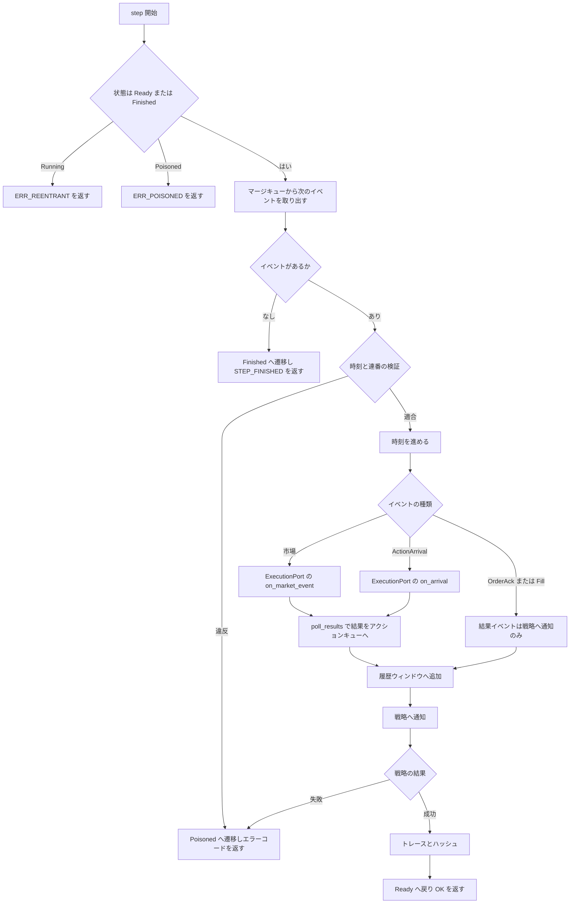
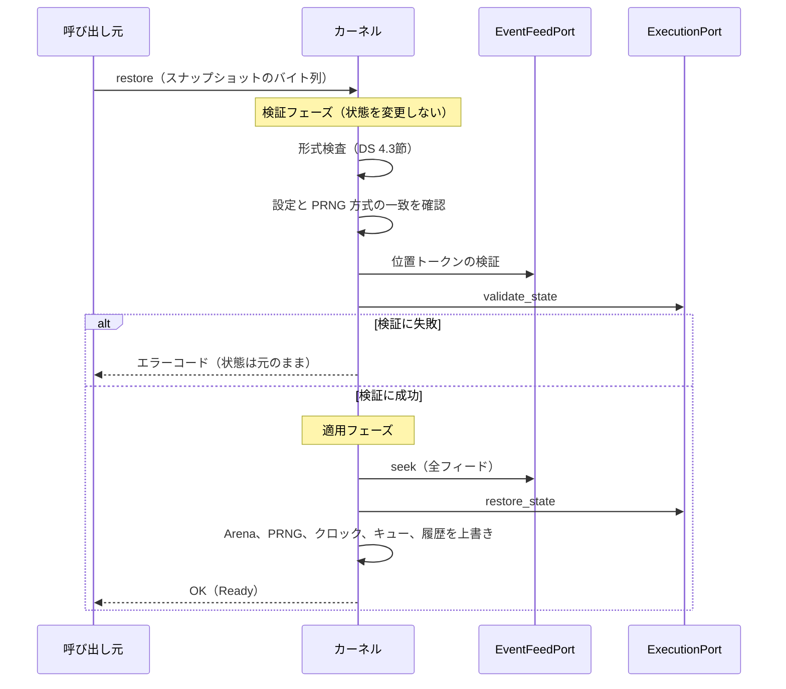

# 詳細設計書（カーネルコアの制御仕様）
**ハンドル操作、イベントループ、ポート契約、状態遷移、エラーコード**

---

## 1. 概要とSSOT境界

### 1.1 モジュールの目的

`core` クレートが公開する、カーネルのハンドル操作（作成、ステップ実行、連続実行、スナップショット、復元、破棄）と、4つのポート（`ClockPort`、`EventFeedPort`、`ExecutionPort`、`SnapshotPort`）の呼び出し契約を定義する。BD のコンポーネント C-001〜C-011 と C-015（戦略インターフェース）が対象である。

### 1.2 単一責任範囲 (SSOT) とデータ境界

- **本書の正本範囲**: `module_behavior`。関数の呼び出し順序、制御フロー、状態遷移の条件、エラーコードの値、ポートの呼び出し契約。
- **データ境界**: メモリ上のモジュール間の受け渡し（DTO）は本書を正本とする。保存形式（スナップショット、トレースログ、`EventHeader` のバイト配置）は EK-DS-001 を正本とする。
- **BDとの関係**: 構造、責務、横断方針は EK-BD-001 を正本とし、本書は機能単位へ具体化する。
- **外部公開契約**: `core-capi` の関数と型、Python の公開 API は、IF/API 仕様書（未作成）を正本とする。本書は `core` の安全な Rust API だけを定義し、公開範囲はすべて「内部」とする。
- **他文書へ委譲する情報**: 品質ゲートの実行条件と合格基準は EK-ENV-001、テストケースと実行結果はテスト計画・結果報告書（未作成）を正本とする。
- **責務の対象外**: C ABI の関数名とシグネチャ、Arrow 出力の形式、アダプタの内部実装（Parquet の読み込みなど）。
- **矛盾時の扱い**: 更新日ではなく、該当する `ssot_scope` の正本を更新して整合させる。

### 1.3 本書で確定する事項

BD 4.2節と DS 4.2節から引き継いだ事項に、次のとおり答える。

| 引き継ぎ事項                       | 決定                                                                                                                                 | 節           |
| :--------------------------------- | :----------------------------------------------------------------------------------------------------------------------------------- | :----------- |
| 同一の市場イベントでの処理順序     | `ExecutionPort` の約定判定を先に行い、その後に戦略へ通知する                                                                         | 3.1節        |
| システムストリームの ID と優先順位 | アクションキューの仮想ストリームは `0xFFFF_FF00`。同一時刻では、外部フィードの後に配送する                                           | 2.5節        |
| `sequence_id` の検証               | 外部ストリームごとに、`(timestamp_ns, sequence_id)` が厳密に増加することを検証する。違反は致命的                                     | 3.1節、4.1節 |
| `restore` の手順                   | 検証フェーズ（状態を変更しない）と適用フェーズに分ける。`Poisoned` からの `restore` を許可する                                       | 3.3節        |
| `capture` の拒否条件               | 3.2節の状態表と 4.1節                                                                                                                | 3.2節        |
| PRNG の方式（OPEN-03）             | Xoshiro256++。シードは SplitMix64 で展開する                                                                                         | 2.6節        |
| 復元後のペイロードの参照先         | `core` が、フィードからイベントを取得するときに、ペイロードを自分の領域へコピーする。復元後も、`core` は外部のペイロードを参照しない | 3.1節        |
| エラーコードの値                   | 4.1節                                                                                                                                | 4.1節        |

---

## 2. インターフェースと DTO (Data Transfer Object) 仕様

### 2.1 対象機能一覧

| 機能ID | 関数・機能名                        | 呼び出し元                     | 主な呼び出し先                                   | 同期 / 非同期 |                  冪等性                  | 外部副作用                      | 公開範囲 |
| :----- | :---------------------------------- | :----------------------------- | :----------------------------------------------- | :-----------: | :--------------------------------------: | :------------------------------ | :------: |
| F-001  | カーネルの作成（`create`）          | 境界層、ネイティブ戦略のホスト | `ClockPort`、`EventFeedPort`、`ExecutionPort`    |     同期      |                   なし                   | メモリの確保（この関数だけ）    |   内部   |
| F-002  | ステップ実行（`step`）              | 境界層、F-003                  | F-004、`EventFeedPort`、`ExecutionPort`、戦略    |     同期      |                   なし                   | トレースの出力（任意）          |   内部   |
| F-003  | 連続実行（`run`）                   | 境界層                         | F-002                                            |     同期      |                   なし                   | 同上                            |   内部   |
| F-004  | アクションの提出（`submit_action`） | 戦略（コールバック中のみ）     | アクションキュー                                 |     同期      |                   なし                   | なし                            |   内部   |
| F-005  | スナップショット作成（`capture`）   | 境界層                         | `SnapshotPort`、`EventFeedPort`、`ExecutionPort` |     同期      |   条件付き（同じ状態なら同じバイト列）   | `SnapshotPort` の実装による保存 |   内部   |
| F-006  | 復元（`restore`）                   | 境界層                         | `SnapshotPort`、`EventFeedPort`、`ExecutionPort` |     同期      | あり（同じスナップショットなら同じ状態） | ポートの状態の書き換え          |   内部   |
| F-007  | 破棄（`destroy`）                   | 境界層                         | なし                                             |     同期      |                   あり                   | メモリの解放                    |   内部   |
| F-008  | `EventFeedPort` の契約              | F-001、F-002、F-005、F-006     | アダプタ                                         |     同期      |                 条件付き                 | アダプタによる                  |   内部   |
| F-009  | `ExecutionPort` の契約              | F-002、F-004、F-005、F-006     | アダプタ                                         |     同期      |                   なし                   | アダプタによる                  |   内部   |
| F-010  | 戦略インターフェース（`Strategy`）  | F-002                          | ネイティブ戦略、Python 戦略（境界層経由）        |     同期      |                   なし                   | 戦略による                      |   内部   |

### 2.2 主要関数・機能の契約

#### 機能契約（F-001 `create`）

- **機能概要**: 設定を検証し、すべてのバッファを確保して、`Ready` 状態のハンドルを返す。確保は、この関数に限る（ADR-004）。
- **事前条件**: 設定が 2.3節の制約を満たす。登録する外部フィードの数が `stream_count` と一致する。
- **事後条件**: ハンドルは `Ready`。`processed_event_count` は0。論理時刻は、最初のイベントを取得するまで未設定（`i64` の最小値）。PRNG はシードで初期化済み。ホットパスで確保が起きない。
- **タイムアウト / キャンセル**: なし。
- **ログ・メトリクス**: なし。

#### 機能契約（F-002 `step`）

- **機能概要**: 次の1イベントを取り出し、因果律を検証し、時刻を進め、ポートと戦略へ配送する（3.1節）。
- **事前条件**: ハンドルが `Ready` または `Finished`。
- **事後条件**: 正常時は、1イベントを処理し、`processed_event_count` が1増える。次のイベントがない場合は、`Finished` に遷移し、状態を変えずに終了コード `STEP_FINISHED` を返す。エラー時は、4.1節に従う。
- **タイムアウト / キャンセル**: なし。ステップは、有限の処理で必ず終わる。
- **ログ・メトリクス**: `hash_interval` に達したとき、状態ハッシュ付きのトレースレコードを出力する（DS 2.5節）。

#### 機能契約（F-003 `run`）

- **機能概要**: `step` を、停止条件が成立するまで繰り返す。
- **事前条件**: F-002 と同じ。
- **事後条件**: 次のいずれかで終了する。終了コードで区別する。
  - `STEP_FINISHED`: 入力が尽きた。
  - `RUN_LIMIT_REACHED`: 指定したイベント数を処理した。
  - `RUN_SNAPSHOT_REQUESTED`: `SnapshotTrigger` フラグ付きのイベントを処理した。呼び出し側は `capture` を呼べる。
  - エラーコード: 最初のエラーで停止する。
- **タイムアウト / キャンセル**: 指定したイベント数が上限になる。

#### 機能契約（F-004 `submit_action`）

- **機能概要**: 戦略のコールバック中に、アクションを提出する。アクションは、`latency_ns` を加算した時刻の到達イベントとして、アクションキューに入る。
- **事前条件**: ハンドルが `Running`（戦略のコールバック中）。`latency_ns` が1以上。
- **事後条件**: アクションキューに `ActionArrival` イベントが1件増える。時刻は現在時刻 + `latency_ns`。約定価格は確定しない（要件定義書 FR-04-2）。
- **失敗時**: キューが満杯なら `ERR_QUEUE_FULL`（状態は変更しない、`Poisoned` にしない）。`latency_ns` が0以下なら `ERR_INVALID_ARGUMENT`（同上）。

#### 機能契約（F-005 `capture`）

- **機能概要**: 現在の状態を、DS 2.3節のセクション構成のバイト列にし、`SnapshotPort` へ渡す。
- **事前条件**: ハンドルが `Ready` または `Finished`。外部フィードがすべて `seekable`。`EXEC_STATE` と位置トークンが、宣言した最大長以内。
- **事後条件**: 同じ状態からは、常に同じバイト列が得られる。カーネルの状態は変化しない。
- **失敗時**: `Running` は `ERR_REENTRANT`。`Poisoned` は `ERR_POISONED`。`seekable` でないフィードがある場合と、最大長を超えた場合は `ERR_SNAPSHOT_UNSUPPORTED`。どの場合も、カーネルの状態を変更しない。
- **注記**: 最終状態のハッシュの計算（DS 2.5節）は、`seekable` でないフィードがあっても行える。これは `capture` とは別の操作（`state_digest`）で、保存を伴わない。

#### 機能契約（F-006 `restore`）

- **機能概要**: スナップショットから状態を復元する（3.3節）。
- **事前条件**: ハンドルが `Ready`、`Finished`、または `Poisoned`。
- **事後条件**: 成功時は、保存時点の状態と、外部ポートの位置と状態が戻り、ハンドルは `Ready`（`Poisoned` も解除）。
- **失敗時**: 検証フェーズの失敗は、状態を変更せず、ハンドルの状態も変えない。適用フェーズの失敗は、`Poisoned`（`ERR_PORT_FAILURE` など）。

#### 機能契約（F-007 `destroy`）

- **機能概要**: ハンドルのメモリを解放する。
- **事前条件**: ハンドルが `Running` ではない（`Ready`、`Finished`、`Poisoned`）。
- **事後条件**: ハンドルは無効になる。以後の操作は未定義で、境界層が使用後の操作を防ぐ。

### 2.3 入力 DTO スキーマ・パラメータ仕様

#### F-001: `KernelConfig`

| フィールド              | データ型 | 必須性 | NULL可 | デフォルト値 | バリデーションルール・入力制約                              |
| :---------------------- | :------- | :----: | :----: | :----------- | :---------------------------------------------------------- |
| `history_ring_len`      | `u32`    |  必須  |  不可  | なし         | 1以上                                                       |
| `arena_size`            | `u64`    |  必須  |  不可  | なし         | 8の倍数。`strategy_arena_offset + strategy_arena_size` 以上 |
| `strategy_arena_offset` | `u64`    |  必須  |  不可  | 0            | 8の倍数                                                     |
| `strategy_arena_size`   | `u64`    |  必須  |  不可  | 0            | 8の倍数                                                     |
| `action_queue_capacity` | `u32`    |  必須  |  不可  | なし         | 1以上                                                       |
| `payload_record_size`   | `u32`    |  必須  |  不可  | 64           | 8の倍数                                                     |
| `price_scale_exp`       | `i32`    |  必須  |  不可  | なし         | 0以下                                                       |
| `qty_scale_exp`         | `i32`    |  必須  |  不可  | なし         | 0以下                                                       |
| `prng_seed`             | `u64`    |  必須  |  不可  | なし         | 任意の値。SplitMix64 で状態を展開する（2.6節）              |
| `exec_state_max_bytes`  | `u32`    |  必須  |  不可  | なし         | 8の倍数                                                     |
| `feed_token_max_bytes`  | `u32`    |  必須  |  不可  | 4096         | 1以上                                                       |
| `hash_interval`         | `u64`    |  必須  |  不可  | 0            | 0はハッシュを計算しない                                     |
| `trace_enabled`         | `bool`   |  必須  |  不可  | false        | true の場合のみトレースを出力する                           |

- 外部フィードの登録順が、`stream_id` の添字になる。`stream_id` は `0` から `stream_count - 1` の連番である。
- `stream_count` は、登録したフィードの数から決まる。

#### F-004: `Action`

| フィールド    | データ型                  | 必須性 | NULL可 | デフォルト値 | バリデーションルール・入力制約                           |
| :------------ | :------------------------ | :----: | :----: | :----------- | :------------------------------------------------------- |
| `action_kind` | `u16`                     |  必須  |  不可  | なし         | 戦略と `ExecutionPort` の間で決める。`core` は解釈しない |
| `latency_ns`  | `i64`                     |  必須  |  不可  | なし         | 1以上                                                    |
| `payload`     | `u8[payload_record_size]` |  必須  |  不可  | 0            | `ExecutionPort` が解釈する                               |

#### F-002: `Strategy` へ渡す `Context`（読み取り専用）

| 項目             | 内容                                                                          |
| :--------------- | :---------------------------------------------------------------------------- |
| `now_ns`         | 現在の論理時刻                                                                |
| `history`        | 履歴ウィンドウの読み取り専用ビュー。現在時刻以下の確定済みイベントだけを含む  |
| `strategy_arena` | `StrategyArena` の書き込み可能ビュー。コールバック中のみ有効（ADR-003 5.1-7） |
| `rng`            | 決定論 PRNG への参照。戦略は、これ以外の乱数源を使わない                      |
| `submit_action`  | F-004 を呼ぶ手段                                                              |

### 2.4 出力 DTO スキーマ・戻り値仕様

#### 共通: 終了コード

すべての操作は、32ビットの符号付き整数の終了コードを返す。0以上は正常、負は失敗である。

|  値   | 名前                     | 意味                                               |
| :---: | :----------------------- | :------------------------------------------------- |
|   0   | `OK`                     | 正常終了                                           |
|   1   | `STEP_FINISHED`          | 入力が尽きた（正常）                               |
|   2   | `RUN_LIMIT_REACHED`      | 指定したイベント数を処理した（正常）               |
|   3   | `RUN_SNAPSHOT_REQUESTED` | `SnapshotTrigger` 付きのイベントを処理した（正常） |

#### F-002、F-003: `StepResult`

| フィールド              | データ型 | 必須性 | NULL可 | 正常時の意味・制約     |
| :---------------------- | :------- | :----: | :----: | :--------------------- |
| `status`                | `i32`    |  必須  |  不可  | 終了コード             |
| `processed_event_count` | `u64`    |  必須  |  不可  | 処理済みイベントの累計 |
| `now_ns`                | `i64`    |  必須  |  不可  | 現在の論理時刻         |

- **異常時の戻り値**: 4.1節のエラーコード。`StepResult` の `status` に入る。
- **再試行可否**: 致命的エラー（`Poisoned` になるもの）は、再試行しない。`restore` で復旧する。回復可能なエラーは、4.1節の列に従う。
- **相関ID・監査情報**: `processed_event_count` と、トレースレコード（DS 2.2節）。

### 2.5 イベント配送の順序とシステムストリーム

- 同一時刻のイベントは、`(timestamp_ns, stream_id, sequence_id)` の昇順で配送する（要件定義書 FR-01-3）。
- アクションキューの仮想ストリームの `stream_id` は、`0xFFFF_FF00` とする。外部フィードの `stream_id` より大きいので、同一時刻では、外部フィードのイベントの後に配送される。
- アクションキューのイベントの `sequence_id` は、`next_action_sequence_id`（DS の `CLOCK` セクション）から振る。投入のたびに1増える。
- 外部フィードは、`stream_id` の昇順で、同一時刻のイベントを配送する。
- **根拠**: 市場イベントを先に処理してから、そのイベントの時刻に生成された約定結果などを処理する。BD 2.3節の「同一の市場イベントでは、`ExecutionPort` の約定判定を、戦略への通知より先に行う」は、ステップの中の手順（3.1節の手順5）で保証する。

### 2.6 決定論 PRNG（OPEN-03 の決定）

- **方式**: Xoshiro256++。状態は32バイト（`u64` が4つ）。DS の `prng_algorithm` は1とする。
- **シードの展開**: 64ビットの `prng_seed` から、SplitMix64 を4回呼んで状態を作る。状態がすべて0になることは、この方法では起きない。
- **理由**: 128ビットの演算を必要とせず、実装が単純で速い。PCG64 は、128ビットの状態と乗算を必要とする。
- **使用者**: 戦略（`Context.rng` 経由）と、`ExecutionPort`（約定モデルのスリッページなど）。呼び出し順序が決定論的であれば、同じ結果になる。
- **スナップショット**: 状態の4つの `u64` を保存する。

### 2.7 ポートの呼び出し契約

#### `EventFeedPort`（F-008）

| 操作                  | 契約                                                                                                                                                                         |
| :-------------------- | :--------------------------------------------------------------------------------------------------------------------------------------------------------------------------- |
| `peek_next_timestamp` | 次のイベントの時刻を返す。イベントがなければ「なし」を返す。状態を変えない                                                                                                   |
| `pop_next`            | 次のイベントを取り出し、ヘッダとペイロードを、`core` が渡すバッファへコピーする。ペイロードを、`core` が後から参照することはない。`pop_next` の呼び出しごとに、位置が1つ進む |
| `position`            | 現在の読み取り位置を、不透明なトークンとして返す。位置を戻せない（`seekable` でない）データ源は、`seekable = false` を返す                                                   |
| `seek`                | 保存したトークンの位置へ戻す。**既存の状態を読まず、位置だけで状態を決める（全上書き）**                                                                                     |
| 不変条件              | `peek` した時刻より前のイベントを、後から返してはならない。同一ストリーム内で、`(timestamp_ns, sequence_id)` は厳密に増加する                                                |

#### `ExecutionPort`（F-009）

| 操作              | 呼び出されるとき                                 | 契約                                                                                                                           |
| :---------------- | :----------------------------------------------- | :----------------------------------------------------------------------------------------------------------------------------- |
| `on_arrival`      | `ActionArrival` イベントを配送するとき           | アクションを受け取り、内部状態を更新する。結果（`OrderAck`、`Fill`）を、結果バッファへ積んでよい                               |
| `on_market_event` | 市場イベントを配送するとき（戦略への通知より前） | 待機中のアクションの約定を判定する。判定には、現在時刻以下の確定済みの履歴（読み取り専用のビュー）だけを使う。結果を積んでよい |
| `poll_results`    | `on_arrival` と `on_market_event` の直後         | 積まれた結果を、決まった順序で返す。結果の時刻は、現在時刻以上でなければならない                                               |
| `capture_state`   | `capture` のとき                                 | 内部状態を、決定的な直列化（DS 2.3節）で返す。長さは `exec_state_max_bytes` 以下                                               |
| `restore_state`   | `restore` の適用フェーズ                         | 内部状態を、バイト列だけから全上書きする。既存の状態を読まない                                                                 |
| `validate_state`  | `restore` の検証フェーズ                         | バイト列が復元できるかを検査する。状態を変更しない                                                                             |

- 約定価格は、約定判定の時刻以前に確定した市場データだけから決める（要件定義書 FR-04-2）。
- 乱数が必要な場合は、`core` が渡す PRNG を使う。独自の乱数源を使わない。

---

## 3. 処理フロー・シーケンス・状態遷移ロジック (Mermaid 図)

### 3.1 ステップ実行のフロー（F-002）

- **図の正本**: 手順表（下の表）を正本とする。図は、手順の流れを示す。
- **対象機能ID**: F-002、F-004、F-009、F-010

#### 手順表（正本）

| 手順  | 処理                                                                                                                                                                                                                                                                                                | 失敗時                                                                            |
| :---: | :-------------------------------------------------------------------------------------------------------------------------------------------------------------------------------------------------------------------------------------------------------------------------------------------------- | :-------------------------------------------------------------------------------- |
|   1   | 状態を検査する（3.2節の表）                                                                                                                                                                                                                                                                         | `ERR_REENTRANT`、`ERR_POISONED`。状態を変更しない                                 |
|   2   | 外部フィードの先頭とアクションキューの先頭から、`(timestamp_ns, stream_id, sequence_id)` が最小のイベントを選ぶ。何もなければ `Finished` に遷移し、`STEP_FINISHED` を返す                                                                                                                           | なし                                                                              |
|   3   | **検証**: 外部フィードのイベントについて、同一ストリームの直前のイベントより `(timestamp_ns, sequence_id)` が大きいことを確認する。違反は `ERR_SEQUENCE_VIOLATION`。さらに、`timestamp_ns` が現在時刻より小さければ `ERR_CAUSALITY_VIOLATION`。どちらも、イベントを処理せずに `Poisoned` へ遷移する | `Poisoned`                                                                        |
|   4   | `ClockPort` を、イベントの時刻へ進める。選んだ外部フィードから、`pop_next` で次のイベントを取り込み、先頭を更新する（ペイロードをコピーする）                                                                                                                                                       | `ERR_PORT_FAILURE`。`Poisoned`                                                    |
|   5   | イベントの種類に応じて、`ExecutionPort` を呼ぶ。市場イベントは `on_market_event`、`ActionArrival` は `on_arrival`。`OrderAck` と `Fill` は呼ばない。呼び出しの直後に `poll_results` で結果を受け取り、アクションキューへ入れる                                                                      | 結果がキューに入らなければ `ERR_RESULT_OVERFLOW`。`Poisoned`                      |
|   6   | イベントを履歴ウィンドウへ追加する（満杯なら、最古を上書きする）                                                                                                                                                                                                                                    | なし                                                                              |
|   7   | 戦略へ、`Context` とイベントを渡して通知する。戦略は、このコールバック中に F-004 を呼べる。コールバックの終了時に、ビューを無効化する（`ViewGuard`）                                                                                                                                                | 戦略が失敗を返した場合は `ERR_STRATEGY_FAILURE`。`Poisoned`                       |
|   8   | `trace_enabled` なら、トレースレコードを出力する。`hash_interval` ごとに、状態ハッシュを計算して付ける                                                                                                                                                                                              | 出力の失敗は `ERR_PORT_FAILURE`（トレースの書き込み先がポートの場合）。`Poisoned` |
|   9   | `Ready` に戻り、`OK` を返す                                                                                                                                                                                                                                                                         | なし                                                                              |

- **ハンドルの状態**: 手順3〜8は、`Running` で実行する。手順3〜8の中でエラーが起きた場合は、`Poisoned` に遷移する。
- **ペイロードのコピー**: 手順4で、`core` が自分のレコード領域へコピーする。復元後に、`core` が外部のペイロードを参照することはない。コピーの性能への影響は、ベンチマーク（QG-008）で確認する。
- **戦略への通知**: `OrderAck` と `Fill` も、戦略へ通知する。戦略が必要としなければ、何もしない。

### 3.2 ハンドルの状態と操作

- **図の正本**: 状態遷移表（下の表）。BD 2.4節の図は概要で、条件の詳細は本表を正本とする。
- **初期状態**: `Ready`（`create` の成功後）。
- **終端状態**: `Destroyed`。
- **状態不変条件**: `Ready` と `Finished` では、カーネルの状態が一貫している。`Running` は、1つのステップの間だけ存在する。`Poisoned` では、状態の一貫性を保証しない。
- **未定義イベントの扱い**: 表にない操作は、`ERR_INVALID_ARGUMENT` で拒否し、状態を変更しない。

| 現在の状態 | 操作                                           | 結果                                           | 次の状態                                 | 備考                     |
| :--------- | :--------------------------------------------- | :--------------------------------------------- | :--------------------------------------- | :----------------------- |
| `Ready`    | `step`、`run`                                  | 正常                                           | `Ready`（入力が尽きたときは `Finished`） |                          |
| `Ready`    | `step`、`run`                                  | 致命的エラー                                   | `Poisoned`                               | 4.1節                    |
| `Ready`    | `capture`                                      | 成功または回復可能なエラー                     | `Ready`                                  | 状態は変化しない         |
| `Ready`    | `restore`                                      | 成功                                           | `Ready`                                  |                          |
| `Ready`    | `restore`                                      | 検証フェーズの失敗                             | `Ready`                                  | 状態を変更しない         |
| `Ready`    | `restore`                                      | 適用フェーズの失敗                             | `Poisoned`                               |                          |
| `Ready`    | `destroy`                                      | 成功                                           | `Destroyed`                              |                          |
| `Running`  | `step`、`run`、`capture`、`restore`、`destroy` | `ERR_REENTRANT`                                | `Running`                                | 再入の拒否               |
| `Running`  | `submit_action`                                | 成功、`ERR_QUEUE_FULL`、`ERR_INVALID_ARGUMENT` | `Running`                                | 戦略のコールバック中だけ |
| `Finished` | `step`、`run`                                  | `STEP_FINISHED`                                | `Finished`                               | 状態を変更しない         |
| `Finished` | `capture`                                      | 成功または回復可能なエラー                     | `Finished`                               |                          |
| `Finished` | `restore`                                      | 成功                                           | `Ready`                                  |                          |
| `Finished` | `restore`                                      | 適用フェーズの失敗                             | `Poisoned`                               |                          |
| `Finished` | `destroy`                                      | 成功                                           | `Destroyed`                              |                          |
| `Poisoned` | `step`、`run`、`capture`、`submit_action`      | `ERR_POISONED`                                 | `Poisoned`                               |                          |
| `Poisoned` | `restore`                                      | 成功                                           | `Ready`                                  | `Poisoned` を解除する    |
| `Poisoned` | `restore`                                      | 検証または適用フェーズの失敗                   | `Poisoned`                               |                          |
| `Poisoned` | `destroy`                                      | 成功                                           | `Destroyed`                              |                          |

- **`Poisoned` からの `restore` を許可する理由**: ADR-003 5.1-9 の許可条件を満たすためである。`restore` は、既存のカーネル状態（State Arena、PRNG、クロック、キュー）を読まず、スナップショットのバイト列で全領域を上書きする。外部ポートの `seek`、`restore_state` も、全上書きを契約としている（2.7節）。復元が最後まで成功した場合にだけ、`Poisoned` を解除する。

### 3.3 `restore` のシーケンス（F-006）

- **検証フェーズ**: 次をすべて確認し、1つでも失敗したら、状態を変更せずにエラーコードを返す。
  - DS 4.3節の形式検査。失敗は `ERR_SNAPSHOT_INVALID`。
  - `CONFIG` が、現在の設定と一致する（`history_ring_len`、`arena_size`、`strategy_arena_*`、`stream_count`、`action_queue_capacity`、`payload_record_size`、スケール、`exec_state_max_bytes`、`feed_token_max_bytes`）。`PRNG.algorithm` が現在の方式と一致する。失敗は `ERR_SNAPSHOT_MISMATCH`。
  - `FEED_STATES` の `stream_id` が、登録済みのフィードと一致し、各フィードが位置トークンを受け付けられる。`EXEC_STATE` を `validate_state` が受け付ける。失敗は `ERR_SNAPSHOT_MISMATCH`。
- **適用フェーズ**: すべてのセクションを書き込み、外部ポートへ位置と状態を戻す。途中で失敗した場合は、ロールバックできないので、`Poisoned` へ遷移し、`ERR_PORT_FAILURE` を返す。
- **復元後のイベントのペイロード**: スナップショットのレコードは、ペイロードを含む。`core` は、復元したレコードを、そのまま自分の領域に置く。

---

## 4. エラー処理・失敗契約

### 4.1 エラー分類と対処方針

| エラーコード               |  値   | カテゴリ | 発生・判定基準                                                                              | 再試行安全条件                 | 終端ステータス       | 利用者・運用者対応                                         | 副作用・データ保持契約                     |
| :------------------------- | :---: | :------- | :------------------------------------------------------------------------------------------ | :----------------------------- | :------------------- | :--------------------------------------------------------- | :----------------------------------------- |
| `ERR_INVALID_ARGUMENT`     |  -1   | 回復可能 | 引数が制約を満たさない。表にない操作                                                        | 引数を直せば安全               | 変化なし             | 引数を直す                                                 | 状態を変更しない                           |
| `ERR_CAPACITY_EXCEEDED`    |  -2   | 初期化時 | 設定が容量の上限を超える。登録ストリーム数が上限を超える                                    | 設定を直せば安全               | ハンドルは作られない | 設定を直す                                                 | 確保したメモリを解放する                   |
| `ERR_QUEUE_FULL`           |  -3   | 回復可能 | `submit_action` で、アクションキューが満杯                                                  | 空きができれば安全             | 変化なし             | 戦略が発注を見送る、または中断する                         | 状態を変更しない                           |
| `ERR_CAUSALITY_VIOLATION`  |  -4   | 致命的   | イベントの時刻が現在時刻より小さい                                                          | 再試行しない                   | `Poisoned`           | 入力データを直す。必要なら、アダプタ層でフィルタリングする | イベントを処理しない。`restore` で復旧する |
| `ERR_SEQUENCE_VIOLATION`   |  -5   | 致命的   | 同一ストリームの `(timestamp_ns, sequence_id)` が増加しない                                 | 再試行しない                   | `Poisoned`           | 入力データを直す                                           | 同上                                       |
| `ERR_POISONED`             |  -6   | 拒否     | `Poisoned` のハンドルへの操作                                                               | `restore` の後は安全           | 変化なし             | `restore` または `destroy`                                 | 状態を変更しない                           |
| `ERR_REENTRANT`            |  -7   | 拒否     | `Running` 中の禁止操作                                                                      | コールバックの外では安全       | 変化なし             | コールバック内から禁止操作を呼ばない                       | 状態を変更しない                           |
| `ERR_SNAPSHOT_UNSUPPORTED` |  -8   | 回復可能 | `capture` で、位置を戻せないフィードがある。`EXEC_STATE` または位置トークンが最大長を超える | 条件を満たせば安全             | 変化なし             | 設定を直す、または別のデータ源を使う                       | 状態を変更しない                           |
| `ERR_SNAPSHOT_INVALID`     |  -9   | 回復可能 | `restore` の形式検査に失敗                                                                  | 正しいスナップショットなら安全 | 変化なし             | 別のスナップショットを使う                                 | 状態を変更しない                           |
| `ERR_SNAPSHOT_MISMATCH`    |  -10  | 回復可能 | `restore` の設定または外部ポートの検証に失敗                                                | 設定を合わせれば安全           | 変化なし             | 設定を合わせる                                             | 状態を変更しない                           |
| `ERR_PORT_FAILURE`         |  -11  | 致命的   | ポートの操作が失敗した（`pop_next`、`seek` など）                                           | `restore` の後は安全           | `Poisoned`           | アダプタの原因を調べる                                     | 途中の状態は保証しない                     |
| `ERR_RESULT_OVERFLOW`      |  -12  | 致命的   | `ExecutionPort` の結果が、アクションキューに入らない                                        | 再試行しない                   | `Poisoned`           | `action_queue_capacity` を増やす                           | 同上                                       |
| `ERR_STRATEGY_FAILURE`     |  -13  | 致命的   | 戦略がエラーを返した。Python 戦略の例外を含む                                               | 再試行しない                   | `Poisoned`           | 戦略を直す                                                 | 同上                                       |
| `ERR_PANIC`                |  -99  | 致命的   | 境界層がパニックを捕捉した（ADR-003 5.1-4）                                                 | `restore` の後は安全           | `Poisoned`           | 不具合として報告する                                       | 同上                                       |

- **再試行上限**: 致命的エラーは、再試行しない。`core` は、内部でリトライを持たない（BD 3.2節）。
- **未確定**: `ExecutionPort` の結果が、キューの空きを使い切らないようにする予約方式（`action_queue_capacity` のうち、結果用に確保する量）は、決まっていない（5.3節）。現在は、溢れた場合を致命的エラー `ERR_RESULT_OVERFLOW` とする。

---

## 5. 機能テスト要件

### 5.1 機能テスト要件一覧

| 要件ID | 対象機能ID   | 保証すべき振る舞い・条件                                                                                                                                         | 検証観点         | 対応テストケース       |
| :----- | :----------- | :--------------------------------------------------------------------------------------------------------------------------------------------------------------- | :--------------- | :--------------------- |
| TR-001 | F-001        | 設定が制約を満たさない場合に、`ERR_INVALID_ARGUMENT` または `ERR_CAPACITY_EXCEEDED` を返し、ハンドルを作らない。成功時は `Ready` で、`processed_event_count` が0 | 正常、境界、異常 | テスト計画で割り当てる |
| TR-002 | F-001、F-002 | `create` の完了後、`step` と `run` の間は、ヒープの確保も解放も起きない（AC-05）                                                                                 | 正常             | 同上                   |
| TR-003 | F-002        | 同一時刻のイベントが、`(timestamp_ns, stream_id, sequence_id)` の昇順で配送される。システムストリームのイベントは、外部フィードの後（AC-02）                     | 正常、境界       | 同上                   |
| TR-004 | F-002        | 時刻が逆行するイベントを入力すると、イベントを処理せず `ERR_CAUSALITY_VIOLATION` を返し、`Poisoned` になる（AC-01）                                              | 異常             | 同上                   |
| TR-005 | F-002        | 同一ストリームで `(timestamp_ns, sequence_id)` が増加しない入力に、`ERR_SEQUENCE_VIOLATION` を返し、`Poisoned` になる                                            | 異常             | 同上                   |
| TR-006 | F-002、F-009 | 市場イベントの処理で、`ExecutionPort` の約定判定が、戦略への通知より先に行われる                                                                                 | 正常             | 同上                   |
| TR-007 | F-004、F-009 | アクションの結果が、提出時刻より後の時刻にだけ現れる。`latency_ns` が0以下なら `ERR_INVALID_ARGUMENT`（AC-02）                                                   | 正常、境界、異常 | 同上                   |
| TR-008 | F-004        | キューが満杯のとき `ERR_QUEUE_FULL` を返し、状態ハッシュが変化せず、`Poisoned` にならない（AC-08）                                                               | 境界             | 同上                   |
| TR-009 | F-002        | 戦略がエラーを返すと、`ERR_STRATEGY_FAILURE` を返し、`Poisoned` になる                                                                                           | 異常             | 同上                   |
| TR-010 | F-005、F-006 | `capture` の後に、パラメータを変えて実行し、`restore` して同じ条件で再実行すると、結果が元の実行とビット単位で一致する（AC-03）。`HISTORY_RING` を含む           | 正常             | 同上                   |
| TR-011 | F-005        | 位置を戻せないフィード、または最大長を超える状態があると、`ERR_SNAPSHOT_UNSUPPORTED` を返し、状態を変更しない                                                    | 異常             | 同上                   |
| TR-012 | F-006        | 検証フェーズの失敗（形式、設定の不一致）で、状態もハンドルの状態も変わらない。適用フェーズの失敗で `Poisoned` になる                                             | 異常             | 同上                   |
| TR-013 | F-006        | `Poisoned` のハンドルに `restore` が成功すると、`Ready` に戻り、以後の `step` の結果が、`restore` 元の状態から実行した場合と一致する                             | 正常             | 同上                   |
| TR-014 | F-002        | `Running` 中（戦略のコールバック内）に `step`、`run`、`capture`、`restore`、`destroy` を呼ぶと `ERR_REENTRANT` を返し、状態を変更しない                          | 異常             | 同上                   |
| TR-015 | F-003        | `run` が、入力の終端、指定イベント数、`SnapshotTrigger` で止まり、それぞれ異なる終了コードを返す                                                                 | 正常、境界       | 同上                   |
| TR-016 | F-002、F-005 | 同じ入力、同じシード、同じ設定で、全セクションの SHA-256 とトレースログのハッシュが一致する（AC-04、AC-07）                                                      | 正常             | 同上                   |
| TR-017 | F-001、F-002 | PRNG が、同じシードから同じ系列を出し、状態が `CLOCK` と並んで保存、復元される（FR-05-1）                                                                        | 正常             | 同上                   |

### 5.2 適用する品質ゲート

- **品質ゲートの正本**: [EK-ENV-001 環境・開発基盤仕様書](../setup/EK-ENV-001_環境・開発基盤仕様書.md)
- **適用するゲートID**: QG-001〜QG-006、QG-014（`core/` を変更する PR）。QG-007、QG-012、QG-013 は、境界層の変更に適用する。QG-008、QG-009 は、定期実行に適用する。
- 本機能だけに必要な条件が出た場合は、環境・開発基盤仕様書へゲートを追加してから参照する。

### 5.3 未確定事項

| 項目                                  | 内容                                                                                                                      | 決める場所             |
| :------------------------------------ | :------------------------------------------------------------------------------------------------------------------------ | :--------------------- |
| 結果用の予約                          | `ExecutionPort` の結果が、アクションキューの空きを使い切る場合の予約方式                                                  | 本書の次の版           |
| 戦略の通知の対象                      | `OrderAck` と `Fill` を、すべての戦略へ通知するか、購読する種類を選べるようにするか                                       | 本書の次の版           |
| ペイロードのコピーの性能              | 手順4のコピーが NFR-03 に与える影響                                                                                       | ベンチマーク（QG-008） |
| 入力の `payload_idx`                  | フィードのペイロードの参照方式。`pop_next` がコピーするため、`core` は `payload_idx` を使わない。アダプタが使う場合の規約 | IF/API 仕様書          |
| 状態ハッシュのアルゴリズム（OPEN-05） | ステップごとのハッシュの方式（候補は XXH3-64）。ベンチマークで決める                                                      | ベンチマーク           |
| `state_digest` の定義                 | 保存を伴わない最終状態ハッシュの操作の詳細                                                                                | IF/API 仕様書          |

---

## 6. 作成完了チェック

- [x] `document_role`、`ssot_scope`、`status`、`owner` を Frontmatter へ設定した。
- [x] 対象機能一覧の ID と、契約、DTO、状態遷移、機能テスト要件の ID が対応している。
- [x] 呼び出し元、呼び出し先、同期方式、冪等性、外部副作用、公開範囲を記入した。
- [x] 外部公開する機能がない（すべて内部）ことを明記した。
- [x] 事前条件、事後条件、タイムアウト、キャンセル、ログを記入した。
- [x] 入力・出力 DTO の必須性、NULL可否、制約、異常時の形式を記入した。
- [x] 初期状態、終端状態、未定義イベント、状態不変条件を記入した。
- [x] エラーコード、再試行安全条件、利用者・運用者対応、データ保持契約を記入した。
- [x] 機能テスト要件ごとに、検証観点を記入した。
- [ ] 機能テスト要件ごとに、テスト計画・結果報告書の対応ケース ID を記入した（テスト計画は未作成）。
- [x] 品質ゲートは、環境・開発基盤仕様書のゲート ID を参照し、実行コマンドと合格基準を再掲していない。
- [x] Mermaid のサンプルの状態名、エラー名、閾値と、未置換の `[ ... ]` が残っていない。

---

## 7. 改訂履歴 (Change Log)

| 版数    | 改訂日     | 変更者 | 変更内容・変更理由 (Why)                                                                                                                              |
| :------ | :--------- | :----- | :---------------------------------------------------------------------------------------------------------------------------------------------------- |
| Rev.0.1 | 2026-11-25 | xzyozi | 初版ドラフト。BD 4.2節と DS 4.2節の引き継ぎ事項（処理順序、`restore` の手順、エラーコード、PRNG、`sequence_id` の検証、システムストリーム）に答えた。 |
