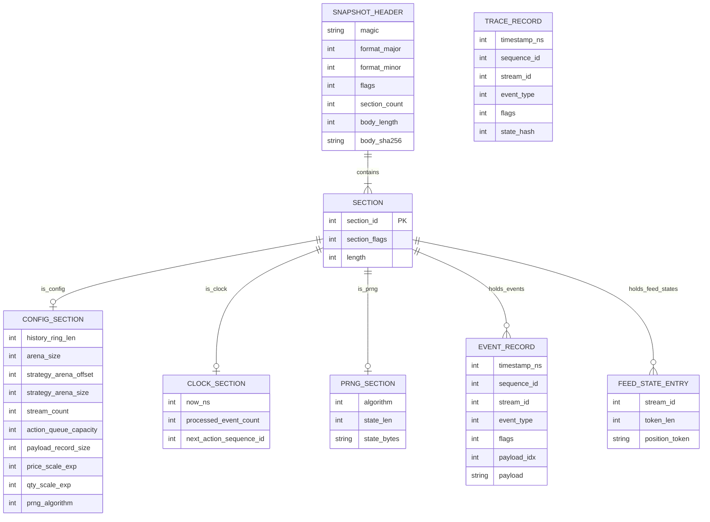

# データ構造仕様書（イベントヘッダ・スナップショット・トレースログ）
**決定論的リプレイのための、保存形式と状態ハッシュの定義**

詳細設計書（DD）は未作成のため、本書から DD へのリンクは張っていない。DD の作成後に追加する。

---

## 1. 概要とデータ管理方針

### 1.1 管理対象データの目的

- **管理対象**:
  - イベントヘッダ（`EventHeader`）とペイロードの保存形式
  - スナップショット（チェックポイント）のバイナリ形式
  - トレースログのレコード形式
  - 状態ハッシュの対象範囲
- **データ形式・文字コード・改行**: バイナリ形式。整数はすべて固定幅で、リトルエンディアンとする。テキストを含まない。
- **時刻の基準**: 論理タイムスタンプ（`int64`、Unix Epoch ナノ秒）のみを使う。スナップショットとトレースログに、実時間（OS時刻）やホスト名を保存しない（NFR-01、要件定義書 FR-01-1）。
- **スキーマの正本形式**: 本書のフィールド表。
- **機密性・個人情報分類**: 機密情報と個人情報を保存しない。ファイルパスは、保存形式に含めない。

### 1.2 データ境界

- **本書の正本範囲**: `persistent_data`。保存されるデータの形式、および永続化の契約。
- **DTOとの使い分け**: 関数の引数や戻り値など、メモリ上の受け渡しは詳細設計書（DD）を正本とする。ただし、`EventHeader` は、メモリ上とスナップショット内で同じ配置を使うため、本書を正本とする。
- **DDとの関係**: ハンドルの状態遷移、`restore` の手順、エラーコードの値は DD を正本とする。本書は、保存形式と検証の契約だけを定義する。
- **IF/API仕様との境界**: Arrow による結果出力の形式（約定履歴、資産推移、状態遷移ログ）は IF/API 仕様書を正本とする。
- **責務の対象外**: 入力データ（Parquet、CSV）の形式。入力はアダプタ層の責務である。
- **矛盾時の扱い**: 更新日ではなく、`ssot_scope` の正本を更新して整合させる。

### 1.3 ファイル配置および階層構造

| データ種別       | 相対パス / 命名規則                                        | 保持内容                                     | 所有者・アクセス権                     | 保持・バックアップ・復旧                                                                           |
| :--------------- | :--------------------------------------------------------- | :------------------------------------------- | :------------------------------------- | :------------------------------------------------------------------------------------------------- |
| スナップショット | `<保存先>/<run_id>_<logical_time_ns>_<event_count>.eksnap` | 1時点の完全な状態                            | 実行したプロセスのユーザー。読み書き可 | 保持期間はホスト層が決める。作成後は不変で、上書きしない。破損時は別のスナップショットから復旧する |
| トレースログ     | `<保存先>/<run_id>.ektrace`                                | ステップごとのトレースレコード（任意で保存） | 同上                                   | 同上                                                                                               |

- `<保存先>` は、`SnapshotPort` のディスク実装が設定で受け取る。メモリ実装はファイルを作らず、同じバイト列をメモリ上に保持する。
- `run_id` は、ホスト層が与える識別子（英数字、`_`、`-`）である。実時間から生成しない。

---

## 2. データ構造およびスキーマ定義

### 2.1 エンティティ関係・データモデル構造

- `TRACE_RECORD` は、スナップショットとは独立したトレースログのレコードである。ほかのエンティティとの関係を持たない。
- State Arena、`EXEC_STATE`（`ExecutionPort` の内部状態）は、内部構造を持たない不透明なバイト列である。エンティティとしては定義せず、2.3節で扱う。
- `EVENT_RECORD` は、`MERGE_HEADS`、`ACTION_QUEUE`、`HISTORY_RING` の3つのセクションで使う（2.3節）。

### 2.2 データモデル・フィールド仕様

**共通規則**: 整数はリトルエンディアンの固定幅（`u8`、`u16`、`u32`、`u64`、`i32`、`i64`）。予約領域は0で書き込み、読み込み時は0以外を拒否する。

#### EventHeader（32バイト、`EVENT_RECORD` の先頭）

| フィールド     | オフセット | データ型 | 必須性 | NULL可 | 許容値・制約                                                                        | 互換性・移行メモ         |
| :------------- | :--------: | :------- | :----: | :----: | :---------------------------------------------------------------------------------- | :----------------------- |
| `timestamp_ns` |     0      | `i64`    |  必須  |  不可  | 論理発生時刻（ナノ秒）。単調非減少の検証対象（要件定義書 FR-01-2）                  | 変更は主版数を上げる     |
| `sequence_id`  |     8      | `u64`    |  必須  |  不可  | 同一ストリーム内の連番。同一時刻のイベントの順序付けに使う（FR-01-3）               | 同上                     |
| `stream_id`    |     16     | `u32`    |  必須  |  不可  | データソース識別子。`0xFFFF_FFFF` はアクションキューの仮想ストリーム（予約）        | 同上                     |
| `event_type`   |     20     | `u16`    |  必須  |  不可  | 2.4節の表                                                                           | 値の追加は副版数を上げる |
| `flags`        |     22     | `u16`    |  必須  |  不可  | bit0 `SnapshotTrigger`、bit1 `EndOfStream`。ほかのビットは0                         | 同上                     |
| `payload_idx`  |     24     | `u64`    |  必須  |  不可  | フィードのペイロード配列内の添字。フィード固有の値で、スナップショット内では0を書く | 同上                     |

- 構造体のサイズは32バイト、アラインメントは8バイトとする。フィールドの間にパディングはない。
- 並びの順序（`timestamp_ns`、`sequence_id`、`stream_id`）が、同一時刻のイベントの処理順の比較キーである。比較は `(timestamp_ns, stream_id, sequence_id)` の昇順とする（要件定義書 AC-02）。

#### ペイロード

- ペイロードは、`event_type` ごとの固定長レコードとして保持する。レコード長は、`CONFIG_SECTION.payload_record_size`（既定は64バイト）で固定する。
- 価格と数量は、`i64` の固定小数点数で表す。小数点の位置は `price_scale_exp` と `qty_scale_exp`（10 の負のべき乗の指数）で決める（NFR-04）。
- `event_type` ごとのフィールドの配置（`Tick` の価格と数量など）は、本書の初版では定義しない。未確定事項として 6.1節に記録する。

#### SNAPSHOT_HEADER（64バイト、ファイルの先頭）

| フィールド      | オフセット | データ型 | 必須性 | 許容値・制約                   | 互換性・移行メモ                                     |
| :-------------- | :--------: | :------- | :----: | :----------------------------- | :--------------------------------------------------- |
| `magic`         |     0      | `u8[4]`  |  必須  | ASCII の `EKSN`                | 固定                                                 |
| `format_major`  |     4      | `u16`    |  必須  | 現在は1                        | 主版数が違う場合は読み込みを拒否する                 |
| `format_minor`  |     6      | `u16`    |  必須  | 現在は0                        | 新しい副版数は、必須でないセクションを無視して読める |
| `flags`         |     8      | `u32`    |  必須  | 現在は0                        | 予約                                                 |
| `section_count` |     12     | `u32`    |  必須  | 現在は9                        |                                                      |
| `body_length`   |     16     | `u64`    |  必須  | 本体（全セクション）のバイト数 |                                                      |
| `body_sha256`   |     24     | `u8[32]` |  必須  | 本体の SHA-256                 | 整合性の検査に使う                                   |
| `reserved`      |     56     | `u8[8]`  |  必須  | 0                              |                                                      |

#### SECTION（セクションヘッダ、12バイト）

| フィールド      | オフセット | データ型 | 必須性 | 許容値・制約                     | 互換性・移行メモ                                                                |
| :-------------- | :--------: | :------- | :----: | :------------------------------- | :------------------------------------------------------------------------------ |
| `section_id`    |     0      | `u16`    |  必須  | 2.3節の表                        | 未知の ID は、`required` ビットが立っていれば拒否し、立っていなければ読み飛ばす |
| `section_flags` |     2      | `u16`    |  必須  | bit0 `required`。ほかのビットは0 |                                                                                 |
| `length`        |     4      | `u64`    |  必須  | 続くセクション本体のバイト数     |                                                                                 |

#### CONFIG_SECTION

| フィールド              | データ型 | 許容値・制約                                           | 互換性・移行メモ           |
| :---------------------- | :------- | :----------------------------------------------------- | :------------------------- |
| `history_ring_len`      | `u32`    | 1以上。履歴リングバッファの要素数                      | 復元先の設定と一致すること |
| `arena_size`            | `u64`    | State Arena 全体のバイト数                             | 同上                       |
| `strategy_arena_offset` | `u64`    | `arena_size` 未満                                      | 同上                       |
| `strategy_arena_size`   | `u64`    | `strategy_arena_offset` と合わせて `arena_size` 以下   | 同上                       |
| `stream_count`          | `u32`    | 外部フィードの数。仮想ストリームを含まない             | 同上                       |
| `action_queue_capacity` | `u32`    | 1以上                                                  | 同上                       |
| `payload_record_size`   | `u32`    | 既定64                                                 | 同上                       |
| `price_scale_exp`       | `i32`    | 価格の小数点の位置（0以下）                            | 同上                       |
| `qty_scale_exp`         | `i32`    | 数量の小数点の位置（0以下）                            | 同上                       |
| `prng_algorithm`        | `u16`    | 1: Xoshiro256、2: PCG64（OPEN-03 の確定後に1つにする） | 同上                       |

#### CLOCK_SECTION

| フィールド                | データ型 | 許容値・制約                                             |
| :------------------------ | :------- | :------------------------------------------------------- |
| `now_ns`                  | `i64`    | 現在の論理時刻                                           |
| `processed_event_count`   | `u64`    | 処理済みイベント数                                       |
| `next_action_sequence_id` | `u64`    | アクションキューの仮想ストリームに次に振る `sequence_id` |

#### PRNG_SECTION

| フィールド    | データ型        | 許容値・制約                                                |
| :------------ | :-------------- | :---------------------------------------------------------- |
| `algorithm`   | `u16`           | `prng_algorithm` と一致すること                             |
| `state_len`   | `u16`           | アルゴリズムの状態のバイト数（Xoshiro256 は32、PCG64 は32） |
| `state_bytes` | `u8[state_len]` | 状態そのもの                                                |

#### FEED_STATE_ENTRY

| フィールド       | データ型        | 許容値・制約                                                              |
| :--------------- | :-------------- | :------------------------------------------------------------------------ |
| `stream_id`      | `u32`           | 登録済みの外部フィードの ID                                               |
| `token_len`      | `u32`           | 0以上4096以下                                                             |
| `position_token` | `u8[token_len]` | `EventFeedPort` が定義する不透明な読み取り位置。`core` は中身を解釈しない |

#### TRACE_RECORD（32バイト）

| フィールド     | オフセット | データ型 | 許容値・制約                                 |
| :------------- | :--------: | :------- | :------------------------------------------- |
| `timestamp_ns` |     0      | `i64`    | 処理した入力イベントの時刻                   |
| `sequence_id`  |     8      | `u64`    | 処理した入力イベントの `sequence_id`         |
| `stream_id`    |     16     | `u32`    | 処理した入力イベントの `stream_id`           |
| `event_type`   |     20     | `u16`    | 処理した入力イベントの `event_type`          |
| `flags`        |     22     | `u16`    | 処理した入力イベントの `flags`               |
| `state_hash`   |     24     | `u64`    | 状態ハッシュ（2.5節）。計算しないステップは0 |

### 2.3 スナップショットのセクション構成

セクションは、`section_id` の昇順に、各1回だけ並べる。同じ状態からは、常に同じバイト列が得られる。

| `section_id` | 名前           | `required` | 内容                                                                                                                                                     |
| :----------: | :------------- | :--------: | :------------------------------------------------------------------------------------------------------------------------------------------------------- |
|      1       | `CONFIG`       |    必須    | `CONFIG_SECTION`                                                                                                                                         |
|      2       | `CLOCK`        |    必須    | `CLOCK_SECTION`                                                                                                                                          |
|      3       | `PRNG`         |    必須    | `PRNG_SECTION`                                                                                                                                           |
|      4       | `STATE_ARENA`  |    必須    | State Arena（`StrategyArena` を含む）のバイト列。`arena_size` バイト。内部の意味は戦略が決める不透明なデータ                                             |
|      5       | `MERGE_HEADS`  |    必須    | 外部フィードごとの先頭イベント。`stream_count` 個を添字順に並べる。各要素は、存在フラグ（`u8`）と、存在する場合の `EVENT_RECORD`（ペイロードを埋め込む） |
|      6       | `ACTION_QUEUE` |    必須    | 要素数（`u32`）と、`(timestamp_ns, sequence_id)` の昇順に並べた `EVENT_RECORD`（ペイロードを埋め込む）                                                   |
|      7       | `HISTORY_RING` |    必須    | 要素数（`u32`）と、最古から最新の順に並べた `EVENT_RECORD`。リングバッファの回転位置は保存しない。復元時は先頭から詰める                                 |
|      8       | `FEED_STATES`  |    必須    | 要素数（`u32`）と、`stream_id` の昇順に並べた `FEED_STATE_ENTRY`                                                                                         |
|      9       | `EXEC_STATE`   |    必須    | 長さ（`u64`）と、`ExecutionPort` が定義する不透明なバイト列                                                                                              |

- **ヒープの配置は保存しない。** マージキューの内部配列の並びは、保存しない。先頭イベントだけを添字順に保存し、復元時に決定論的に組み立て直す。
- **ペイロードは埋め込む。** `MERGE_HEADS` と `ACTION_QUEUE` のイベントは、ペイロード（`payload_record_size` バイト）を直後に埋め込む。`payload_idx` はフィード固有の値なので、0 を書く。復元後のペイロードの参照先は DD で定義する。
- **保存を拒否する状態。** `Poisoned` のハンドルと、`Running` 中のハンドルからは、スナップショットを作らない（BD 2.4節）。位置を取得できない外部フィードがある場合も、作らない。

### 2.4 イベント種別とフラグ

| `event_type` | 名前            | 区分     | 備考                                 |
| :----------: | :-------------- | :------- | :----------------------------------- |
|      1       | `Tick`          | 市場     | 価格ティック                         |
|      2       | `Bar`           | 市場     | バー（OHLC）                         |
|      3       | `BookUpdate`    | 市場     | 板情報                               |
|      4       | `Indicator`     | 市場     | 指標データ                           |
|      5       | `Timer`         | 市場     | タイマーイベント                     |
|      16      | `ActionArrival` | システム | アクションの到達イベント（BD 2.3節） |
|      17      | `OrderAck`      | システム | 注文の受付応答                       |
|      18      | `Fill`          | システム | 約定結果                             |

- 1〜15 は市場イベント、16〜31 はシステムイベントに予約する。32 以上は将来用とする。
- 未知の `event_type` は、読み込み時に拒否する。

### 2.5 状態ハッシュの対象範囲

状態ハッシュは、2段階で使う。

| 用途                                                        | 対象                                                                                                                                               | アルゴリズム                                        | 計算の頻度                                                    |
| :---------------------------------------------------------- | :------------------------------------------------------------------------------------------------------------------------------------------------- | :-------------------------------------------------- | :------------------------------------------------------------ |
| ステップごとのトレース（`TRACE_RECORD.state_hash`、NFR-05） | `CLOCK`、`PRNG`、`STATE_ARENA`、`MERGE_HEADS`、`ACTION_QUEUE` のバイト列。`payload_idx` は除く。`HISTORY_RING`、`FEED_STATES`、`EXEC_STATE` は除く | 64ビットの非暗号ハッシュ（候補は XXH3-64。OPEN-05） | 設定したイベント数ごと（標準測定条件では10,000イベントに1回） |
| 最終状態と分岐リプレイの比較（AC-03、AC-04、AC-07）         | スナップショット全体（全セクション）                                                                                                               | SHA-256                                             | 実行の終了時。ホットパスの外                                  |

- ステップごとのハッシュは、変化の検知が目的で、改ざんへの耐性を必要としない。ホットパスの負荷を抑えるため、非暗号ハッシュにする。
- `HISTORY_RING` は、処理済みのイベントとリングバッファの長さから決まる。ステップごとのハッシュには含めない。最終状態の比較では、全セクションの SHA-256 に含まれる。

---

## 3. 永続化・原子置換契約・排他制御

### 3.1 原子的書き込み契約（スナップショットとトレースログのディスク実装）

1. **一時ファイル生成**: 保存先と同じディレクトリに、正式なファイル名の先頭に `.` を、末尾に `.tmp` を付けた名前（例: `.<run_id>_<logical_time_ns>_<event_count>.eksnap.tmp`）の一時ファイルを、既存ファイルを上書きしない作成モード（排他的な新規作成）で作る。全量を書き出す。一時ファイルの名前に、実時間と乱数を使わない。
2. **物理書き込み保証**: 一時ファイルをディスクに同期する。同期に失敗した場合は、一時ファイルを削除し、`capture` を失敗させる。
3. **原子的置換**: 一時ファイルを正式なファイル名にリネームする。同じ名前のファイルが既にある場合は、置換せず失敗させる（スナップショットは不変）。失敗時は、一時ファイルを削除する。既存のスナップショットには触れない。
4. **一時ファイル清掃**: 起動時に、保存先の `.tmp` ファイルを検出して削除する。
5. **復旧確認**: 読み込み時に、`magic`、`format_major`、`body_length`、`body_sha256` を検査する。1つでも違う場合は、読み込みを拒否する。

- **メモリ実装**: ファイルを作らない。バイト列を作り終えてから、保持領域に差し替える。作成中に失敗した場合は、保持領域を変更しない。
- **トレースログ**: 追記専用のファイルとし、32バイトのレコード単位で書く。ファイルの長さが32の倍数でない場合は、末尾の端数を破棄して読み込む。

### 3.2 排他制御仕様

- **ファイルロックは使用しない。** スナップショットは作成後に不変で、名前に `run_id`、`logical_time_ns`、`event_count` を含む。複数のインスタンスが別の `run_id` で書き込む限り、名前は衝突しない。
- **名前が衝突した場合**: 3.1節の手順3で、排他的な新規作成またはリネームが失敗する。後から書こうとしたほうが失敗する。
- **同一 `run_id` の同時実行**: ホスト層の責務で禁止する。違反した場合は、上の衝突として検知される。
- **stale lock**: ロックを使わないため、存在しない。

---

## 4. データライフサイクルと互換性保全

### 4.1 フォーマット移行と互換性ルール

| 移行元バージョン | 移行先バージョン | 実行契機 | 変換内容・保持する旧フィールド | ロールバック可否・方法 | 失敗時の扱い |
| :--------------- | :--------------- | :------- | :----------------------------- | :--------------------- | :----------- |
| なし（初版 1.0） | なし             | なし     | なし                           | なし                   | なし         |

- **旧バージョン互換**: `format_major` が違うスナップショットは、読み込みを拒否する。変換はしない。
- **後方互換性維持**: 副版数の追加は、必須でないセクションの追加と、`event_type` の値の追加に限る。読み込み側は、`required` が立っていない未知のセクションを読み飛ばす。

### 4.2 `restore` の検証フェーズと適用フェーズ

BD 3.2節は、`restore` の途中失敗を `Poisoned` とし、検証フェーズと適用フェーズを分ける方式を DD と DS で検討するとしている。本書は、スナップショットの形式として、次の2段階を可能にする。採否は DD が決める。

1. **検証フェーズ（状態を変更しない）**:
   - `SNAPSHOT_HEADER` と全セクションの構造を検査する（長さ、順序、`required`）。
   - `body_sha256` を検査する。
   - `CONFIG` が、現在のインスタンスの設定と一致するか検査する。
   - `PRNG.algorithm` が `CONFIG.prng_algorithm` と一致するか検査する。
   - `FEED_STATES` の `stream_id` が、登録済みのフィードと一致するか検査する。
2. **適用フェーズ**: 検証を通過した後に、各セクションを適用し、外部ポートに位置と状態を戻す。外部ポートの復元が失敗した場合は、ロールバックできないため `Poisoned` とする（BD 3.2節）。

検証フェーズで失敗した場合は、状態を変更していないので、`Poisoned` にしない。ハンドルの状態は元のままとする（DD で確定する）。

---

## 5. 作成完了チェック

- [x] `document_role`、`ssot_scope`、`status`、`owner` を Frontmatter へ設定した。
- [x] 管理対象、データ形式、文字コード、時刻基準、スキーマの正本形式を記入した。
- [x] 全エンティティが ER 図とフィールド仕様の双方に定義され、関係とカーディナリティが一致している。
- [x] 必須性、NULL可否、既定値、列挙値、制約、一意性、サイズ上限を記入した。
- [x] ファイルの相対パス、所有者・アクセス権、保持期間、バックアップ・復旧を記入した。
- [x] 原子書き込みの同期、置換、失敗、清掃、復旧の契約を記入した。
- [x] ファイルロックを使わない理由と、衝突時の扱いを記入した。
- [x] バージョン移行、後方互換性、ロールバック、移行失敗時の扱いを記入した。
- [x] Mermaid のサンプルのエンティティ、フィールド、関係と、未置換の `[ ... ]` が残っていない。
- [ ] DD へのリンクを記入した（DD は未作成）。
- [ ] `event_type` ごとのペイロードの配置を定義した（6.1節）。

## 6. 補足

### 6.1 未確定事項と提案

| 項目                       | 内容                                                                                                                                                                                 | 決める場所       |
| :------------------------- | :----------------------------------------------------------------------------------------------------------------------------------------------------------------------------------- | :--------------- |
| OPEN-01（提案）            | `EventHeader` は、サイズ32バイト、アラインメント8バイトの `repr(C)` 構造体とする。64バイト境界は、配列の先頭を64バイトに揃える補助的な最適化として、性能の実測後（NFR-03）に判断する | 本書のレビュー   |
| OPEN-05（一部）            | 対象範囲は 2.5節で定めた。ステップごとのハッシュのアルゴリズム（候補は XXH3-64）は、ベンチマークで確定する                                                                           | DD、ベンチマーク |
| OPEN-03                    | PRNG の方式。`CONFIG` と `PRNG` の形式は、どちらの方式でも変わらない                                                                                                                 | DD               |
| ペイロードの配置           | `event_type` ごとのフィールド（価格、数量、板の深さなど）                                                                                                                            | DS の次の版      |
| システムストリームの ID    | アクションキューの仮想ストリームに `0xFFFF_FFFF` を割り当てた。同一時刻では、市場イベントの後に処理される。この順序が適切かは、DD で確認する                                         | DD               |
| ペイロードの復元後の参照先 | スナップショットのイベントは、ペイロードを埋め込み、`payload_idx` を0にする。復元後に、`core` がどの領域を参照するか                                                                 | DD               |
| 検証フェーズの採否         | 4.2節の2段階の採否と、検証失敗時のハンドルの状態                                                                                                                                     | DD               |

## 7. 改訂履歴 (Change Log)

| 版数    | 改訂日     | 変更者 | 変更内容・変更理由 (Why)                                                                                                                             |
| :------ | :--------- | :----- | :--------------------------------------------------------------------------------------------------------------------------------------------------- |
| Rev.0.1 | 2026-11-25 | xzyozi | 初版ドラフト。BD Rev.0.6 の 4.2節の引き継ぎ事項（`EventHeader`、スナップショット形式、状態ハッシュの対象範囲、`restore` の検証フェーズ）を反映した。 |
