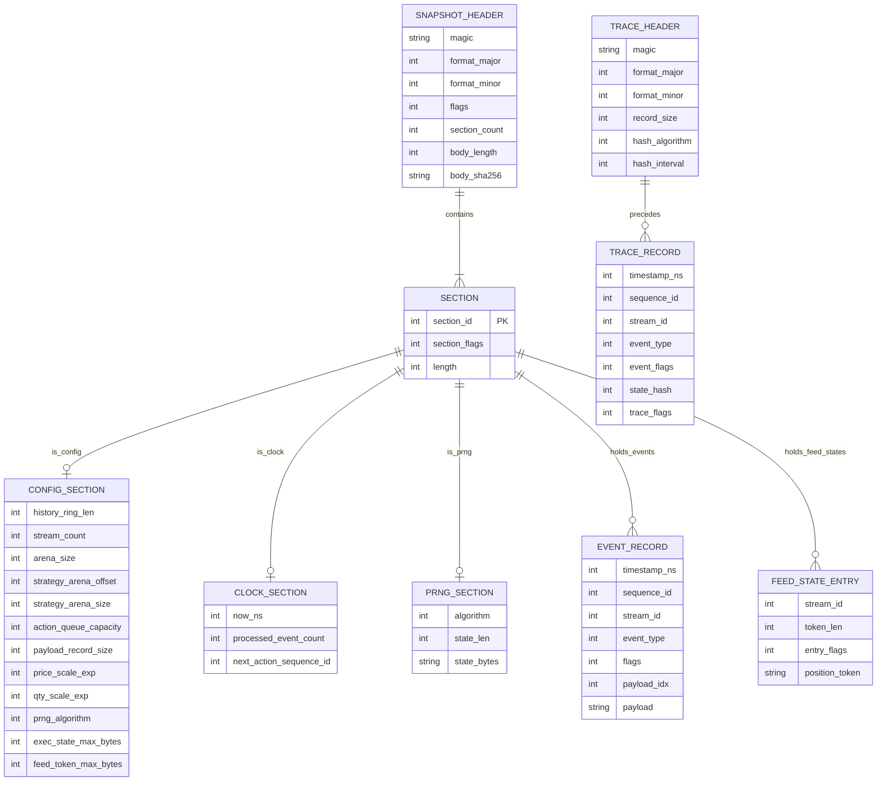

# データ構造仕様書（イベントヘッダ・スナップショット・トレースログ）
**決定論的リプレイのための、保存形式と状態ハッシュの定義**

詳細設計書は [EK-DD-001 カーネルコア詳細設計書](./EK-DD-001_カーネルコア詳細設計書.md)である。

---

## 1. 概要とデータ管理方針

### 1.1 管理対象データの目的

- **管理対象**:
  - イベントヘッダ（`EventHeader`）とイベントレコードのバイト配置
  - スナップショット（チェックポイント）のバイナリ形式
  - トレースログのファイル形式
  - 状態ハッシュの対象範囲
- **データ形式・文字コード・改行**: バイナリ形式。整数はすべて固定幅のリトルエンディアンとする。テキストを含まない。すべての構造体とセクションは、8バイト境界に配置する。
- **時刻の基準**: 論理タイムスタンプ（`i64`、Unix Epoch ナノ秒）のみを使う。スナップショットとトレースログに、実時間（OS時刻）とホスト名を保存しない（要件定義書 FR-01-1、NFR-01）。
- **スキーマの正本形式**: 本書のフィールド表。
- **機密性・個人情報分類**: 機密情報と個人情報を保存しない。ファイルパスを、保存形式に含めない。

### 1.2 データ境界

- **本書の正本範囲**: `persistent_data`。保存されるデータの形式、および永続化の契約。
- **`EventHeader` の正本**: バイト配置（フィールド、オフセット、サイズ）の正本は本書とする。メモリ上の配置も、同じとする。C ABI としての公開（型名、ヘッダの生成、関数の署名）は IF/API 仕様書を正本とし、本書の配置に従う。
- **DDとの関係**: ハンドルの状態遷移、`restore` と `capture` の手順と拒否条件、エラーコードの値、イベントの処理順序は DD を正本とする。本書は、保存形式と、形式の検査項目だけを定義する。
- **IF/API仕様との境界**: Arrow による結果出力（約定履歴、資産推移、状態遷移ログ）の形式は IF/API 仕様書を正本とする。
- **責務の対象外**: 入力データ（Parquet、CSV）の形式。入力は、アダプタ層の責務である。
- **矛盾時の扱い**: 更新日ではなく、`ssot_scope` の正本を更新して整合させる。

**用語**:
- **外部フィード**: `EventFeedPort` の実装。外部のデータ源である。
- **システムストリーム**: カーネルが内部で持つストリーム。現在は、アクションキューの仮想ストリーム（BD の C-006）だけである。

### 1.3 ファイル配置および階層構造

| データ種別       | 相対パス / 命名規則                                        | 保持内容                               | 所有者・アクセス権                     | 保持・バックアップ・復旧                                                                           |
| :--------------- | :--------------------------------------------------------- | :------------------------------------- | :------------------------------------- | :------------------------------------------------------------------------------------------------- |
| スナップショット | `<保存先>/<run_id>_<logical_time_ns>_<event_count>.eksnap` | 1時点の完全な状態                      | 実行したプロセスのユーザー。読み書き可 | 保持期間はホスト層が決める。作成後は不変で、上書きしない。破損時は別のスナップショットから復旧する |
| トレースログ     | `<保存先>/<run_id>.ektrace`                                | ステップごとのトレースレコード（任意） | 同上                                   | 追記専用。保持期間はホスト層が決める。末尾が不完全な場合は、読み込み時に端数を破棄する（3.1節）    |

- `<保存先>` は、`SnapshotPort` のディスク実装が設定で受け取る。メモリ実装は、ファイルを作らず、同じバイト列をメモリ上に保持する。
- `run_id` は、ホスト層が与える識別子で、使える文字は英数字と `-` に限る（`_` を使えない）。実時間から生成しない。ファイル名は `_` で分解でき、`logical_time_ns` と `event_count` は10進数の整数である。

---

## 2. データ構造およびスキーマ定義

### 2.1 エンティティ関係・データモデル構造

- `STATE_ARENA` と `EXEC_STATE` は、内部構造を持たない不透明なバイト列なので、エンティティとして定義しない（2.3節）。
- `EVENT_RECORD` は、`MERGE_HEADS`、`ACTION_QUEUE`、`HISTORY_RING` の3つのセクションで使う。
- `TRACE_HEADER` と `TRACE_RECORD` は、スナップショットとは独立したトレースログの構造である。

### 2.2 データモデル・フィールド仕様

**共通規則**:
- 整数はリトルエンディアンの固定幅（`u8`、`u16`、`u32`、`u64`、`i32`、`i64`）。
- 「必須性」は、書き込み側が必ず値を書くかどうかを表す。表の構造体は、全フィールドが必須で、NULL（欠落）を許さない。
- 予約領域は、書き込み時に0を書く。読み込み時に0以外なら、拒否する。
- 構造体のサイズは、8の倍数とする。

#### EventHeader（32バイト）

| フィールド     | オフセット | データ型 | 必須性 | NULL可 | デフォルト値         | 許容値・制約                                                                                                                                                                                       | 互換性・移行メモ             |
| :------------- | :--------: | :------- | :----: | :----: | :------------------- | :------------------------------------------------------------------------------------------------------------------------------------------------------------------------------------------------- | :--------------------------- |
| `timestamp_ns` |     0      | `i64`    |  必須  |  不可  | なし（書き込み必須） | 論理発生時刻（ナノ秒）。入力時に単調非減少を検証する（FR-01-2）                                                                                                                                    | 変更は主版数を上げる         |
| `sequence_id`  |     8      | `u64`    |  必須  |  不可  | なし                 | 入力時の連番（要件定義書の「同一時刻内の決定論的順序ID」）。同一ストリーム内で単調増加する。同一時刻のイベントの順序付けに使う（FR-01-3）。`core` がマージ時に検証し、違反時の動作は DD で定義する | 同上                         |
| `stream_id`    |     16     | `u32`    |  必須  |  不可  | なし                 | データ源の識別子。外部フィードは `0` から `0xFFFF_FEFF`。`0xFFFF_FF00` 以上はシステムストリーム用に予約する（個別の値の割り当ては DD）                                                             | 同上                         |
| `event_type`   |     20     | `u16`    |  必須  |  不可  | なし                 | 2.4節の表                                                                                                                                                                                          | 値の追加は主版数を上げる     |
| `flags`        |     22     | `u16`    |  必須  |  不可  | 0                    | bit0 `SnapshotTrigger`、bit1 `EndOfStream`。ほかのビットは0                                                                                                                                        | ビットの追加は主版数を上げる |
| `payload_idx`  |     24     | `u64`    |  必須  |  不可  | 0                    | 外部フィードのペイロード配列内の添字。フィード固有の値。スナップショットとステップハッシュでは0として扱う                                                                                          | フィード固有                 |

- サイズは32バイト、アラインメントは8バイトで、パディングはない。この配置は、メモリ上でも同じとする。
- **比較キー**: 同一時刻のイベントは、`(timestamp_ns, stream_id, sequence_id)` の昇順で処理する（要件定義書 FR-01-3、AC-02）。比較キーは、フィールドの並び順とは関係なく、この順序で定める。

#### EVENT_RECORD（可変長）

| フィールド | オフセット | データ型                  | 必須性 | NULL可 | デフォルト値 | 許容値・制約                                                               |
| :--------- | :--------: | :------------------------ | :----: | :----: | :----------- | :------------------------------------------------------------------------- |
| ヘッダ     |     0      | `EventHeader`             |  必須  |  不可  | なし         | 上の表                                                                     |
| `payload`  |     32     | `u8[payload_record_size]` |  必須  |  不可  | 0 で埋める   | `event_type` ごとの固定長レコード。`payload_record_size` は16以上の8の倍数 |

- レコードのサイズは、`32 + payload_record_size` バイトで、すべて同じである。
- 価格と数量は、`i64` の固定小数点数で表す。小数点の位置は、`price_scale_exp` と `qty_scale_exp`（10の負のべき乗の指数）で決める（NFR-04）。
- `event_type` ごとのペイロードのフィールド配置は、本書の初版では定義しない（4.2節）。

#### SNAPSHOT_HEADER（64バイト、ファイルの先頭）

| フィールド      | オフセット | データ型 | 必須性 | NULL可 | デフォルト値    | 許容値・制約                                     | 互換性・移行メモ                                 |
| :-------------- | :--------: | :------- | :----: | :----: | :-------------- | :----------------------------------------------- | :----------------------------------------------- |
| `magic`         |     0      | `u8[4]`  |  必須  |  不可  | `EKSN`（ASCII） | 固定                                             | 固定                                             |
| `format_major`  |     4      | `u16`    |  必須  |  不可  | 1               | 主版数が違う場合は、読み込みを拒否する           |                                                  |
| `format_minor`  |     6      | `u16`    |  必須  |  不可  | 0               | 副版数。4.1節の規則に従う                        |                                                  |
| `flags`         |     8      | `u32`    |  必須  |  不可  | 0               | 予約                                             |                                                  |
| `section_count` |     12     | `u32`    |  必須  |  不可  | 9               | 含まれるセクションの数                           | 副版数でセクションが増えた場合は、この値が増える |
| `body_length`   |     16     | `u64`    |  必須  |  不可  | なし            | 全セクション（セクションヘッダを含む）のバイト数 |                                                  |
| `body_sha256`   |     24     | `u8[32]` |  必須  |  不可  | なし            | 本体（`body_length` バイト）の SHA-256           | 整合性の検査に使う                               |
| `reserved`      |     56     | `u8[8]`  |  必須  |  不可  | 0               | 0                                                |                                                  |

#### SECTION（セクションヘッダ、16バイト）

| フィールド      | オフセット | データ型 | 必須性 | NULL可 | デフォルト値 | 許容値・制約                          | 互換性・移行メモ                                                          |
| :-------------- | :--------: | :------- | :----: | :----: | :----------- | :------------------------------------ | :------------------------------------------------------------------------ |
| `section_id`    |     0      | `u16`    |  必須  |  不可  | なし         | 2.3節の表                             | 未知の ID は、`required` が立っていれば拒否し、立っていなければ読み飛ばす |
| `section_flags` |     2      | `u16`    |  必須  |  不可  | 0            | bit0 `required`。ほかのビットは0      |                                                                           |
| `reserved`      |     4      | `u32`    |  必須  |  不可  | 0            | 0                                     |                                                                           |
| `length`        |     8      | `u64`    |  必須  |  不可  | なし         | 続くセクション本体のバイト数。8の倍数 |                                                                           |

#### CONFIG_SECTION（64バイト）

| フィールド              | オフセット | データ型 | 必須性 | NULL可 | デフォルト値 | 許容値・制約                                                         |
| :---------------------- | :--------: | :------- | :----: | :----: | :----------- | :------------------------------------------------------------------- |
| `history_ring_len`      |     0      | `u32`    |  必須  |  不可  | なし         | 1以上。履歴リングバッファの要素数                                    |
| `stream_count`          |     4      | `u32`    |  必須  |  不可  | なし         | 外部フィードの数。システムストリームを含まない                       |
| `arena_size`            |     8      | `u64`    |  必須  |  不可  | なし         | State Arena 全体のバイト数。8の倍数                                  |
| `strategy_arena_offset` |     16     | `u64`    |  必須  |  不可  | なし         | `arena_size` 未満。8の倍数                                           |
| `strategy_arena_size`   |     24     | `u64`    |  必須  |  不可  | なし         | `strategy_arena_offset` との合計が `arena_size` 以下                 |
| `action_queue_capacity` |     32     | `u32`    |  必須  |  不可  | なし         | 1以上                                                                |
| `payload_record_size`   |     36     | `u32`    |  必須  |  不可  | 64           | 16以上の8の倍数。`ActionArrival` のペイロードが1バイト以上になるため |
| `price_scale_exp`       |     40     | `i32`    |  必須  |  不可  | なし         | 0以下。価格の小数点の位置                                            |
| `qty_scale_exp`         |     44     | `i32`    |  必須  |  不可  | なし         | 0以下。数量の小数点の位置                                            |
| `prng_algorithm`        |     48     | `u16`    |  必須  |  不可  | なし         | 1: Xoshiro256++（OPEN-03 で決定。DD 2.6節）。2以上は将来用に予約     |
| `reserved0`             |     50     | `u16`    |  必須  |  不可  | 0            | 0                                                                    |
| `exec_state_max_bytes`  |     52     | `u32`    |  必須  |  不可  | なし         | `EXEC_STATE` の本体の最大バイト数。初期化時に宣言する                |
| `feed_token_max_bytes`  |     56     | `u32`    |  必須  |  不可  | 4096         | 1つの位置トークンの最大バイト数                                      |
| `reserved1`             |     60     | `u32`    |  必須  |  不可  | 0            | 0                                                                    |

#### CLOCK_SECTION（24バイト）

| フィールド                | オフセット | データ型 | 必須性 | NULL可 | デフォルト値 | 許容値・制約                                                   |
| :------------------------ | :--------: | :------- | :----: | :----: | :----------- | :------------------------------------------------------------- |
| `now_ns`                  |     0      | `i64`    |  必須  |  不可  | なし         | 現在の論理時刻                                                 |
| `processed_event_count`   |     8      | `u64`    |  必須  |  不可  | 0            | 処理済みイベント数                                             |
| `next_action_sequence_id` |     16     | `u64`    |  必須  |  不可  | 0            | アクションキューのシステムストリームに、次に振る `sequence_id` |

#### PRNG_SECTION（8 + `state_len` を8の倍数に切り上げたバイト数）

| フィールド    | オフセット | データ型        | 必須性 | NULL可 | デフォルト値 | 許容値・制約                                      |
| :------------ | :--------: | :-------------- | :----: | :----: | :----------- | :------------------------------------------------ |
| `algorithm`   |     0      | `u16`           |  必須  |  不可  | なし         | `prng_algorithm` と一致する                       |
| `state_len`   |     2      | `u16`           |  必須  |  不可  | なし         | アルゴリズムの状態のバイト数（Xoshiro256++ は32） |
| `reserved`    |     4      | `u32`           |  必須  |  不可  | 0            | 0                                                 |
| `state_bytes` |     8      | `u8[state_len]` |  必須  |  不可  | なし         | 状態そのもの。末尾を0で8の倍数に揃える            |

#### FEED_STATE_ENTRY（16 + `token_len` を8の倍数に切り上げたバイト数）

| フィールド       | オフセット | データ型        | 必須性 | NULL可 | デフォルト値 | 許容値・制約                                                                                        |
| :--------------- | :--------: | :-------------- | :----: | :----: | :----------- | :-------------------------------------------------------------------------------------------------- |
| `stream_id`      |     0      | `u32`           |  必須  |  不可  | なし         | 登録済みの外部フィードの ID                                                                         |
| `token_len`      |     4      | `u32`           |  必須  |  不可  | 0            | 0以上、`feed_token_max_bytes` 以下                                                                  |
| `entry_flags`    |     8      | `u16`           |  必須  |  不可  | 0            | bit0 `seekable`。位置を戻せるフィードで1。0の場合は `token_len` を0にする。ほかのビットは0          |
| `reserved`       |     10     | `u8[6]`         |  必須  |  不可  | 0            | 0                                                                                                   |
| `position_token` |     16     | `u8[token_len]` |  必須  |  不可  | なし         | `EventFeedPort` が定義する不透明な読み取り位置。`core` は中身を解釈しない。末尾を0で8の倍数に揃える |

#### TRACE_HEADER（32バイト、トレースログの先頭）

| フィールド       | オフセット | データ型 | 必須性 | NULL可 | デフォルト値    | 許容値・制約                                                  |
| :--------------- | :--------: | :------- | :----: | :----: | :-------------- | :------------------------------------------------------------ |
| `magic`          |     0      | `u8[4]`  |  必須  |  不可  | `EKTR`（ASCII） | 固定                                                          |
| `format_major`   |     4      | `u16`    |  必須  |  不可  | 1               | 主版数が違う場合は、読み込みを拒否する                        |
| `format_minor`   |     6      | `u16`    |  必須  |  不可  | 0               | 副版数                                                        |
| `record_size`    |     8      | `u32`    |  必須  |  不可  | 40              | `TRACE_RECORD` のバイト数                                     |
| `hash_algorithm` |     12     | `u16`    |  必須  |  不可  | 1               | 1: XXH3-64（OPEN-05 の確定後に固定する）                      |
| `reserved0`      |     14     | `u16`    |  必須  |  不可  | 0               | 0                                                             |
| `hash_interval`  |     16     | `u64`    |  必須  |  不可  | なし            | 状態ハッシュを計算するイベント数の間隔。0の場合は、計算しない |
| `reserved1`      |     24     | `u8[8]`  |  必須  |  不可  | 0               | 0                                                             |

#### TRACE_RECORD（40バイト）

| フィールド     | オフセット | データ型 | 必須性 | NULL可 | デフォルト値 | 許容値・制約                                                        |
| :------------- | :--------: | :------- | :----: | :----: | :----------- | :------------------------------------------------------------------ |
| `timestamp_ns` |     0      | `i64`    |  必須  |  不可  | なし         | 処理した入力イベントの時刻                                          |
| `sequence_id`  |     8      | `u64`    |  必須  |  不可  | なし         | 処理した入力イベントの `sequence_id`                                |
| `stream_id`    |     16     | `u32`    |  必須  |  不可  | なし         | 処理した入力イベントの `stream_id`                                  |
| `event_type`   |     20     | `u16`    |  必須  |  不可  | なし         | 処理した入力イベントの `event_type`                                 |
| `event_flags`  |     22     | `u16`    |  必須  |  不可  | 0            | 処理した入力イベントの `flags`                                      |
| `state_hash`   |     24     | `u64`    |  必須  |  不可  | 0            | 状態ハッシュ。`trace_flags` の bit0 が0の場合は無効で、0を書く      |
| `trace_flags`  |     32     | `u16`    |  必須  |  不可  | 0            | bit0 `HashPresent`。`state_hash` が計算済みのとき1。ほかのビットは0 |
| `reserved`     |     34     | `u8[6]`  |  必須  |  不可  | 0            | 0                                                                   |

### 2.3 スナップショットのセクション構成

セクションは、`section_id` の昇順に、各1回だけ並べる。各セクションは、16バイトのセクションヘッダと、本体で構成する。同じ状態からは、常に同じバイト列が得られる。

| `section_id` | 名前           | `required` | 本体の内容                                                                                                                                                             |
| :----------: | :------------- | :--------: | :--------------------------------------------------------------------------------------------------------------------------------------------------------------------- |
|      1       | `CONFIG`       |    必須    | `CONFIG_SECTION`                                                                                                                                                       |
|      2       | `CLOCK`        |    必須    | `CLOCK_SECTION`                                                                                                                                                        |
|      3       | `PRNG`         |    必須    | `PRNG_SECTION`                                                                                                                                                         |
|      4       | `STATE_ARENA`  |    必須    | State Arena（`StrategyArena` を含む）のバイト列（`arena_size` バイト）。内部の意味は戦略が決める                                                                       |
|      5       | `MERGE_HEADS`  |    必須    | `stream_count` 個の要素を、外部フィードの添字順に並べる。各要素は、8バイトの先頭（`present` が `u8`、続く7バイトは予約）と、`present` が1の場合のみ続く `EVENT_RECORD` |
|      6       | `ACTION_QUEUE` |    必須    | 要素数（`u64`）と、`(timestamp_ns, stream_id, sequence_id)` の昇順に並べた `EVENT_RECORD`                                                                              |
|      7       | `HISTORY_RING` |    必須    | 要素数（`u64`）と、最古から最新の順に並べた `EVENT_RECORD`。リングバッファの回転位置は保存しない。復元時は、先頭から詰める                                             |
|      8       | `FEED_STATES`  |    必須    | 要素数（`u64`）と、`stream_id` の昇順に並べた `FEED_STATE_ENTRY`                                                                                                       |
|      9       | `EXEC_STATE`   |    必須    | 長さ（`u64`）と、`ExecutionPort` が定義する不透明なバイト列。末尾を0で8の倍数に揃える                                                                                  |

- **イベントのペイロードは、すべて埋め込む。** `MERGE_HEADS`、`ACTION_QUEUE`、`HISTORY_RING` の `EVENT_RECORD` は、ペイロードを含む。`payload_idx` は0を書く。
- **ヒープの配置は保存しない。** マージキューの内部配列の並びは保存せず、先頭イベントだけを添字順に保存する。
- **`EXEC_STATE` と位置トークンの最大長**: `exec_state_max_bytes` と `feed_token_max_bytes` を、初期化時に宣言する。これを超える状態は、`capture` の失敗として扱う（拒否と手順は DD）。
- **スナップショットの最大サイズ**: 次の式で、初期化時に決まる。capture 用のバッファは、この大きさで初期化時に確保する（ADR-004）。

  最大サイズ = 64（`SNAPSHOT_HEADER`）+ 16 × 9（セクションヘッダ）+ 64（`CONFIG`）+ 24（`CLOCK`）+ 40（`PRNG`）+ `arena_size` + `stream_count` × (8 + R) + (8 + `action_queue_capacity` × R) + (8 + `history_ring_len` × R) + (8 + `stream_count` × (16 + `feed_token_max_bytes` を8の倍数に切り上げた値)) + (8 + `exec_state_max_bytes` を8の倍数に切り上げた値)

  ここで R = 32 + `payload_record_size`（`EVENT_RECORD` のバイト数）。
- **外部ポートの状態の直列化契約**: `FEED_STATES` と `EXEC_STATE` のバイト列は、次を満たす。
  - 同じ状態からは、常に同じバイト列が得られる（決定的な直列化）。
  - ポインタ、実時間、ホスト名、乱数を含まない。
  - 整数は、リトルエンディアンの固定幅で表す。

### 2.4 イベント種別とフラグ

| `event_type` | 名前            | 区分     | 備考                                 |
| :----------: | :-------------- | :------- | :----------------------------------- |
|      1       | `Tick`          | 市場     | 価格ティック                         |
|      2       | `Bar`           | 市場     | バー（OHLC）                         |
|      3       | `BookUpdate`    | 市場     | 板情報                               |
|      4       | `Indicator`     | 市場     | 指標データ                           |
|      5       | `Timer`         | 市場     | タイマーイベント                     |
|      16      | `ActionArrival` | システム | アクションの到達イベント（BD 2.3節） |
|      17      | `OrderAck`      | システム | 注文の受付応答                       |
|      18      | `Fill`          | システム | 約定結果                             |

- 1〜15 は市場イベント、16〜31 はシステムイベントに予約する。32 以上は将来用とする。

#### `ActionArrival`（`event_type` 16）のペイロード

`ActionArrival` の `EVENT_RECORD` のペイロード（`payload_record_size` バイト）は、次の配置とする。`ACTION_QUEUE` に保存されるバイト列なので、配置の正本は本書である。アクションの作成の手順は、DD の F-004 を参照する。

| フィールド       | オフセット | データ型                      | 必須性 | NULL可 | デフォルト値 | 許容値・制約                                               |
| :--------------- | :--------: | :---------------------------- | :----: | :----: | :----------- | :--------------------------------------------------------- |
| `action_kind`    |     0      | `u16`                         |  必須  |  不可  | なし         | 戦略と `ExecutionPort` の間で決める値。`core` は解釈しない |
| `reserved`       |     2      | `u8[6]`                       |  必須  |  不可  | 0            | 0                                                          |
| `action_payload` |     8      | `u8[payload_record_size - 8]` |  必須  |  不可  | 0            | `ExecutionPort` が解釈する                                 |
- 未知の `event_type` は、読み込み時に拒否する。

### 2.5 状態ハッシュと出力ハッシュ

**正準バイト列**: ハッシュの入力は、スナップショットと同じセクション構成（2.3節）のバイト列である。ただし `payload_idx` は0として扱う。ファイルの有無と、位置を戻せないフィードの有無に関係なく、計算できる（`seekable` が0のフィードは、`token_len` を0にして含める）。

| 用途                                                        | 対象                                                                                                                          | アルゴリズム                                                                                      | 計算の頻度                                             |
| :---------------------------------------------------------- | :---------------------------------------------------------------------------------------------------------------------------- | :------------------------------------------------------------------------------------------------ | :----------------------------------------------------- |
| ステップごとのトレース（`TRACE_RECORD.state_hash`、NFR-05） | `CLOCK`、`PRNG`、`STATE_ARENA`、`MERGE_HEADS`、`ACTION_QUEUE`、`FEED_STATES`、`EXEC_STATE`。`CONFIG` と `HISTORY_RING` は除く | 64ビットの非暗号ハッシュ（候補は XXH3-64。OPEN-05）。トレースヘッダの `hash_algorithm` に記録する | `hash_interval` イベントごと（標準測定条件では10,000） |
| 最終状態と分岐リプレイの比較（AC-03、AC-04、AC-07）         | 正準バイト列の全セクション                                                                                                    | SHA-256                                                                                           | 実行の終了時。ホットパスの外                           |
| トレースログの比較（NFR-01、AC-04、AC-07）                  | トレースログのファイル全体（`TRACE_HEADER` を含む）                                                                           | SHA-256                                                                                           | 実行の終了時                                           |

- ステップごとのハッシュは、そのステップの処理と、外部フィードの先頭の補充が終わった後の状態から計算する。この状態は、同じ時点で `capture` が保存する状態と同じである（DD 3.1節の手順8と手順9）。
- ステップごとのハッシュは、変化の検知が目的で、改ざんへの耐性を必要としない。ホットパスの負荷を抑えるため、非暗号ハッシュにする。
- `HISTORY_RING` は、処理済みのイベントから決まるので、ステップごとのハッシュに含めない。最終状態の SHA-256 には含まれる。
- NFR-01 の「全出力ログ」のうち、約定履歴、資産推移、状態遷移ログ（Arrow 出力）のハッシュは、IF/API 仕様書で定義する（4.2節）。

---

## 3. 永続化・原子置換契約・排他制御

### 3.1 原子的書き込み契約

#### スナップショット（ディスク実装）

1. **一時ファイル生成**: 保存先と同じディレクトリに、正式なファイル名の先頭に `.` を、末尾に `.tmp` を付けた名前（例: `.<run_id>_<logical_time_ns>_<event_count>.eksnap.tmp`）の一時ファイルを、既存ファイルを上書きしない作成モード（排他的な新規作成）で作る。全量を書き出す。名前に、実時間と乱数を使わない。
2. **物理書き込み保証**: 一時ファイルをディスクに同期する。同期に失敗した場合は、一時ファイルを削除し、`capture` を失敗させる。
3. **原子的置換**: 一時ファイルを、既存のファイルを上書きしない方式で、正式なファイル名にする。同じ名前のファイルが既にある場合は、失敗させる（スナップショットは不変）。
   - Linux: `renameat2` の `RENAME_NOREPLACE`、または `link` と `unlink` の組み合わせ。
   - Windows: 上書きを許可しないフラグでの移動（`MoveFileEx`）。
   - 失敗時は、一時ファイルを削除し、既存のスナップショットに触れない。
4. **ディレクトリの同期**: 置換の後に、保存先のディレクトリを同期する（Windows では、手順3の `MoveFileEx` に `MOVEFILE_WRITE_THROUGH` を指定し、この手順に代える）。
5. **一時ファイル清掃**: 起動時に、名前が `.<run_id>_` で始まり `.eksnap.tmp` で終わるファイルだけを削除する。`<run_id>` は自分の識別子で、直後の `_` までを含めて照合する。`run_id` に `_` は使えないので、`run` と `run-2` は区別できる。ほかの `run_id` の一時ファイルは、書き込み中の可能性があるため、削除しない。
6. **復旧確認**: 読み込み時に、4.3節の形式検査を行う。

- **メモリ実装**: ファイルを作らない。バイト列を作り終えてから、保持領域に差し替える。作成中に失敗した場合は、保持領域を変更しない。

#### トレースログ

- 追記専用のファイルで、原子置換の対象としない。作成時に `TRACE_HEADER` を書き、続けて、`record_size` バイトのレコードを追記する。
- ファイルの長さからヘッダを引いた値が `record_size` の倍数でない場合は、読み込み時に末尾の端数を破棄する。
- 同じ名前のファイルが既にある場合は、作成に失敗する。

### 3.2 排他制御仕様

- **ファイルロックは使用しない。** スナップショットは、作成後に不変で、名前に `run_id`、`logical_time_ns`、`event_count` を含む。別の `run_id` で書き込む限り、名前は衝突しない。
- **名前が衝突した場合**: 3.1節の手順1または手順3で、作成が失敗する。後から書こうとしたほうが失敗する。
- **同一 `run_id` の同時実行**: ホスト層の責務で禁止する。違反した場合は、上の衝突として検知される。
- **stale lock**: ロックを使わないため、存在しない。

---

## 4. データライフサイクルと互換性保全

### 4.1 フォーマット移行と互換性ルール

| 移行元バージョン | 移行先バージョン | 実行契機 | 変換内容・保持する旧フィールド | ロールバック可否・方法 | 失敗時の扱い |
| :--------------- | :--------------- | :------- | :----------------------------- | :--------------------- | :----------- |
| なし（初版 1.0） | なし             | なし     | なし                           | なし                   | なし         |

- **旧バージョン互換**: `format_major` が違うファイルは、読み込みを拒否する。変換はしない。
- **主版数を上げる変更**: `EventHeader`、`event_type` の値、`flags` のビット、必須セクションの変更と追加。
- **副版数でできる変更**: 必須でない（`required` が0の）セクションの追加だけ。読み込み側は、未知のセクションを `length` で読み飛ばす。`section_count` は、含まれるセクションの数で、固定値ではない。
- **予約領域**: 読み込み時に0以外なら、拒否する。予約領域を使う変更は、主版数を上げる。
- **トレースログの互換**: `TRACE_HEADER` の `format_major` が違うファイルは、読み込みを拒否する。副版数でできる変更は、`TRACE_RECORD` の末尾にフィールドを足して `record_size` を大きくすることだけである。読み込み側は、`record_size` でレコードを区切り、既知のフィールドだけを読む。

### 4.2 未確定事項と提案

| 項目                                    | 内容                                                                                                                                                                                     | 決める場所       |
| :-------------------------------------- | :--------------------------------------------------------------------------------------------------------------------------------------------------------------------------------------- | :--------------- |
| OPEN-01                                 | **本書で決定する。** `EventHeader` は、サイズ32バイト、アラインメント8バイトとする。64バイト境界は、配列の先頭を揃える補助的な最適化として、性能の実測後（NFR-03）に判断する             | 本書             |
| OPEN-05                                 | 対象範囲は 2.5節で定めた。ステップごとのハッシュのアルゴリズム（候補は XXH3-64）は、ベンチマークで確定する                                                                               | DD、ベンチマーク |
| OPEN-03                                 | 【解決済み】PRNG の方式は、DD 2.6節で Xoshiro256++ に決定した。`CONFIG` と `PRNG` の形式は、方式が変わっても変わらない                                                                   | DD               |
| ペイロードの配置                        | `ActionArrival`（2.4節で定義済み）を除く `event_type` ごとのフィールド（価格、数量、`Bar` の始値・高値・安値・終値、`BookUpdate` の気配の段数）は、本書の次の版で定義する                | DS の次の版      |
| システムストリームの ID と優先順位      | `0xFFFF_FF00` 以上を予約した。個別の ID と、同一時刻での優先順位は DD で定義する。既定の比較キー（2.2節）では、外部フィードの後に並ぶ。変える場合は、DD で比較キーを決め、本書を更新する | DD               |
| 復元後のペイロードの参照先              | スナップショットのイベントは、ペイロードを埋め込み、`payload_idx` を0にする。復元後に `core` がどの領域を参照するか                                                                      | DD               |
| `restore` と `capture` の手順と拒否条件 | 本書は形式だけを定める。検証フェーズと適用フェーズの採否、`seekable` でないフィードがあるときの `capture` の扱い、状態の不一致の扱いは DD が決める                                       | DD               |
| `sequence_id` の検証                    | `core` がマージ時に、同一ストリーム内で `sequence_id` が単調増加しているかを検証する（2.2節）。違反時のエラーコードと、ハンドルへの影響                                                  | DD               |
| Arrow 出力のハッシュ                    | 約定履歴、資産推移、状態遷移ログのハッシュの対象と形式（NFR-01）                                                                                                                         | IF/API 仕様書    |

### 4.3 読み込み時の形式検査

読み込み側は、バイト列の形式の正しさとして、次を検査する。検査に失敗したら、読み込みを拒否する。検査の順序、失敗時のハンドルの扱い、設定との一致の検査は、DD が定義する。

- `magic` と `format_major` が一致する。
- `body_length` が、ファイルの長さから64（`SNAPSHOT_HEADER`）を引いた値と一致し、`body_sha256` が一致する。
- セクションが、`section_id` の昇順で、各1回だけ並び、全セクションの（16 + `length`）の合計が、`body_length` と一致する。
- 必須セクションがすべてある。
- 予約領域がすべて0である。
- `event_type` が、2.4節の既知の値である。

トレースログの読み込み側は、次を検査する。
- `TRACE_HEADER` の `magic` と `format_major` が一致する。
- `record_size` が、40以上で、8の倍数である。
- `hash_algorithm` が、既知の値である。
- 予約領域がすべて0である。
- 読み込み時は、`record_size` を使ってレコードを区切る。

---

## 5. 作成完了チェック

- [x] `document_role`、`ssot_scope`、`status`、`owner` を Frontmatter へ設定した。
- [x] 管理対象、データ形式、文字コード、時刻基準、スキーマの正本形式を記入した。
- [x] 全エンティティが ER 図とフィールド仕様の双方に定義され、関係とカーディナリティが一致している（`STATE_ARENA` と `EXEC_STATE` は不透明なバイト列として 2.3節に記載）。
- [x] 全フィールド表に、必須性、NULL可否、デフォルト値、制約を記入した。
- [x] ファイルの相対パス、所有者・アクセス権、保持期間、バックアップ・復旧を記入した。
- [x] 原子書き込みの同期、置換、失敗、清掃、復旧の契約を記入した。
- [x] ファイルロックを使わない理由と、衝突時の扱いを記入した。
- [x] バージョン移行、後方互換性、ロールバック、移行失敗時の扱いを記入した。
- [x] Mermaid のサンプルのエンティティ、フィールド、関係と、未置換の `[ ... ]` が残っていない。
- [x] DD へのリンクを記入した。
- [ ] `event_type` ごとのペイロードの配置を定義した（4.2節）。

---

## 6. 改訂履歴 (Change Log)

| 版数    | 改訂日     | 変更者 | 変更内容・変更理由 (Why)                                                                                                                                                                                                                                                                                                                                                                                                                                                                                                                                         |
| :------ | :--------- | :----- | :--------------------------------------------------------------------------------------------------------------------------------------------------------------------------------------------------------------------------------------------------------------------------------------------------------------------------------------------------------------------------------------------------------------------------------------------------------------------------------------------------------------------------------------------------------------- |
| Rev.0.1 | 2026-11-25 | xzyozi | 初版ドラフト。BD Rev.0.6 の 4.2節の引き継ぎ事項（`EventHeader`、スナップショット形式、状態ハッシュの対象範囲、`restore` の検証フェーズ）を反映した。                                                                                                                                                                                                                                                                                                                                                                                                             |
| Rev.0.2 | 2026-11-25 | xzyozi | レビュー指摘を反映。全フィールド表に必須性、NULL可、デフォルト値を追加。DD の正本範囲（`restore` の手順、保存の拒否条件）を削除し、形式検査（4.3節）に置き換えた。`HISTORY_RING` のペイロードの保存、ステップハッシュへの `EXEC_STATE` と `FEED_STATES` の追加、トレースログのヘッダと `HashPresent`、外部ポート状態の最大長と直列化契約、`seekable` フラグを追加。原子書き込みの手順を修正（上書きしない置換、ディレクトリの同期、自分の一時ファイルだけを清掃）。副版数の互換規則、8バイト境界の配置、`sequence_id` の定義、`EventHeader` の正本の範囲を整理。 |
| Rev.0.3 | 2026-11-25 | xzyozi | 再レビュー指摘を反映。一時ファイルの清掃条件の照合方法、形式検査の `body_length` の計算、Windows のディレクトリ同期（`MOVEFILE_WRITE_THROUGH`）、トレースログの互換規則と形式検査、`reserved` の名前の重複、`sequence_id` の検証者を修正。                                                                                                                                                                                                                                                                                                                       |
| Rev.0.4 | 2026-11-25 | xzyozi | DD のレビューを受けて、`ActionArrival` のペイロード配置を DD から移して 2.4節に定義した。PRNG の方式を Xoshiro256++ に合わせた。                                                                                                                                                                                                                                                                                                                                                                                                                                 |
| Rev.0.5 | 2026-11-25 | xzyozi | `payload_record_size` の下限を16に揃えた（DD の制約に合わせた）。                                                                                                                                                                                                                                                                                                                                                                                                                                                                                                |
| Rev.0.6 | 2026-11-25 | xzyozi | ステップごとの状態ハッシュの計算時点を、先頭の補充の後の状態と明記した（DD の手順の入れ替えに合わせた）。                                                                                                                                                                                                                                                                                                                                                                                                                                                        |
| Rev.0.7 | 2026-11-26 | xzyozi | DD のマージに伴い、DD へのリンクを追加した。                                                                                                                                                                                                                                                                                                                                                                                                                                                                                                                     |
