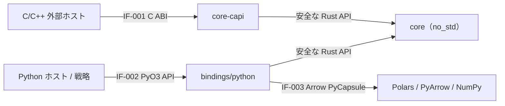
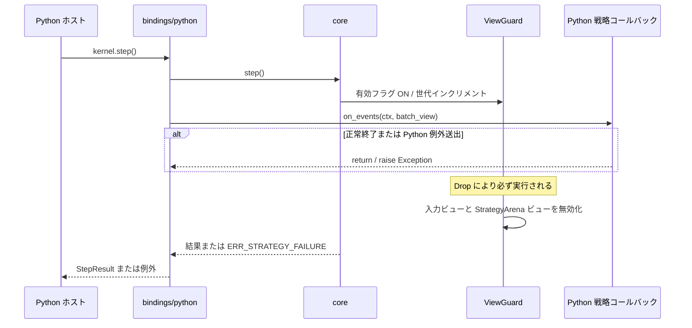

# IF/API仕様書（外部インターフェース契約）
**`core-capi` C ABI・`bindings/python` Python API・Arrow ゼロコピー出力契約**

コア内部制御は [EK-DD-001 カーネルコア詳細設計書](./EK-DD-001_カーネルコア詳細設計書.md) を参照する。

---

## 1. 概要とSSOT境界

### 1.1 対象インターフェースの目的

- **提供者 / 利用者**:
  - **提供者**: 境界層コンポーネント `core-capi`（EK-BD-001 C-012）および `bindings/python`（EK-BD-001 C-013）。
  - **利用者**: Python ホスト層（オーケストレーション、パラメータ探索、Polars / Pandas / NumPy 分析）、および将来の C ABI 対応外部ホスト / 本番アダプタ。
- **連携の目的**: Rust で実装する決定論的カーネル（`core`）を、ホスト言語のランタイムから隔離したまま、戦略コールバックの注入、バッチ/ステップ実行、スナップショット保存・復元、結果のゼロコピー受け渡しを行えるようにする（要件定義書 FR-06、ADR-003 案C）。
- **対象範囲**:
  - `core-capi` が公開する `extern "C"` 関数、`#[repr(C)]` 構造体・コールバック vtable、`cbindgen` で生成する C ヘッダ契約。
  - `bindings/python` が公開する Python クラス・メソッド・ビューオブジェクト（`ViewGuard` による寿命制御を含む）・例外マッピング。
  - Apache Arrow C Data / Stream Interface（PyCapsule）による結果出力（約定履歴、資産推移、状態遷移ログ）のスキーマおよび出力ハッシュ定義（NFR-01）。
  - DD/DS から引き継がれた外部境界固有の規約（`state_digest`、入力側 `payload_idx`、`ExecutionPort` 外部境界呼び出し順序）。
- **対象外**:
  - `core` 内部の制御フロー、イベントループの内部手順、エラーコードの数値定義の正本（詳細設計書 DD が正本）。
  - スナップショット・トレースログの永続化バイナリ形式（EK-DS-001 が正本）。
  - ネットワーク通信プロトコル、本番ブローカー API（要件定義書 1.2節アウトオブスコープ）。

### 1.2 単一責任範囲 (SSOT) と文書境界

- **本書の正本範囲**: `external_interface`。システム境界（C ABI および Python 拡張境界）を越えて受け渡す公開 API、構造体レイアウト（C ABI 表現）、メモリ所有権・ビュー寿命契約、Arrow 出力形式と出力ハッシュ対象、互換性・バージョニング。
- **DDとの関係**: 内部のモジュール間 DTO、ハンドル状態遷移条件、イベント処理手順、エラーコード値（`0`〜`3`、`-1`〜`-14`、`-99`）は [EK-DD-001](./EK-DD-001_カーネルコア詳細設計書.md) を正本とする。本書は DD の内部機能を外部境界（`core-capi` / `bindings/python`）へ露出する契約を定義する。
- **DSとの関係**: `EventHeader`（32バイト、8バイト境界）のバイト配置と永続化スキーマは EK-DS-001 を正本とする。本書で定義する C ABI 型 `EkEventHeader` は DS の配置に厳密に従う。また、保存用スナップショット（`.eksnap`）の形式と出力結果（Arrow 出力）の形式を混同しない。
- **BDとの関係**: ヘキサゴナルアーキテクチャ、信頼境界、パニック捕捉・ビュー無効化の横断方針は EK-BD-001 を正本とし、本書はそれを C ABI / Python API の具体契約へ落とし込む。
- **ADR-003 との関係**: ADR-003 は「Proposed」であり、スパイク V-01〜V-06 の実測結果によっては本書の一部（バッチ単位の既定値や `abi3` 採否等）を改訂する。
- **矛盾時の扱い**: 更新日ではなく、該当する `ssot_scope` の正本を更新し、関連文書を追従させる。

### 1.3 BD・DS・DD からの引き継ぎ事項の整理

| 引き継ぎ元       | 引き継ぎ事項                                | 本書での決定・定義箇所                                                                              |
| :--------------- | :------------------------------------------ | :-------------------------------------------------------------------------------------------------- |
| BD 4.2節 #1      | `ExecutionPort` 境界呼び出し順序と契約      | 4.1節・4.2節（同一時刻市場イベントでは `on_market_event` → `poll_results` → 戦略コールバックの順） |
| BD 4.2節 #5      | `core-capi`、Python API、Arrow 出力形式     | 2章・4章（`IF-001`〜`IF-003`）。ADR-003 スパイク V-01〜V-06 後に確定版へ更新                        |
| DS 4.2節         | Arrow 出力のハッシュ対象と形式（NFR-01）    | 4.3.4節（約定履歴・資産推移・状態遷移ログの正準カラム配列に対する SHA-256 定義）                    |
| DD 5.3節         | 入力 `payload_idx` のアダプタ側規約         | 2.2節（`core` 取り込み前に外部フィード配列を参照するための添字契約。スナップショット時は0）         |
| DD 5.3節         | `state_digest` の詳細契約                   | 4.1.1節・4.2.5節（保存を伴わない最終状態 SHA-256 計算、`seekable=false` フィード時も実行可能）      |

---

## 2. インターフェース共通仕様

### 2.1 インターフェース一覧

| IF-ID  | インターフェース名                   | 方向   | 方式                                 | 相手先                          | 対応する DD 機能ID         | 状態 |
| :----- | :----------------------------------- | :----- | :----------------------------------- | :------------------------------ | :------------------------- | :--- |
| IF-001 | `core-capi` C ABI インターフェース   | 双方向 | C ABI（`extern "C"` + `cbindgen`）   | 外部 C/C++ ホスト、ネイティブ層 | F-001〜F-012               | 計画 |
| IF-002 | `bindings/python` Python 拡張 API    | 双方向 | PyO3 拡張モジュール（`maturin`）     | Python ホスト・Python 戦略      | F-001〜F-012               | 計画 |
| IF-003 | Arrow ゼロコピー結果出力インターフェース | 提供   | Arrow PyCapsule（`__arrow_c_stream__` 等） | Polars / PyArrow / NumPy        | F-002、F-003 の結果蓄積    | 計画 |

図中の矢印は境界を通過する呼び出しとデータ受け渡しの向きを示す。`bindings/python` は `core-capi` を経由せず、`core` の安全な Rust API を直接呼び出す（ADR-003 5.1-8）。

### 2.2 共通ルール

- **プロトコル・トランスポート**: 同一プロセス内のインメモリ境界（C ABI 関数呼び出しおよび Python C 拡張 API）。ネットワーク通信は行わない。
- **データ形式・バイトオーダー**:
  - 構造体はホスト環境のリトルエンディアン固定幅整数（`int32_t` / `uint32_t` / `int64_t` / `uint64_t` / `uint16_t` / `uint8_t`）を用いる。
  - `EkEventHeader` はサイズ32バイト、8バイトアラインメント、パディングなしとし、EK-DS-001 2.2節の `EventHeader` と完全に同一の配置とする。コンパイル時にサイズとフィールドオフセットを静的検証する（ADR-003 5.1-1）。
  - 金額・価格・数量は固定小数点数（`int64_t`）とスケール指数（`price_scale_exp`, `qty_scale_exp` <= 0）で受け渡す（NFR-04）。
- **時刻・タイムゾーン**: すべて論理タイムスタンプ（`int64_t`、Unix Epoch ナノ秒）。システム時刻・タイムゾーンは境界でも使用しない。
- **入力 `payload_idx` の規約（DD 引き継ぎ）**:
  - 外部フィードが SoA（Structure of Arrays）ペイロード配列を持つ場合、アダプタの `peek` / `pop_next` が返す `EkEventHeader.payload_idx` に配列添字を設定できる。
  - `core` は `pop_next` 時にペイロード実体を内部バッファへコピーするため、`core` 内部およびスナップショット・状態ハッシュ計算では `payload_idx` を常に `0` として扱う（EK-DS-001 2.2節）。
- **識別子・相関情報**: 実行ごとの状態追跡は `processed_event_count`（`u64`）および `now_ns`（`i64`）の組、ならびに任意のトレースログで行う。リクエスト相関 ID は持たない。
- **タイムアウト・再試行・再入**:
  - 境界層にタイムアウト・自動再試行は設けない（EK-BD-001 3.2節）。
  - 戦略コールバック実行中（`Running` 状態）の `step` / `run` / `capture` / `restore` / `state_digest` / `destroy` 呼び出しは、再入エラー（`ERR_REENTRANT`）として拒否する。
- **パニックとメモリ寿命**:
  - `core-capi` および `bindings/python` を含む成果物は `panic = "unwind"` でビルドする（EK-ENV-001 4.3節、ADR-003 5.1-4）。
  - コールバックに渡す入力ビューと `StrategyArena` ビューは、例外・パニック経路を含めコールバック終了時に `ViewGuard` により即座に無効化する（EK-BD-001 3.2節、ADR-003 5.1-7）。
- **スレッドと並列性**: 1カーネルハンドルは単一スレッド専用であり、複数スレッドから同一ハンドルを同時に操作してはならない。`bindings/python` ではコールバック実行中以外の純粋ネイティブ計算時にのみ GIL 解放を検討し、Python コールバック呼び出し時は GIL を保持する（ADR-003 5.1-6）。

---

## 3. 認証・認可

| 項目             | 内容                                                                 |
| :--------------- | :------------------------------------------------------------------- |
| 認証方式         | なし（同一プロセス内のローカルライブラリ境界。通信・認証を持たない） |
| 認可（権限）単位 | なし（OS プロセスのメモリ空間およびファイルシステム権限に従う）      |
| 資格情報の管理   | 対象外（本システムは秘密情報を扱わない）                             |
| 権限不足時の応答 | 対象外（スナップショット保存先の I/O 権限エラーは `ERR_PORT_FAILURE` として返す） |

信頼境界の原則として、`core` は境界外（ホスト層から渡されるポインタ、サイズ、Python オブジェクト、コールバック結果）を一切信用せず、入口（`core-capi` / `bindings/python`）で NULL ポインタ・アラインメント・長さ・再入・状態（`Poisoned`）を検証する（EK-BD-001 3.2節）。

---

## 4. インターフェース別契約

### 4.1 契約（IF-ID: IF-001 `core-capi` C ABI インターフェース）

- **概要**: `core` の安全な Rust API を `extern "C"` 関数として公開する薄い変換層（EK-BD-001 C-012）。`cbindgen` により `include/event_kernel.h`（仮称）を生成する。
- **呼び出し方式**: C ABI 関数呼び出し。すべての関数は `std::panic::catch_unwind` で本体を保護し、Rust パニックを C 境界の外へ漏らさず `ERR_PANIC`（`-99`）へ変換し、ハンドルを `Poisoned` に遷移させる。
- **冪等性**: `ek_kernel_destroy`（NULL ハンドルを渡した場合は無処理で `OK`）および `ek_kernel_state_digest`（読み取り専用）は冪等。`step` / `run` / `submit_action` は非冪等。`restore` は同一スナップショットに対してべき等。
- **事前条件 / 事後条件**: 非 NULL が必須のポインタ引数が NULL の場合は即座に `ERR_INVALID_ARGUMENT`（`-1`）を返し、ハンドル状態を変更しない。

#### 4.1.1 公開 C ABI 関数一覧

| 関数名                    | 対応 DD 機能 | 主な引数                                                                 | 戻り値（`int32_t`）         | 概要                                                     |
| :------------------------ | :----------- | :----------------------------------------------------------------------- | :-------------------------- | :------------------------------------------------------- |
| `ek_capi_abi_version`     | —            | `uint32_t* out_major, uint32_t* out_minor`                               | `OK` / `ERR_INVALID_ARGUMENT` | C ABI バージョンを取得する                               |
| `ek_kernel_create`              | F-001        | `config*`, `feeds*`, `feed_count`, `exec_vtable*`, `snap_vtable*`, `trace_vtable*`, `strategy*`, `out_handle**` | `OK` / 負のエラーコード | 検証と初期メモリ確保を行い、`Ready` ハンドルを生成する   |
| `ek_kernel_step`                | F-002        | `handle*`, `EkStepResult* out_result`                                                                           | 終了コード / 負のエラー | 1イベントを処理し、結果構造体へ書き込む                  |
| `ek_kernel_run`                 | F-003        | `handle*`, `uint64_t max_events`, `EkStepResult* out_result`                                                    | 終了コード / 負のエラー | 停止条件まで `step` を繰り返す（`0` は上限なし）         |
| `ek_kernel_submit_action`       | F-004        | `EkActionContext* ctx`, `const EkAction* action`                                                                | `OK` / 負のエラーコード | 戦略コールバック内から遅延アクションを提出する           |
| `ek_kernel_capture`             | F-005        | `handle*`, `int64_t trigger_tag`                                                                                | `OK` / 負のエラーコード | 現在の完全状態を `SnapshotPort` 経由で保存する           |
| `ek_kernel_restore`             | F-006        | `handle*`, `const uint8_t* blob`, `size_t blob_len`                                                             | `OK` / 負のエラーコード | 検証フェーズ＋適用フェーズにより状態を復元する           |
| `ek_kernel_state_digest`        | F-005 派生   | `handle*`, `uint8_t out_sha256[32]`                                                                             | `OK` / 負のエラーコード | 保存を伴わず正準バイト列の全セクション SHA-256 を算出する |
| `ek_kernel_init_strategy_arena` | F-011        | `handle*`, `uint64_t offset`, `const uint8_t* bytes`, `size_t len`                                              | `OK` / 負のエラーコード | 実行前（`Ready` / 処理数0）に `StrategyArena` を初期化する |
| `ek_kernel_read_strategy_arena` | F-012        | `handle*`, `uint64_t offset`, `uint8_t* out_bytes`, `size_t len`                                                | `OK` / 負のエラーコード | `StrategyArena` の内容を呼び出し側バッファへコピーする   |
| `ek_kernel_destroy`             | F-007        | `EkKernelHandle* handle`                                                                                        | `OK` / `ERR_REENTRANT`  | ハンドルと確保済みメモリを解放する                       |

#### 4.1.2 主要 C ABI 構造体仕様

**`EkKernelConfig`**

| フィールド              | C 型       |   必須性   | NULL可 | 制約・説明                                                 |
| :---------------------- | :--------- | :--------: | :----: | :--------------------------------------------------------- |
| `struct_size`           | `uint32_t` |    必須    |  不可  | `sizeof(EkKernelConfig)`（ABI 互換性検査用）               |
| `history_ring_len`      | `uint32_t` |    必須    |  不可  | `1` 以上                                                   |
| `arena_size`            | `uint64_t` |    必須    |  不可  | `8` の倍数。`strategy_arena_offset + strategy_arena_size` 以上 |
| `strategy_arena_offset` | `uint64_t` |    必須    |  不可  | `8` の倍数                                                 |
| `strategy_arena_size`   | `uint64_t` |    必須    |  不可  | `8` の倍数                                                 |
| `action_queue_capacity` | `uint32_t` |    必須    |  不可  | `1` 以上                                                   |
| `payload_record_size`   | `uint32_t` |    必須    |  不可  | `8` の倍数かつ `16` 以上（標準 `64`）                      |
| `price_scale_exp`       | `int32_t`  |    必須    |  不可  | `0` 以下                                                   |
| `qty_scale_exp`         | `int32_t`  |    必須    |  不可  | `0` 以下                                                   |
| `prng_seed`             | `uint64_t` |    必須    |  不可  | 任意の64ビット値                                           |
| `exec_state_max_bytes`  | `uint32_t` |    必須    |  不可  | `8` の倍数                                                 |
| `feed_token_max_bytes`  | `uint32_t` |    必須    |  不可  | `1` 以上（標準 `4096`）                                    |
| `hash_interval`         | `uint64_t` |    必須    |  不可  | `0` はステップごとのハッシュ計算を無効化                   |
| `trace_enabled`         | `uint8_t`  |    必須    |  不可  | `0`（false）または `1`（true）。その他は `ERR_INVALID_ARGUMENT` |
| `reserved`              | `uint8_t[7]` |  必須    |  不可  | `0` 埋め必須                                               |
| `max_total_bytes`       | `uint64_t` |    必須    |  不可  | 初期化時に確保する合計バイト数の上限（DD 2.3節）           |

**`EkEventHeader`（32バイト、8バイト境界）**

| フィールド     | C 型       | オフセット |   必須性   | NULL可 | 制約・説明                                      |
| :------------- | :--------- | :--------: | :--------: | :----: | :---------------------------------------------- |
| `timestamp_ns` | `int64_t`  |     0      |    必須    |  不可  | 論理発生時刻（ナノ秒）                          |
| `sequence_id`  | `uint64_t` |     8      |    必須    |  不可  | ストリーム内の単調増加連番                      |
| `stream_id`    | `uint32_t` |    16      |    必須    |  不可  | 外部フィード `0..0xFFFF_FEFF`、システム `0xFFFF_FF00..` |
| `event_type`   | `uint16_t` |    20      |    必須    |  不可  | EK-DS-001 2.4節の値                             |
| `flags`        | `uint16_t` |    22      |    必須    |  不可  | bit0 `SnapshotTrigger`, bit1 `EndOfStream`      |
| `payload_idx`  | `uint64_t` |    24      |    必須    |  不可  | 入力側 SoA 配列添字（内部・保存時は `0` 扱い）  |

**`EkStepResult` / `EkAction` / `EkHistoryView`**

| 構造体          | フィールド              | C 型              |   必須性   | NULL可 | 制約・説明                                              |
| :-------------- | :---------------------- | :---------------- | :--------: | :----: | :------------------------------------------------------ |
| `EkStepResult`  | `status`                | `int32_t`         |    必須    |  不可  | 終了コードまたは負のエラーコード                        |
| `EkStepResult`  | `detail`                | `int32_t`         |    必須    |  不可  | 戦略またはポートが返した詳細コード（ない場合は `0`）    |
| `EkStepResult`  | `processed_event_count` | `uint64_t`        |    必須    |  不可  | 累計処理イベント数                                      |
| `EkStepResult`  | `now_ns`                | `int64_t`         |    必須    |  不可  | 現在の論理時刻                                          |
| `EkAction`      | `action_kind`           | `uint16_t`        |    必須    |  不可  | 戦略・`ExecutionPort` 間の識別子                        |
| `EkAction`      | `reserved`              | `uint8_t[6]`      |    必須    |  不可  | `0` 埋め必須                                            |
| `EkAction`      | `latency_ns`            | `int64_t`         |    必須    |  不可  | `1` 以上                                                |
| `EkAction`      | `payload_ptr`           | `const uint8_t*`  |    必須    |  条件付き | `payload_len > 0` のとき非 NULL                      |
| `EkAction`      | `payload_len`           | `uint32_t`        |    必須    |  不可  | `payload_record_size` 以下                              |
| `EkStrategyCtx` | `now_ns`                | `int64_t`         |    必須    |  不可  | コールバック呼び出し時の現在時刻                        |
| `EkStrategyCtx` | `history_headers`       | `const EkEventHeader*` | 必須  |  条件付き | 確定済み過去イベント配列先頭（コールバック中のみ有効） |
| `EkStrategyCtx` | `history_len`           | `uint32_t`        |    必須    |  不可  | 有効な履歴件数（`history_ring_len` 以下）               |
| `EkStrategyCtx` | `strategy_arena_ptr`    | `uint8_t*`        |    必須    |  条件付き | `strategy_arena_size > 0` なら非 NULL（コールバック中のみ有効） |
| `EkStrategyCtx` | `strategy_arena_len`    | `uint64_t`        |    必須    |  不可  | `strategy_arena_size` と一致                            |
| `EkStrategyCtx` | `action_ctx`            | `EkActionContext*` |   必須    |  不可  | `ek_kernel_submit_action` に渡す不透明コンテキスト      |

- **外部ポート vtable 契約**: `EkFeedVTable`（`peek_next_timestamp`, `pop_next`, `position`, `seek`）、`EkExecVTable`（`on_arrival`, `on_market_event`, `poll_results`, `capture_state`, `restore_state`, `validate_state`）、`EkSnapVTable`（`write_snapshot`, `read_snapshot`）は、すべて `user_data: void*` を第1引数に取り、C 関数戻り値（`0` 成功 / 負値失敗）を返す。各メソッド内部でパニックを起こしてはならない。

#### 4.1.3 エラー応答（C ABI）

| 終了/エラーコード          |  値   | 発生条件                                        | 呼び出し側の対応                           | 再試行可否 |
| :------------------------- | :---: | :---------------------------------------------- | :----------------------------------------- | :--------: |
| `OK`                       |   0   | 正常終了                                        | 続行                                       |     —      |
| `STEP_FINISHED`            |   1   | 全ストリーム終端                                | 結果出力を取得または `restore` で再利用    |     可     |
| `RUN_LIMIT_REACHED`        |   2   | `max_events` 到達                               | 継続するなら再度 `step` / `run`            |     可     |
| `RUN_SNAPSHOT_REQUESTED`   |   3   | `SnapshotTrigger` フラグ検出                    | 必要なら `ek_kernel_capture` を実行        |     可     |
| `ERR_INVALID_ARGUMENT`     |  -1   | NULL ポインタ、`struct_size` 不一致、範囲外引数 | 引数を修正する                             |  条件付き  |
| `ERR_CAPACITY_EXCEEDED`    |  -2   | 容量上限超過                                    | 設定値を修正し再作成                       |  条件付き  |
| `ERR_QUEUE_FULL`           |  -3   | アクションキュー満杯                            | 発注見送りまたは戦略側で待機               |  条件付き  |
| `ERR_CAUSALITY_VIOLATION`  |  -4   | 時刻逆行検出（ハンドルは `Poisoned`）           | `ek_kernel_restore` または `destroy`       |    不可    |
| `ERR_SEQUENCE_VIOLATION`   |  -5   | 同一ストリーム内の連番違反（`Poisoned`）        | `ek_kernel_restore` または `destroy`       |    不可    |
| `ERR_POISONED`             |  -6   | `Poisoned` ハンドルへの禁止操作                 | `restore` または `destroy` のみ許可        |    不可    |
| `ERR_REENTRANT`            |  -7   | コールバック実行中の再入操作                    | コールバック外から呼び出す                 |  条件付き  |
| `ERR_SNAPSHOT_UNSUPPORTED` |  -8   | 非 seekable フィードまたは状態サイズ超過        | フィード・設定を見直す                     |  条件付き  |
| `ERR_SNAPSHOT_INVALID`     |  -9   | スナップショット形式検査失敗                    | 正しいスナップショットを使用               |  条件付き  |
| `ERR_SNAPSHOT_MISMATCH`    | -10   | 設定または外部ポート検証失敗                    | 一致する設定・ポートを用意                 |  条件付き  |
| `ERR_PORT_FAILURE`         | -11   | 外部ポート I/O または適用フェーズ失敗           | アダプタ原因調査、`restore` または破棄     |    不可    |
| `ERR_RESULT_OVERFLOW`      | -12   | ポート結果がキュー容量超過（`Poisoned`）        | `action_queue_capacity` を拡大             |    不可    |
| `ERR_STRATEGY_FAILURE`     | -13   | 戦略コールバックの失敗返却（`Poisoned`）        | 戦略実装を修正                             |    不可    |
| `ERR_PANIC`                | -99   | C 境界でのパニック捕捉（`Poisoned`）            | バグ報告、`restore` または `destroy`       |    不可    |

---

### 4.2 契約（IF-ID: IF-002 `bindings/python` Python 拡張 API）

- **概要**: PyO3 と `maturin` により Python へ提供する拡張モジュール（仮称 `event_kernel._core` / 公開パッケージ `event_kernel`）。`core` の安全な Rust API を直接呼び出し、Python 戦略コールバック・NumPy バッファ・Arrow PyCapsule・Python 例外変換を担う（EK-BD-001 C-013）。
- **呼び出し方式**: Python メソッド呼び出し。コールバックの通過回数を抑えるため、同一時刻または一定件数のイベントを連続メモリビューにまとめたバッチコールバック（`on_events(ctx, batch)`）を標準とし、単一イベント形式も互換 API として維持する（ADR-003 5.1-2）。バッチ化の効果は V-01 スパイク後に確定する。
- **冪等性**: `close()`（複数回呼び出し安全）および `state_digest()` は冪等。

#### 4.2.1 Python 公開クラス・メソッド契約

| クラス / 関数        | メンバー / 引数                                                      | 戻り値型         | 必須性・制約・振る舞い                                                       |
| :------------------- | :------------------------------------------------------------------- | :--------------- | :--------------------------------------------------------------------------- |
| `KernelConfig`       | `history_ring_len`, `arena_size`, `strategy_arena_offset`, `strategy_arena_size`, `action_queue_capacity`, `payload_record_size=64`, `price_scale_exp`, `qty_scale_exp`, `prng_seed`, `exec_state_max_bytes`, `feed_token_max_bytes=4096`, `hash_interval=0`, `trace_enabled=False` | `KernelConfig` | 不変データオブジェクト。制約違反時は `ValueError`                            |
| `Kernel(config, feeds, execution, snapshot, strategy)` | 各引数は必須（`None` 不可） | `Kernel` | 初期化時に全メモリを確保し `Ready` 状態で生成。容量超過は `KernelCapacityError` |
| `Kernel.step()`      | なし                                                                 | `StepResult`     | 1ステップ実行。終端時は `status == StepStatus.FINISHED`                      |
| `Kernel.run(max_events=None)` | `max_events: int | None`（`>= 1` または `None`）       | `StepResult`     | `max_events` または終端、`SnapshotTrigger` まで連続実行                      |
| `Kernel.capture()`   | なし                                                                 | `bytes` または保存完了 | スナップショット作成。非 seekable 時は `SnapshotUnsupportedError`          |
| `Kernel.restore(blob)` | `blob: bytes | memoryview`（空不可）                             | `None`           | 検証フェーズ後に状態を復元。`Poisoned` からも復元成功で `Ready` 復帰         |
| `Kernel.state_digest()` | なし                                                               | `bytes`（32バイト SHA-256） | 保存を伴わず正準バイト列の SHA-256 を返す（非 seekable フィード時も可）   |
| `Kernel.export_fills()` / `export_equity()` / `export_transitions()` | なし | Arrow Stream オブジェクト（`__arrow_c_stream__` 実装） | Polars / PyArrow へゼロコピー受け渡し（IF-003）                              |
| `Kernel.close()`     | なし（コンテキストマネージャ `__enter__` / `__exit__` 対応）         | `None`           | 明示的破棄。`Running` 中は `ReentrantError`                                  |

#### 4.2.2 コールバックコンテキストと `ViewGuard` 寿命契約（ADR-003 5.1-7）

| ビューオブジェクト | 提供元             | 提供形態                                            | コールバック中の操作                   | コールバック終了後（例外含む）のアクセス |
| :----------------- | :----------------- | :-------------------------------------------------- | :------------------------------------- | :--------------------------------------- |
| `EventBatchView`   | `on_events` 第2引数 | 構造化配列 / NumPy バッファプロトコル（読み取り専用） | スライス・フィールド参照のみ可         | すべての属性・バッファアクセスで `RuntimeError` |
| `HistoryView`      | `ctx.history`      | 確定済み過去イベントの読み取り専用ビュー            | 長さ取得・添字・NumPy 変換（コピー無し閲覧） | すべてのアクセスで `RuntimeError`        |
| `StrategyArenaView` | `ctx.strategy_arena` | 書き込み可能 `memoryview` / NumPy 配列（`strategy_arena_size` バイト） | 戦略状態のインプレース読み書き         | すべての読み書きアクセスで `RuntimeError` |

- `EventBatchView` / `HistoryView` / `StrategyArenaView` から `memoryview` や NumPy 配列がエクスポートされている場合も、Rust 側の `PyBuffer` / 世代フラグ検査により無効化後のアクセスを拒否し、`RuntimeError` を送出する（QG-013、V-05）。
- ステップ外で `StrategyArena` の内容を確認したい場合は、コピーを返す明示的な読み取り専用メソッド `Kernel.read_strategy_arena() -> bytes` または `Kernel.capture()` を使用する。

#### 4.2.3 Python 例外マッピング

| `core` エラーコード / 事象      | Python 例外クラス（基底）                     | 発生条件                                            | ハンドル状態 | 再試行可否 |
| :------------------------------ | :-------------------------------------------- | :-------------------------------------------------- | :----------- | :--------: |
| `ERR_INVALID_ARGUMENT`          | `ValueError`                                  | 引数制約違反                                        | 変化なし     |  条件付き  |
| `ERR_CAPACITY_EXCEEDED`         | `KernelCapacityError(KernelError)`            | 初期化時の容量超過                                  | 未生成       |  条件付き  |
| `ERR_QUEUE_FULL`                | `ActionQueueFullError(KernelError)`           | `ctx.submit_action()` 時のキュー満杯                | 変化なし     |  条件付き  |
| `ERR_CAUSALITY_VIOLATION`       | `CausalityViolationError(KernelFatalError)`   | 時刻逆行検出                                        | `Poisoned`   |    不可    |
| `ERR_SEQUENCE_VIOLATION`        | `SequenceViolationError(KernelFatalError)`    | 同一ストリーム内連番違反                            | `Poisoned`   |    不可    |
| `ERR_POISONED`                  | `KernelPoisonedError(KernelError)`            | `Poisoned` ハンドルへの禁止操作                     | `Poisoned`   |    不可    |
| `ERR_REENTRANT`                 | `ReentrantError(KernelError)`                 | コールバック中の禁止操作                            | 変化なし     |  条件付き  |
| `ERR_SNAPSHOT_UNSUPPORTED`      | `SnapshotUnsupportedError(KernelError)`       | 非 seekable フィードまたは最大長超過                | 変化なし     |  条件付き  |
| `ERR_SNAPSHOT_IO`               | `SnapshotIoError(KernelError)`                | `SnapshotPort::store` / `load` の保存・読込失敗     | 変化なし     |  条件付き  |
| `ERR_SNAPSHOT_INVALID` / `MISMATCH` | `SnapshotRestoreError(KernelError)`       | 復元時の形式・設定・ポート検証失敗                  | 変化なし     |  条件付き  |
| `ERR_PORT_FAILURE`              | `PortFailureError(KernelFatalError)`          | ポート I/O 失敗または適用フェーズ失敗               | `Poisoned`   |    不可    |
| `ERR_RESULT_OVERFLOW`           | `ResultOverflowError(KernelFatalError)`       | 約定結果によるキュー超過                            | `Poisoned`   |    不可    |
| `ERR_STRATEGY_FAILURE`          | `StrategyFailureError(KernelFatalError)`      | Python 戦略コールバックでの例外送出（元の例外を `__cause__` 連鎖） | `Poisoned` | 不可 |
| Rust パニック捕捉（`ERR_PANIC`） | `pyo3::PanicException`（または `KernelPanicError`） | Rust 側パニックの境界捕捉                      | `Poisoned`   |    不可    |
| 無効化後のビューアクセス        | `RuntimeError`                                | `ViewGuard` 無効化後のビュー操作（V-05 / QG-013）   | 変化なし     |    不可    |

---

### 4.3 契約（IF-ID: IF-003 Arrow ゼロコピー結果出力・ハッシュ契約）

- **概要**: リプレイ実行で蓄積された約定履歴・資産推移・状態遷移ログを、Apache Arrow PyCapsule Interface（`__arrow_c_stream__` / `__arrow_c_array__`）を用いて Polars / PyArrow / NumPy へコピーなしで引き渡す（要件定義書 FR-06-2、ADR-003 5.1-5）。
- **所有権移譲契約**: 結果バッファは `core` 側（またはアダプタ側）で連続メモリとして構築し、完了後に所有権（`Arc` / `Box`）を Arrow `FFI_ArrowArray` の `private_data` へ移譲する。Python 側でオブジェクトが破棄されると Arrow `release` コールバックが呼ばれ、メモリが解放される。これによりコールバック中のビューと異なりライフタイムを無期限に維持できる。
- **呼び出し条件**: ハンドルが `Ready` または `Finished` のときに呼び出せる。`Running` 中は `ReentrantError` で拒否する。

#### 4.3.1 約定履歴（`fills`）Arrow スキーマ

| 列名           | Arrow 型  | 必須性 | NULL可 | 意味・制約                                       |
| :------------- | :-------- | :----: | :----: | :----------------------------------------------- |
| `timestamp_ns` | `Int64`   |  必須  |  不可  | 約定確定論理時刻（ナノ秒）                       |
| `sequence_id`  | `UInt64`  |  必須  |  不可  | 約定イベントの `sequence_id`                     |
| `action_id`    | `UInt64`  |  必須  |  不可  | 発生元アクションの一意連番                       |
| `instrument_id`| `UInt32`  |  必須  |  不可  | 銘柄・対象識別子                                 |
| `side`         | `Int8`    |  必須  |  不可  | `1`: Buy、`-1`: Sell（その他は仕様外）           |
| `fill_price`   | `Int64`   |  必須  |  不可  | `price_scale_exp` に基づく固定小数点価格         |
| `fill_qty`     | `Int64`   |  必須  |  不可  | `qty_scale_exp` に基づく固定小数点数量           |
| `fee`          | `Int64`   |  必須  |  不可  | `price_scale_exp` に基づく固定小数点手数料       |

#### 4.3.2 資産推移（`equity_curve`）Arrow スキーマ

| 列名             | Arrow 型 | 必須性 | NULL可 | 意味・制約                               |
| :--------------- | :------- | :----: | :----: | :--------------------------------------- |
| `timestamp_ns`   | `Int64`  |  必須  |  不可  | 評価時刻（ナノ秒）                       |
| `event_count`    | `UInt64` |  必須  |  不可  | 評価時点の `processed_event_count`       |
| `cash`           | `Int64`  |  必須  |  不可  | 固定小数点現金残高                       |
| `position_value` | `Int64`  |  必須  |  不可  | 固定小数点評価額                         |
| `total_equity`   | `Int64`  |  必須  |  不可  | `cash + position_value`（固定小数点総資産） |

#### 4.3.3 状態遷移ログ（`state_transitions`）Arrow スキーマ

| 列名           | Arrow 型 | 必須性 | NULL可 | 意味・制約                               |
| :------------- | :------- | :----: | :----: | :--------------------------------------- |
| `timestamp_ns` | `Int64`  |  必須  |  不可  | 遷移発生論理時刻（ナノ秒）               |
| `sequence_id`  | `UInt64` |  必須  |  不可  | 契機となったイベントの `sequence_id`     |
| `from_state`   | `UInt16` |  必須  |  不可  | 遷移前状態コード（戦略・実行状態コード） |
| `to_state`     | `UInt16` |  必須  |  不可  | 遷移後状態コード                         |
| `reason_code`  | `UInt16` |  必須  |  不可  | 遷移理由コード                           |

#### 4.3.4 Arrow 出力ハッシュ契約（DS 4.2節引き継ぎ・NFR-01）

- **目的**: 要件定義書 NFR-01「全出力ログの SHA-256 ハッシュ値が 100% 一致すること」、および AC-04 / AC-07 の OS 間・並列間比較を、Arrow メモリ配置のパディングやチャンク分割差に左右されず決定論的に検証するため。
- **正規化ハッシュ算出規則**:
  1. 対象テーブル（`fills`、`equity_curve`、`state_transitions`）ごとに、4.3.1〜4.3.3節の表に示した列順・行順（`timestamp_ns`, `sequence_id` / `event_count` の処理順）で走査する。
  2. 先頭にテーブル識別子（ASCII 名）、総行数（`u64` LE）、列数（`u32` LE）をハッシュへ投入する。
  3. 各列について、列名長（`u32` LE）・列名（UTF-8）・Arrow 固定長プリミティブの有効値バッファ（各要素をリトルエンディアン固定幅バイト列として連結、パディングバイトとアラインメント余白を含めない）を順に SHA-256 へ投入する。
  4. バッチ分割（RecordBatch 境界）の有無はハッシュ値に影響させない（全行を連続列として扱う）。
- **注意**: 永続化ファイル（`.eksnap` / `.ektrace`）のハッシュ規則は EK-DS-001 2.5節が正本であり、本節は Arrow 結果出力テーブル専用の正本である。

---

## 5. 互換性・バージョン管理・変更管理

- **バージョン方式**:
  - **C ABI (`core-capi`)**: セマンティックバージョニング相当の `major.minor`（`ek_capi_abi_version` で取得）。構造体 `EkKernelConfig` に `struct_size` を含め、サイズ不一致を検出する。
  - **Python API (`bindings/python`)**: パッケージ版数（`MAJOR.MINOR.PATCH`）。PyO3 0.30.0（MSRV Rust 1.85）および Python `>= 3.10` を前提とする（EK-ENV-001 2章、ADR-003 5.2節）。`abi3` 安定 ABI wheel の採否は ADR-003 スパイク後に決定する。
  - **データ形式との連動**: `EkEventHeader` のサイズ・フィールド・`event_type` 変更は EK-DS-001 の `format_major` 更新と連動させる。
- **後方互換性の範囲**:
  - **後方互換（`minor` 増加）**: 既存の C ABI 関数シグネチャ・構造体レイアウト・既存エラーコード値を変更しない新関数の追加、Python メソッドへのデフォルト付きオプション引数の追加、Arrow 出力スキーマ末尾への新規オプション列の追加。
  - **非互換（`major` 増加）**: 既存 `#[repr(C)]` 構造体のフィールド変更・削除、エラーコード数値の変更、Arrow 既存列の型・意味変更、Python 例外階層の破壊的変更。
- **非推奨・廃止の手順**: 非推奨 API は Python 側では `DeprecationWarning`、C ABI 側ではヘッダ注記と改訂履歴で告知し、次期メジャー版まで維持する。
- **変更時の影響確認**:
  - C ABI 変更時は `cbindgen` で生成するヘッダ差分を `QG-012` で検証する。
  - `core-capi` と `bindings/python` の挙動一致は `QG-007`（同一シナリオの SHA-256 一致・パニック/例外・`Poisoned` 拒否一致）で確認する。

---

## 6. 機能テスト要件（外部契約）

外部契約として保証すべき内容を要件として定義する。具体的なテストケース・実行結果・証跡は [EK-TEST-001 テスト計画・結果報告書](../test/EK-TEST-001_テスト計画・結果報告書.md)、品質ゲート（`QG-007`, `QG-012`, `QG-013`）は [EK-ENV-001](../setup/EK-ENV-001_環境・開発基盤仕様書.md) を正本とし、本書へ再掲しない。

| 要件ID    | 対象 IF-ID | 保証すべき契約上の振る舞い                                                                                         | 検証観点                 | 対応テストケース         |
| :-------- | :--------- | :----------------------------------------------------------------------------------------------------------------- | :----------------------- | :----------------------- |
| TR-IF-001 | IF-001     | `EkEventHeader` のサイズ（32バイト）と各フィールドオフセットが EK-DS-001 と一致し、`cbindgen` 生成ヘッダに差分がない | 静的検証・互換性         | `TC-018` (`EK-TEST-001`) |
| TR-IF-002 | IF-001     | 必須ポインタへの NULL、`struct_size` 不一致、`trace_enabled` の不正値に対して `ERR_INVALID_ARGUMENT` を返し状態を変えない | 異常・境界               | `TC-019` (`EK-TEST-001`) |
| TR-IF-003 | IF-001, IF-002 | `core-capi` と `bindings/python` で同一入力・同一シードのシナリオを実行した出力および `state_digest` の SHA-256 が一致する（V-03） | 決定論性・契約一致 | `TC-022` (`EK-TEST-001`) |
| TR-IF-004 | IF-001, IF-002 | コールバック内部でのパニックおよび Python 例外が境界外へ未捕捉のまま漏洩せず、`ERR_PANIC` / 例外変換されハンドルが `Poisoned` になる（V-04） | 異常・パニック安全 | `TC-023` (`EK-TEST-001`) |
| TR-IF-005 | IF-001, IF-002 | `Poisoned` 状態のハンドルで `step` / `capture` / `submit_action` を呼ぶと両境界で `ERR_POISONED` / `KernelPoisonedError` になる（V-06） | 異常・状態契約 | `TC-023` (`EK-TEST-001`) |
| TR-IF-006 | IF-002     | コールバック終了後（正常返却および例外送出の両方）に保持した `EventBatchView` / `HistoryView` / `StrategyArenaView` / 導出 `memoryview` へアクセスすると `RuntimeError` を送出する（V-05, QG-013） | メモリ安全性・寿命 | `TC-025` (`EK-TEST-001`) |
| TR-IF-007 | IF-003     | Arrow PyCapsule 経由で Polars / PyArrow へ渡した際にデータバッファの追加コピーが発生せず、解放時に `release` コールバックが実行される（V-02） | ゼロコピー・メモリ解放   | `TC-021` (`EK-TEST-001`) |
| TR-IF-008 | IF-003     | 同一入力・同一実行の結果から算出した Arrow 出力ハッシュ（`fills`, `equity_curve`, `state_transitions`）が OS・バッチ分割に関わらず一致する（NFR-01） | 決定論性・ハッシュ一致   | `TC-015` (`EK-TEST-001`) |

---

## 7. 作成完了チェック

- [x] `document_role`、`ssot_scope`、`status`、`owner` を Frontmatter へ設定した。
- [x] インターフェース一覧の IF-ID と、DD の機能 ID（F-001〜F-012）を対応付けた。
- [x] 提供者・利用者、方式、データ形式、時刻、識別子、タイムアウト・再試行を記入した。
- [x] 認証・認可が対象外（ローカルインメモリ境界）である旨と信頼境界の原則を記入した。
- [x] リクエスト・レスポンス・構造体の必須性、NULL 可否、制約、エラー応答を記入した。
- [x] バージョン方式、互換性の範囲、非推奨・廃止の手順を記入した。
- [x] 受信・出力形式（Arrow）と保存形式（EK-DS-001）を混同せず、保存後の形式は DS を参照している。
- [x] 品質ゲート（`QG-007`, `QG-012`, `QG-013`）は EK-ENV-001 への参照とし、実行コマンド・合格基準を再掲していない。
- [x] DD・テスト計画への相対リンクおよび対応テストケース ID（`TC-015`, `TC-018`〜`TC-025`）を記入した。
- [x] 未置換の `[ ... ]`、`YYYY-MM-DD`、サンプル固有名が残っていない。

---

## 8. 改訂履歴 (Change Log)

| 版数    | 改訂日     | 変更者 | 変更内容・変更理由 (Why)                                                                                                                                    |
| :------ | :--------- | :----- | :---------------------------------------------------------------------------------------------------------------------------------------------------------- |
| Rev.0.1 | 2026-11-26 | xzyozi | 初版ドラフト。BD 4.2節、DS 4.2節、ADR-003（層分離案C）を引き継ぎ、`core-capi` C ABI、`bindings/python` PyO3 API、Arrow PyCapsule 出力とハッシュ契約を定義。 |
| Rev.0.2 | 2026-11-27 | xzyozi | `EK-DD-001`・`EK-TEST-001` との相互リンクを追加し、`F-011`/`F-012`、`max_total_bytes`、`StepResult.detail`、`ERR_SNAPSHOT_IO`、`payload_record_size >= 16`、`TC-ID` 対応を同期した。 |
